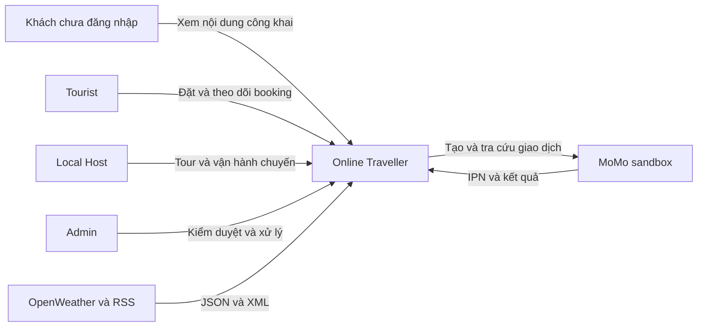
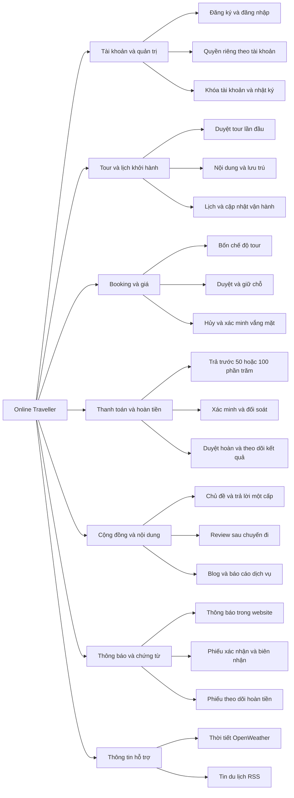
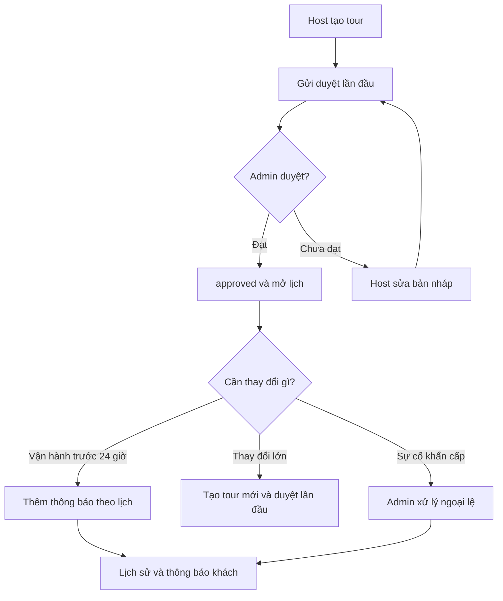
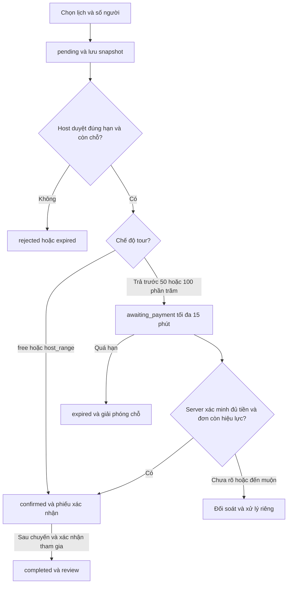
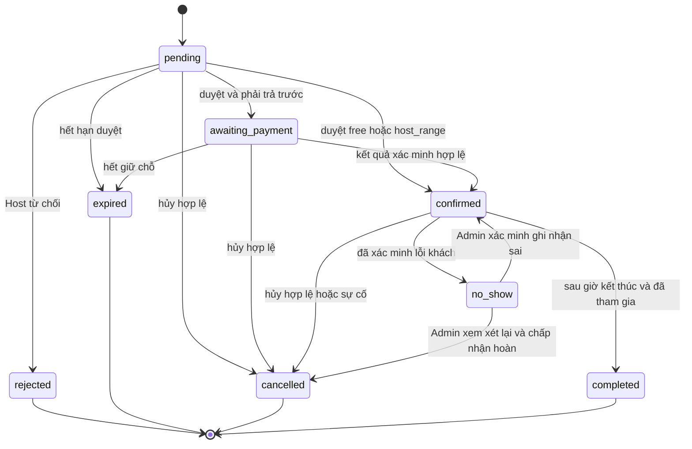
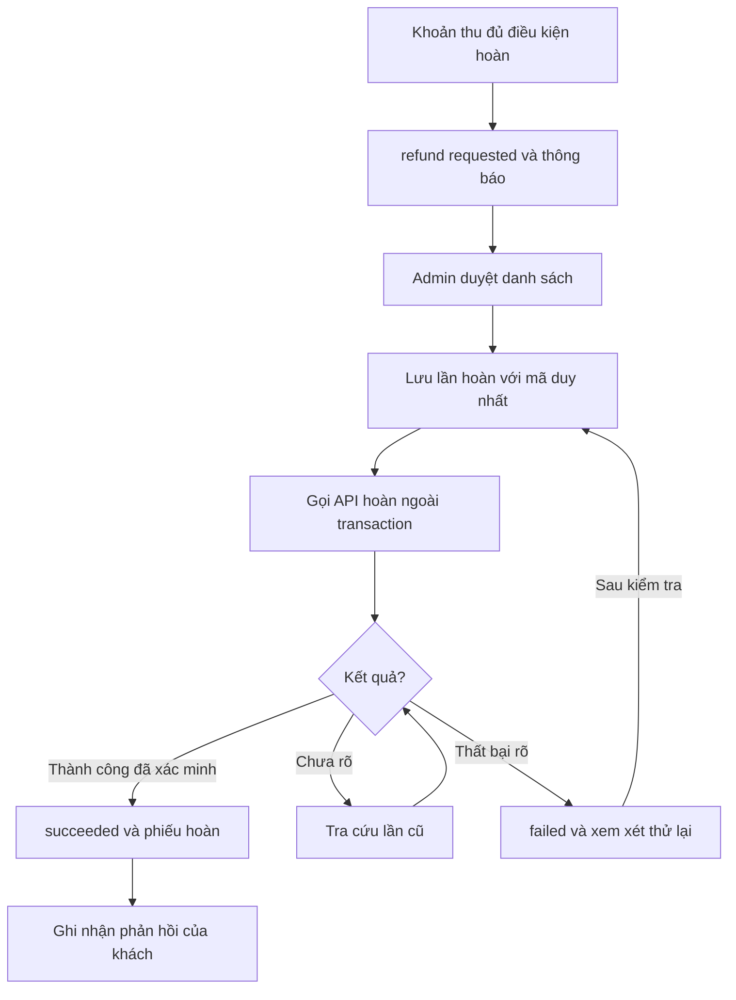
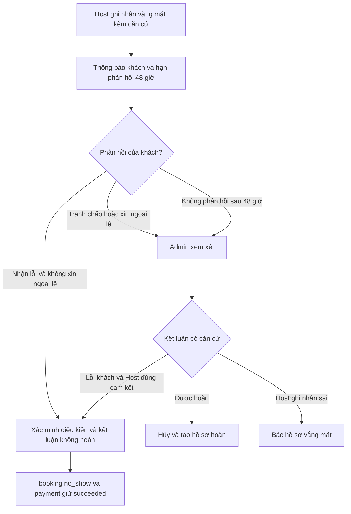

# Phân tích và thiết kế hệ thống

**Online Traveller**

**Đặc tả nghiệp vụ và thiết kế triển khai**

Phiên bản 1.0 | Ngày 15 tháng 10 năm 2026

Online Traveller kết nối Tourist với Local Host để tìm hiểu, thảo luận và đặt tour địa phương. Tài liệu xác định các quy tắc đã thống nhất về giá, trả trước, vận hành chuyến, hủy, hoàn tiền và xác minh khách không tham gia; từ đó thiết kế dữ liệu, lớp, giao diện và thủ tục cơ sở dữ liệu có thể triển khai nhất quán.

# 1 Mục tiêu phạm vi và thuật ngữ

<a id="sec-002"></a>

## 1 1 Mục tiêu

- Tìm và đặt một gói tour theo lịch khởi hành có sẵn và số người tham gia.

- Minh bạch chế độ giá và số tiền cần trả trước; xác nhận chỗ theo đúng điều kiện.

- Bảo toàn cam kết khách đã đặt, đồng thời cho Host cập nhật vận hành có lịch sử.

- Có cộng đồng theo tour, đánh giá sau chuyến đi và hồ sơ báo cáo để Admin xử lý.

- Theo dõi thu tiền, hoàn tiền và vắng mặt qua các trạng thái độc lập, có căn cứ đối soát.

<a id="sec-003"></a>

## 1 2 Phạm vi bản cơ bản

| Trong phạm vi                                                   | Ngoài phạm vi                                                |
| --------------------------------------------------------------- | ------------------------------------------------------------ |
| Tour, lịch, sức chứa theo người; một khối lưu trú mỗi tour      | Đặt phòng độc lập và tồn phòng theo đêm                      |
| MoMo sandbox; trả trước 50% hoặc 100%; hoàn khoản online đã thu | Tiền thật, chia tiền/chuyển tiền cho Host, theo dõi tiền mặt |
| Thông báo lưu trong website; tải lại hoặc AJAX để xem cập nhật  | Chat hoặc push thời gian thực, email bắt buộc                |
| Phiếu xác nhận, biên nhận SANDBOX và phiếu hoàn tiền            | Hóa đơn điện tử thuế và bồi thường ngoài khoản đã thanh toán |
| OpenWeather JSON và tin RSS XML theo thiết kế nền               | Bản đồ và xuất phiếu XML chưa phải phần cốt lõi              |

<a id="sec-004"></a>

## 1 3 Thuật ngữ và mốc thời gian

| Thuật ngữ                | Ý nghĩa                                                                             |
| ------------------------ | ----------------------------------------------------------------------------------- |
| Tour / service           | Gói trải nghiệm và nội dung cam kết, không phải một chuyến khởi hành cụ thể.        |
| Lịch / schedule          | Một lần thực hiện tour có ngày giờ, hạn nhận đăng ký và sức chứa.                   |
| Booking                  | Đặt cả gói cho một hoặc nhiều người; người đặt là đại diện.                         |
| Trả trước 50%            | Một phần tổng giá sau giảm, thu qua website; phần còn lại trả trực tiếp cho Host.   |
| Không tham gia / no_show | Kết quả đã xác minh việc khách vắng mặt do lỗi khách; khác hồ sơ đang chờ xác minh. |
| T0 và T24                | T0 là starts_at của lịch; T24 = T0 trừ 24 giờ.                                      |
| Thời gian chuẩn          | Lưu UTC trong DATETIME(6); hiển thị Asia/Bangkok UTC+7; mọi kiểm tra hạn ở server.  |

Các tỷ lệ 50%, mức khuyến mãi 90%, mốc 24 giờ và thời gian phản hồi 48 giờ là chính sách riêng đã chốt của dự án [S01]. Chúng không được suy ra từ tài liệu MoMo.

<a id="sec-005"></a>

# 2 Tác nhân phân quyền và chức năng

| Tác nhân             | Quyền chính                                                                                       | Giới hạn                                                      |
| -------------------- | ------------------------------------------------------------------------------------------------- | ------------------------------------------------------------- |
| Khách chưa đăng nhập | Xem/tìm tour và nội dung công khai                                                                | Không tạo booking, thảo luận, review hoặc báo cáo             |
| Tourist              | Đặt, trả tiền, xem booking/chứng từ, hủy theo điều kiện, phản hồi, review và báo cáo              | Chỉ thao tác booking và hồ sơ của mình                        |
| Local Host           | Quản lý tour/lịch của mình, duyệt booking, thông báo vận hành, hoàn tất chuyến, ghi nhận vắng mặt | Không đặt tour bằng tài khoản Host; không tự quyết tranh chấp |
| Admin                | Tài khoản, danh mục, duyệt tour, khuyến mãi, chính sách, hoàn tiền, báo cáo và ngoại lệ           | Quyết định quan trọng phải có lý do và audit                  |

Mỗi tài khoản chỉ có một role: tourist, local hoặc admin. Host muốn đặt tour phải dùng tài khoản Tourist riêng. Đăng ký công khai chỉ tạo Tourist; Admin cấp tài khoản Host riêng. Khóa tài khoản ngừng thao tác mới nhưng không tự xóa hoặc hủy lịch sử.

Mọi kiểm tra role, trạng thái active và quyền sở hữu được thực hiện tại server và trong PROCEDURE thay đổi nghiệp vụ. Tuyến công khai không nhận actor_id do trình duyệt tự chọn; server lấy từ phiên đã xác thực.

<a id="sec-006"></a>

## Hình 1 Sơ đồ ngữ cảnh hệ thống

<a id="diagram-context"></a>



<a id="sec-007"></a>

## Hình 2 Sơ đồ phân rã chức năng

<a id="diagram-function"></a>



Các nhánh biểu diễn phân cấp chức năng, không biểu diễn thứ tự xử lý.

<a id="sec-008"></a>

# 3 Quy tắc nghiệp vụ

<a id="sec-009"></a>

## 3 1 Tour và lịch khởi hành

- Tour có nhiều lịch; khách chọn lịch có sẵn, không nhập một ngày tùy ý.

- Mỗi lịch có starts_at < ends_at, booking_closes_at <= starts_at, thời điểm/địa điểm tập trung và capacity >0.

- Một khối lưu trú mô tả nơi ở, số đêm và bố trí phòng. Không có bản ghi lưu trú nghĩa là tour không kèm lưu trú.

- Có lưu trú bắt buộc prepaid_full. Thanh toán và sức chứa theo người không phải bằng chứng đã giữ phòng; Host phải bảo đảm lưu trú trước khi duyệt.

- Tour công khai cần Admin duyệt lần đầu. Tour/lịch bị ngừng nhận mới không tự động làm mất hiệu lực booking đã xác nhận.

<a id="sec-010"></a>

## 3 2 Bốn chế độ giá và thanh toán

| Chế độ       | Giá                 | Phương án booking           | Sau Host duyệt   |
| ------------ | ------------------- | --------------------------- | ---------------- |
| free         | 0 đồng              | none                        | confirmed        |
| host_range   | Khoảng giá/người    | host_direct; không online   | confirmed        |
| fixed_choice | Giá chính xác/người | deposit_50 hoặc full_online | awaiting_payment |
| prepaid_full | Giá chính xác/người | full_online                 | awaiting_payment |

Không còn phương án giữ chỗ miễn trả trước cho tour fixed_choice. Tour host_range là trường hợp riêng đã chốt không thu online; rủi ro vắng mặt của loại này chưa được bù bằng khoản trả trước.

Khoảng giá phải có đơn vị theo người, phần đã gồm/chưa gồm và lựa chọn mua thêm tự nguyện. Mức trên là giới hạn cam kết cho dịch vụ mô tả; không mặc nhiên cho phép thu mọi phát sinh. Tour cố định không biến thành giá thỏa thuận khi chọn trả phần còn lại cho Host.

<a id="sec-011"></a>

## 3 3 Giá khuyến mãi và làm tròn

1. Tính tiền gốc bằng đơn giá cố định tại lúc đặt nhân số người.

2. Chọn tối đa một khuyến mãi active trong starts_at <= lúc đặt < ends_at, đã gắn tour. Tỷ lệ cao nhất; bằng nhau chọn id nhỏ nhất. Tỷ lệ lớn hơn 0 và không quá 90%.

3. Tiền giảm thô = tiền gốc × tỷ lệ /100. Làm tròn đến đồng theo half up: phần lẻ <0,5 xuống; >=0,5 lên.

4. Tổng giá = tiền gốc - tiền giảm đã làm tròn.

5. Nếu deposit_50: khoản trả trước = làm tròn half up của tổng giá /2; phần còn lại = tổng giá - khoản trả trước. Nếu full_online: khoản trước bằng tổng giá, phần còn lại bằng 0.

6. Lưu cả điều chỉnh làm tròn; giữ nguyên mọi đồng nguyên, kể cả 2 hay 3 đồng. Không làm tròn lên hàng chục/trăm/nghìn.

7. Server kiểm tra khoản gửi cổng theo cấu hình hỗ trợ. Nếu 50% không hợp lệ nhưng 100% hợp lệ, chỉ cho chọn 100%, thông báo trước khi tạo booking. Không tự nâng tiền thu.

8. Chốt toàn bộ giá, khuyến mãi, payment_plan và nội dung cam kết trong booking; không tính lại booking cũ.

| Ví dụ       | Tổng sau giảm | Trả trước | Còn trả Host | Điều chỉnh            |
| ----------- | ------------- | --------- | ------------ | --------------------- |
| 50% số lẻ   | 900.003       | 450.002   | 450.001      | +0,5 đồng khoản trước |
| 50% số chẵn | 1.800.000     | 900.000   | 900.000      | 0                     |
| 100%        | 900.003       | 900.003   | 0            | 0                     |

Tour miễn phí là chế độ riêng; không dùng khuyến mãi 100%. Với tour có phí, từ chối tạo booking nếu tổng hoặc khoản online không hợp lệ sau làm tròn/giới hạn cổng. Mức tham chiếu hiện tại của MoMo ví là 1.000 đến 50.000.000 VND; cấu hình và xác nhận lại khi tích hợp [S02]. Tính tiền bằng số nguyên/DECIMAL, không dùng float làm nguồn quyết định.

<a id="sec-012"></a>

## 3 4 Chốt cam kết và cập nhật vận hành

- Có booking pending/awaiting_payment/confirmed: khóa điểm đến, lịch trình chính, dịch vụ gồm, lưu trú, giá và chính sách thanh toán đã cam kết.

- Ngày giờ lịch có booking hiệu lực không được sửa; sức chứa không giảm dưới chỗ giữ.

- Cập nhật vận hành được thêm theo lịch, ví dụ hướng dẫn viên/đầu mối/giờ ăn, nếu không làm mất quyền lợi. Lưu nội dung trước-sau, lý do, người và thời điểm.

- Thay đổi lớn cho gói tương lai tạo tour mới và duyệt lần đầu. Không dùng lịch sử cập nhật để đổi cam kết cũ.

- Thông báo khách liên quan bằng bản ghi trong website. Đã đọc không có nghĩa khách đồng ý thay đổi.

- Cập nhật thông thường và Host hủy lịch trước T24. Sau mốc này, sự cố chuyển Admin xử lý ngoại lệ; hệ thống vẫn phải ghi nhận và hoàn tiền khi đủ điều kiện.

<a id="sec-013"></a>

## 3 5 Hạn duyệt giữ chỗ và công bằng

request_expires_at = MIN(created_at +24 giờ, booking_closes_at). Tại now >= deadline, Host không được duyệt. Booking duyệt đúng hạn có thể dùng hết payment_expires_at = MIN(approved_at +15 phút, starts_at), kể cả đã qua hạn nhận đăng ký.

Chỗ đã dùng = tổng participant_count của confirmed, completed và awaiting_payment còn hạn. Pending không giữ chỗ. Mọi thao tác làm thay đổi số chỗ phải khóa cùng lịch trước khi tính/cập nhật [S07].

Ưu tiên danh sách chờ theo created_at rồi id; từ chối cần lý do. Đây là ưu tiên xét, chưa phải cơ chế bảo đảm tuyệt đối ai gửi trước được chỗ trước. Không tự bổ sung hàng chờ tự động hoặc giữ chỗ cho pending.

<a id="sec-014"></a>

## 3 6 Hủy và quyền hoàn tiền

| Trường hợp                                    | Xử lý                                                                                    |
| --------------------------------------------- | ---------------------------------------------------------------------------------------- |
| Tourist chưa trả online, trước T0             | Được hủy; giải phóng chỗ nếu đang giữ; không tạo hồ sơ hoàn khi chưa thu.                |
| Tourist đã trả online, trước T24              | Hủy hợp lệ và hoàn toàn bộ khoản online đã thu.                                          |
| Tourist xin hủy từ T24 trở đi                 | Tiếp nhận xem xét; không tự động hoàn hoặc tự coi là vắng mặt có lỗi.                    |
| Host chủ động hủy trước T24                   | Có lý do; hủy booking liên quan và tạo nghĩa vụ hoàn các khoản online đã thu.            |
| Host/sự cố cần hủy sau T24                    | Admin xử lý khẩn cấp; mốc thời gian không chặn nghĩa vụ hoàn khi không cung cấp dịch vụ. |
| Thu muộn, thu trùng, khiếu nại được chấp nhận | Đối soát và hoàn khoản thực thu cần trả; không tự hồi sinh booking.                      |

Không gộp ngừng hiển thị tour, đóng nhận đăng ký và hủy lịch. Khi khóa Host hoặc tour, Admin phải kiểm tra booking còn hiệu lực và xử lý từng lịch có liên quan. Không sửa lịch sử completed chỉ vì tài khoản bị khóa sau đó.

<a id="sec-015"></a>

## 3 7 Khách không tham gia và chấp thuận chính sách

Host chỉ ghi nhận khi booking confirmed và đã qua thời điểm tập trung công bố. Hồ sơ có căn cứ vắng mặt và việc đã thử liên hệ. Ghi nhận vắng mặt là đề nghị xác minh, không tự quyết định giữ tiền.

Khách có 48 giờ từ thông báo để xác nhận nhận lỗi, xin ngoại lệ hoặc tranh chấp. Nhận lỗi, không xin ngoại lệ và đủ điều kiện chính sách thì xử lý không hoàn. Tranh chấp, sự cố cần xét hoặc hết hạn im lặng chuyển Admin; im lặng không tự là lỗi.

Chỉ kết luận không hoàn khi khách có lỗi, không có lý do được chấp nhận, Host đúng cam kết và chính sách đã được khách đồng ý. Trả trước 50% có thể không hoàn khoản 50%; trả trước 100% có thể không hoàn toàn bộ khoản đã trả. Không tự thu thêm phần chưa trả như khoản phạt.

Tình huống Host cung cấp sai thông tin/không thực hiện cam kết được xét trách nhiệm Host. Sự cố khẩn cấp có căn cứ được Admin xem xét; quên, đổi ý hoặc tự bỏ tour không mặc nhiên thuộc ngoại lệ. Phản hồi trễ vẫn được tiếp nhận và gắn cờ trễ.

Trước thanh toán hiển thị số tiền, phần còn lại, hạn hủy, điều kiện vắng mặt, ngoại lệ và quyền phản ánh. Checkbox không tích sẵn. Lưu phiên bản, hash nội dung, thời điểm và số tiền đã chấp thuận. Chấp thuận không tước quyền khiếu nại; điều khoản dùng với tiền thật cần rà soát phù hợp pháp luật [S16].

<a id="sec-016"></a>

## 3 8 Cộng đồng review và báo cáo

- Thành viên active được mở chủ đề và trả lời kể cả chưa booking; trả lời chỉ một cấp, cùng tour.

- Tác giả ẩn chủ đề: hiện nhãn thay nội dung gốc, giữ trả lời hợp lệ. Admin ẩn gốc: ẩn cả nhánh công khai, không xóa dữ liệu.

- Tác giả chỉ khôi phục nội dung tự ẩn; admin_hidden chỉ Admin khôi phục. Sửa nội dung không tự gỡ ẩn. Khôi phục gốc không làm hiện lại các trả lời đã bị ẩn riêng.

- Chủ đề ẩn không nhận thêm trả lời. Kiểm tra điều này ở server, không chỉ khóa nút UI.

- Review 1..5 sao, một review cho một booking completed; người viết suy ra từ booking.

- Báo cáo không phụ thuộc completed. Đánh dấu báo cáo có booking liên quan; Admin xét vi phạm đã xác minh và mức độ, không tự kết tội theo số lượt.

- Post do Admin quản lý; RSS là nguồn tin ngoài, không tự biến thành bài viết do Admin viết.

<a id="sec-017"></a>

# 4 Các luồng xử lý

Các luồng dưới dùng chung quy tắc trạng thái và quyền trong mục 3. Mỗi kết quả thay đổi được lưu cùng sự kiện và thông báo; giao dịch với cổng thanh toán được điều phối ngoài khóa CSDL.

<a id="sec-018"></a>

## Hình 3 Luồng duyệt và cập nhật tour

<a id="diagram-tour_flow"></a>



<a id="sec-019"></a>

## 4 1 Đăng ký đăng nhập và phân quyền

1. Khách đăng ký Tourist bằng email duy nhất; PHP hash mật khẩu trước khi lưu [S09].

2. Đăng nhập: lấy bản ghi nội bộ, password_verify và kiểm tra active; tạo session, đổi session id sau đăng nhập.

3. Router áp dụng quyền theo route; thao tác theo id kiểm tra sở hữu. Khóa tài khoản khiến yêu cầu sau không còn quyền hoạt động.

4. Admin cấp tài khoản Host riêng. Không chuyển qua lại vai trò bằng nút ở giao diện hoặc tham số client.

<a id="sec-020"></a>

## 4 2 Tìm xem và gửi booking

1. Khách xem tour approved và lịch, phân biệt rõ giá cố định, khoảng giá hoặc miễn phí.

2. Tourist chọn lịch, số người và payment_plan hợp lệ. Server báo giá, deadline và chính sách.

3. Nếu giá thay đổi từ lúc xem đến lúc gửi, hiển thị lại giá để khách xác nhận, không âm thầm nhận giá mới.

4. Server tính và lưu snapshot, acceptance booking, mã yêu cầu chống trùng; tạo pending trong transaction.

5. Hiển thị booking cho Tourist và Host; chưa giữ chỗ cho pending.

<a id="sec-021"></a>

## Hình 4 Luồng đặt và xác nhận booking

<a id="diagram-booking_flow"></a>



<a id="sec-022"></a>

## Hình 5 Vòng đời booking

<a id="diagram-booking_state"></a>



Hồ sơ vắng mặt và hoàn tiền có vòng đời riêng. Không có chuyển expired/cancelled sang confirmed do IPN muộn.

<a id="sec-023"></a>

## 4 3 Duyệt từ chối và hết hạn

1. Host mở danh sách chờ theo thời điểm tạo. Server kiểm tra deadline và sở hữu.

2. Khóa lịch, khóa booking, tính chỗ còn và kiểm tra lịch chưa hủy/tour còn được phép duyệt.

3. Đủ chỗ: free/host_range -> confirmed; deposit/full -> awaiting_payment và deadline. Thiếu chỗ: không xác nhận, trả lý do rõ; booking không được giữ chỗ ngầm.

4. Từ chối có lý do -> rejected; quá hạn -> expired. Lưu event và thông báo cùng transaction.

5. Tác vụ hết hạn và các thao tác đọc/duyệt đều kiểm tra deadline; không chỉ phụ thuộc thời điểm cron chạy.

<a id="sec-024"></a>

## 4 4 Thanh toán và đối soát

1. Tourist mở booking awaiting_payment, xem đúng số cần trả và tích chấp thuận bản chính sách đã chốt.

2. Tạo payment created và mã request/order duy nhất. Chặn lần mới khi có lần cũ chưa rõ kết quả.

3. Commit dữ liệu chuẩn bị, rồi mới gọi API MoMo; không giữ khóa CSDL trong lúc gọi mạng.

4. IPN hoặc tra cứu hợp lệ được backend xác minh chữ ký, partner/order/amount và kết quả. Redirect chỉ hiển thị trạng thái đã lưu [S03].

5. Trong transaction: khóa lịch rồi booking/payment; kết quả thành công hợp lệ và còn thời hạn áp dụng một lần, chuyển confirmed, phát biên nhận và thông báo.

6. Thu muộn hoặc thu trùng giữ payment succeeded nhưng needs_review; không giữ lại chỗ; tạo nghĩa vụ hoàn sau đối soát phù hợp.

7. Timeout hoặc chưa rõ kết quả: tra cứu yêu cầu cũ; không tự coi là thất bại và mở mã thanh toán mới [S05].

<a id="sec-025"></a>

## Hình 6 Luồng thu tiền và xử lý kết quả

<a id="diagram-payment_flow"></a>

```mermaid
flowchart TB
  consent["Đồng ý chính sách và số tiền"] --> prepare["Lưu payment created và mã duy nhất"]
  prepare --> call["Gọi MoMo ngoài transaction"]
  call --> checkout["Khách thanh toán"]
  checkout --> callback["IPN hoặc tra cứu phía server"]
  callback --> verify{"Chữ ký và dữ liệu khớp?"}
  verify -->|"Có"| lock["Khóa lịch rồi booking"]
  lock --> valid{"Booking còn hiệu lực và chưa áp dụng khoản khác?"}
  valid -->|"Có"| applied["succeeded applied và confirmed"]
  valid -->|"Không"| review["succeeded needs_review và xem xét hoàn"]
  call -->|"Chưa rõ kết quả"| unknown["Tra cứu trước khi thử mới"]
  unknown --> callback
  verify -->|"Không"| reject["Từ chối kết quả và ghi nhật ký"]
```

Redirect chỉ hiển thị kết quả đã lưu; không xác nhận booking bằng dữ liệu từ trình duyệt.

<a id="sec-026"></a>

## 4 5 Hủy booking và hủy lịch

1. Người có quyền gửi yêu cầu và lý do; server xác định hủy thông thường hay hồ sơ cần Admin xem xét.

2. Kiểm tra mốc thời gian, trạng thái booking và khoản thu đã xác minh.

3. Hủy hợp lệ: khóa lịch rồi booking, chuyển cancelled, ghi event; tạo refund nếu có khoản online cần trả.

4. Hủy lịch: khóa lịch một lần, xử lý các booking còn hiệu lực theo id; từng nghĩa vụ hoàn có khóa duy nhất. Không gọi API hoàn trong transaction hủy.

5. Thông báo lý do hủy và hồ sơ hoàn cho khách. Pending/awaiting chưa thu không cần phiếu hoàn tiền giả.

<a id="sec-027"></a>

## 4 6 Hoàn tiền và theo dõi

1. Hệ thống lập hồ sơ từ khoản thực thu. Một payment có tối đa một nghĩa vụ hoàn toàn bộ trong bản cơ bản.

2. Admin xem danh sách, đối chiếu và duyệt; mỗi hồ sơ có người duyệt và thời điểm riêng.

3. Chuẩn bị refund_attempt và mã idempotency, chặn lần đang processing/unknown; commit rồi gọi API hoàn.

4. Kết quả thành công đã xác minh cập nhật hồ sơ và mã tham chiếu; thất bại rõ có thể xem xét thử lại; chưa rõ phải tra cứu.

5. Phiếu hiển thị số tiền, lý do, hạn xử lý, trạng thái cổng và phản hồi khách riêng biệt.

6. Khách bấm đã nhận -> lưu xác nhận; chưa nhận sau hạn -> tạo yêu cầu kiểm tra gắn hồ sơ, không chi lại.

7. Mục tiêu 24 giờ từ hủy, không dời khi Admin duyệt/retry. Khoản đến muộn mới được xác minh sau mốc đó vẫn giữ mốc hủy và hiện trễ; thu trùng không có hủy lấy mốc phát hiện.

8. Cổng báo hoàn thành công không đồng nghĩa khách đã bấm xác nhận. Không hứa thời gian ghi có thực tế ngoài khả năng đã kiểm chứng.

Thiết kế dùng API hoàn gắn giao dịch gốc và API tra cứu hoàn [S04]. Cần nghiệm thu bằng tài khoản sandbox được cấp trước khi coi tích hợp là hoàn thành.

<a id="sec-028"></a>

## Hình 7 Luồng hoàn tiền

<a id="diagram-refund_flow"></a>



Mỗi payment có một nghĩa vụ hoàn trong bản cơ bản. Nút chưa nhận không phát lệnh hoàn mới.

<a id="sec-029"></a>

## 4 7 Khách không tham gia

1. Host mở hồ sơ cho booking confirmed, cung cấp căn cứ sau giờ tập trung; cùng transaction tạo thông báo và hạn phản hồi 48 giờ.

2. Khách nhận lỗi không xin ngoại lệ: xác minh điều kiện, lưu phản hồi và kết luận theo thỏa thuận.

3. Khách xin ngoại lệ/tranh chấp hoặc không phản hồi sau 48 giờ: needs_review để Admin đánh giá; không tự chuyển lỗi khách.

4. Lỗi khách, Host đúng cam kết: no_show và không hoàn khoản đã trả; payment vẫn succeeded.

5. Đủ điều kiện hoàn: cancelled và tạo nghĩa vụ hoàn; ghi nhận sai: dismissed, không dùng để tước quyền khách.

6. Trong lúc chưa kết luận, không cho Host đánh completed để bỏ qua hồ sơ. Phản hồi muộn vẫn lưu và có đường báo cáo xem xét lại.

<a id="sec-030"></a>

## Hình 8 Luồng xác minh khách không tham gia

<a id="diagram-no_show"></a>



Im lặng không đồng nghĩa nhận lỗi. Hồ sơ chưa kết luận chặn hoàn tất booking theo luồng thông thường.

<a id="sec-031"></a>

## 4 8 Kết thúc chuyến review và báo cáo

1. Sau ends_at, Host chỉ complete booking đã xác nhận thực sự tham gia và không bị hồ sơ vắng mặt chưa kết luận chặn.

2. Tourist tạo tối đa một review cho booking completed; server suy ra tour/người viết từ booking.

3. Người dùng gửi báo cáo dịch vụ; nếu có booking thì đối chiếu đúng chủ và cùng tour. Báo cáo không đòi completed.

4. Admin phân công, yêu cầu thông tin khi cần, lưu diễn biến và kết luận; nếu cần khóa/hủy/hoàn thì gọi đúng thủ tục tương ứng.

5. Thông báo kết quả; xem xét lại có căn cứ giữ cả lịch sử cũ.

<a id="sec-032"></a>

## 4 9 Thảo luận và thông báo

1. Thành viên active tạo chủ đề hoặc trả lời chủ đề gốc visible cùng tour; escape khi hiển thị.

2. Tác giả sửa/ẩn đúng quyền; Admin ẩn vi phạm có lý do. Truy vấn công khai áp dụng trạng thái cha và con.

3. Sự kiện booking, vận hành, hoàn, vắng mặt, báo cáo tạo notification cùng transaction với khóa chống lặp.

4. Website lấy danh sách thông báo theo người nhận; đã đọc/ẩn là thao tác UI, không đổi nghĩa vụ nghiệp vụ.

<a id="sec-033"></a>

# 5 Trạng thái và hợp đồng chuyển trạng thái

| Đối tượng    | Trạng thái                                                                          | Điều kiện quan trọng                                                       |
| ------------ | ----------------------------------------------------------------------------------- | -------------------------------------------------------------------------- |
| Booking      | pending                                                                             | Chưa giữ chỗ; chỉ Host đúng sở hữu được duyệt trước deadline.              |
| Booking      | awaiting_payment                                                                    | Đã tạm giữ chỗ; chỉ số tiền online_due hợp lệ được áp dụng.                |
| Booking      | confirmed                                                                           | Đã giữ chỗ; không đồng nghĩa đã trả hết tiền cho Host.                     |
| Booking      | completed                                                                           | Sau ends_at và đã tham gia; mở quyền review.                               |
| Booking      | rejected / expired / cancelled                                                      | Kết thúc tương ứng; không tự khôi phục qua IPN muộn.                       |
| Booking      | no_show                                                                             | Kết luận lỗi khách sau xác minh; không phải trạng thái tự gán khi hết giờ. |
| Payment      | created / pending / succeeded / failed / cancelled                                  | Kết quả khoản thu; succeeded được giữ khi hoàn tiền.                       |
| Allocation   | unapplied / applied / needs_review                                                  | Tách khỏi kết quả thu tiền và khỏi hoàn tiền.                              |
| Refund       | requested / approved / processing / needs_review / succeeded / failed / rejected    | Quá hạn là cờ suy ra; phản hồi khách lưu riêng.                            |
| No show case | awaiting_response / needs_review / resolved_no_refund / resolved_refund / dismissed | Không phản hồi chỉ chuyển needs_review.                                    |

| Chuyển booking                                  | Ai thực hiện          | Điều kiện và tác động                                                        |
| ----------------------------------------------- | --------------------- | ---------------------------------------------------------------------------- |
| pending -> confirmed                            | Host                  | Free/range; đúng hạn, còn chỗ; event và thông báo.                           |
| pending -> awaiting_payment                     | Host                  | Deposit/full; đúng hạn, còn chỗ; đặt payment_expires_at.                     |
| awaiting_payment -> confirmed                   | PaymentService        | Khoản thu verified đúng tiền, booking còn hiệu lực, chỉ một payment áp dụng. |
| pending -> rejected                             | Host                  | Có lý do, chưa hết hạn.                                                      |
| pending/awaiting_payment -> expired             | Tác vụ hoặc nghiệp vụ | Đến deadline; giải phóng chỗ và ghi event một lần.                           |
| pending/awaiting_payment/confirmed -> cancelled | Đúng quyền hủy        | Kiểm tra deadline/ngoại lệ, tạo refund nếu cần.                              |
| confirmed -> completed                          | Host                  | Đã tham gia, sau kết thúc, không có case chưa kết luận.                      |
| confirmed -> no_show                            | Kết luận xác minh     | Lỗi khách và Host đúng cam kết; giữ payment succeeded.                       |

Ngoại lệ xem xét lại: Admin mở lại hồ sơ có căn cứ mới và lịch sử báo cáo. Nếu ghi nhận sai, no_show -> confirmed để xử lý lại đúng thực tế; nếu được hoàn, no_show -> cancelled và tạo nghĩa vụ hoàn. Không cho Host hoặc client tự khôi phục trạng thái này.

Đây là bảng cho phép cùng ngoại lệ xem xét lại vừa nêu: các chuyển khác bị từ chối bằng INVALID_STATE. API gọi lại sau thành công trả trạng thái hiện tại khi có cùng idempotency key; không thực hiện tác động phụ hai lần.
