# Phân tích và thiết kế hệ thống

**Online Traveller**

**Đặc tả nghiệp vụ và thiết kế triển khai**

Phiên bản 1.0 | Ngày 15 tháng 10 năm 2026

Online Traveller kết nối Tourist với Local Host để tìm hiểu, thảo luận và đặt tour địa phương. Tài liệu xác định các quy tắc đã thống nhất về giá, trả trước, vận hành chuyến, hủy, hoàn tiền và xác minh khách không tham gia; từ đó thiết kế dữ liệu, lớp, giao diện và thủ tục cơ sở dữ liệu có thể triển khai nhất quán.

# 1 Mục tiêu phạm vi và thuật ngữ

<a id="sec-002"></a>

## 1 1 Mục tiêu

- Tìm và đặt một gói tour theo lịch khởi hành có sẵn và số người tham gia.

- Minh bạch chế độ giá và số tiền cần trả trước; xác nhận chỗ theo đúng điều kiện.

- Bảo toàn cam kết khách đã đặt, đồng thời cho Host cập nhật vận hành có lịch sử.

- Có cộng đồng theo tour, đánh giá sau chuyến đi và hồ sơ báo cáo để Admin xử lý.

- Theo dõi thu tiền, hoàn tiền và vắng mặt qua các trạng thái độc lập, có căn cứ đối soát.

<a id="sec-003"></a>

## 1 2 Phạm vi bản cơ bản

| Trong phạm vi                                                   | Ngoài phạm vi                                                |
| --------------------------------------------------------------- | ------------------------------------------------------------ |
| Tour, lịch, sức chứa theo người; một khối lưu trú mỗi tour      | Đặt phòng độc lập và tồn phòng theo đêm                      |
| MoMo sandbox; trả trước 50% hoặc 100%; hoàn khoản online đã thu | Tiền thật, chia tiền/chuyển tiền cho Host, theo dõi tiền mặt |
| Thông báo lưu trong website; tải lại hoặc AJAX để xem cập nhật  | Chat hoặc push thời gian thực, email bắt buộc                |
| Phiếu xác nhận, biên nhận SANDBOX và phiếu hoàn tiền            | Hóa đơn điện tử thuế và bồi thường ngoài khoản đã thanh toán |
| OpenWeather JSON và tin RSS XML theo thiết kế nền               | Bản đồ và xuất phiếu XML chưa phải phần cốt lõi              |

<a id="sec-004"></a>

## 1 3 Thuật ngữ và mốc thời gian

| Thuật ngữ                | Ý nghĩa                                                                             |
| ------------------------ | ----------------------------------------------------------------------------------- |
| Tour / service           | Gói trải nghiệm và nội dung cam kết, không phải một chuyến khởi hành cụ thể.        |
| Lịch / schedule          | Một lần thực hiện tour có ngày giờ, hạn nhận đăng ký và sức chứa.                   |
| Booking                  | Đặt cả gói cho một hoặc nhiều người; người đặt là đại diện.                         |
| Trả trước 50%            | Một phần tổng giá sau giảm, thu qua website; phần còn lại trả trực tiếp cho Host.   |
| Không tham gia / no_show | Kết quả đã xác minh việc khách vắng mặt do lỗi khách; khác hồ sơ đang chờ xác minh. |
| T0 và T24                | T0 là starts_at của lịch; T24 = T0 trừ 24 giờ.                                      |
| Thời gian chuẩn          | Lưu UTC trong DATETIME(6); hiển thị Asia/Bangkok UTC+7; mọi kiểm tra hạn ở server.  |

Các tỷ lệ 50%, mức khuyến mãi 90%, mốc 24 giờ và thời gian phản hồi 48 giờ là chính sách riêng đã chốt của dự án [S01]. Chúng không được suy ra từ tài liệu MoMo.

<a id="sec-005"></a>

# 2 Tác nhân phân quyền và chức năng

| Tác nhân             | Quyền chính                                                                                       | Giới hạn                                                      |
| -------------------- | ------------------------------------------------------------------------------------------------- | ------------------------------------------------------------- |
| Khách chưa đăng nhập | Xem/tìm tour và nội dung công khai                                                                | Không tạo booking, thảo luận, review hoặc báo cáo             |
| Tourist              | Đặt, trả tiền, xem booking/chứng từ, hủy theo điều kiện, phản hồi, review và báo cáo              | Chỉ thao tác booking và hồ sơ của mình                        |
| Local Host           | Quản lý tour/lịch của mình, duyệt booking, thông báo vận hành, hoàn tất chuyến, ghi nhận vắng mặt | Không đặt tour bằng tài khoản Host; không tự quyết tranh chấp |
| Admin                | Tài khoản, danh mục, duyệt tour, khuyến mãi, chính sách, hoàn tiền, báo cáo và ngoại lệ           | Quyết định quan trọng phải có lý do và audit                  |

Mỗi tài khoản chỉ có một role: tourist, local hoặc admin. Host muốn đặt tour phải dùng tài khoản Tourist riêng. Đăng ký công khai chỉ tạo Tourist; Admin cấp tài khoản Host riêng. Khóa tài khoản ngừng thao tác mới nhưng không tự xóa hoặc hủy lịch sử.

Mọi kiểm tra role, trạng thái active và quyền sở hữu được thực hiện tại server và trong PROCEDURE thay đổi nghiệp vụ. Tuyến công khai không nhận actor_id do trình duyệt tự chọn; server lấy từ phiên đã xác thực.

<a id="sec-006"></a>

## Hình 1 Sơ đồ ngữ cảnh hệ thống

<a id="diagram-context"></a>

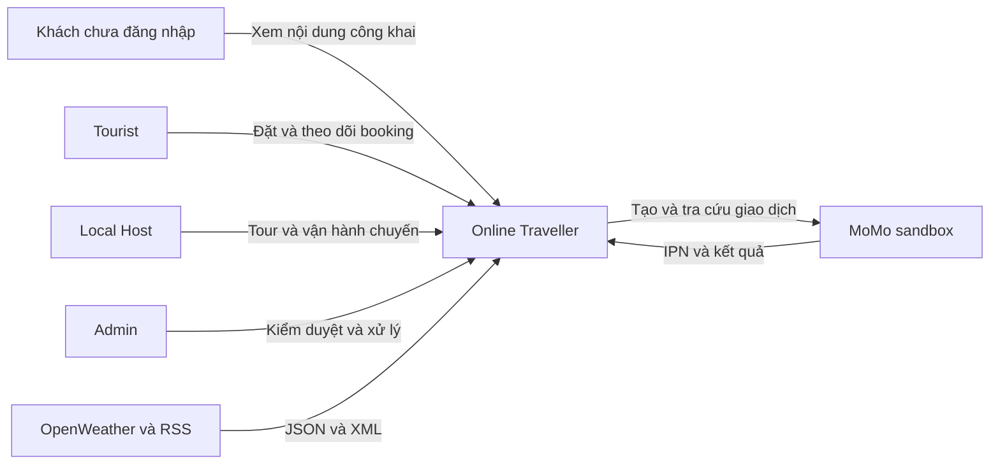

<a id="sec-007"></a>

## Hình 2 Sơ đồ phân rã chức năng

<a id="diagram-function"></a>

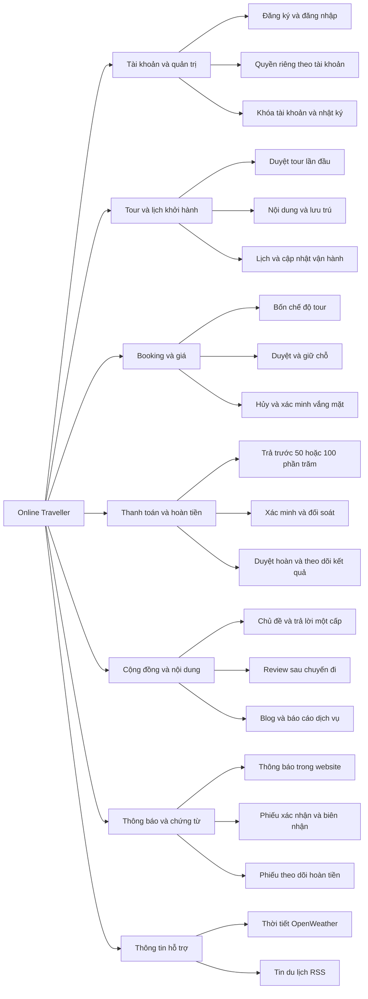

Các nhánh biểu diễn phân cấp chức năng, không biểu diễn thứ tự xử lý.

<a id="sec-008"></a>

# 3 Quy tắc nghiệp vụ

<a id="sec-009"></a>

## 3 1 Tour và lịch khởi hành

- Tour có nhiều lịch; khách chọn lịch có sẵn, không nhập một ngày tùy ý.

- Mỗi lịch có starts_at < ends_at, booking_closes_at <= starts_at, thời điểm/địa điểm tập trung và capacity >0.

- Một khối lưu trú mô tả nơi ở, số đêm và bố trí phòng. Không có bản ghi lưu trú nghĩa là tour không kèm lưu trú.

- Có lưu trú bắt buộc prepaid_full. Thanh toán và sức chứa theo người không phải bằng chứng đã giữ phòng; Host phải bảo đảm lưu trú trước khi duyệt.

- Tour công khai cần Admin duyệt lần đầu. Tour/lịch bị ngừng nhận mới không tự động làm mất hiệu lực booking đã xác nhận.

<a id="sec-010"></a>

## 3 2 Bốn chế độ giá và thanh toán

| Chế độ       | Giá                 | Phương án booking           | Sau Host duyệt   |
| ------------ | ------------------- | --------------------------- | ---------------- |
| free         | 0 đồng              | none                        | confirmed        |
| host_range   | Khoảng giá/người    | host_direct; không online   | confirmed        |
| fixed_choice | Giá chính xác/người | deposit_50 hoặc full_online | awaiting_payment |
| prepaid_full | Giá chính xác/người | full_online                 | awaiting_payment |

Không còn phương án giữ chỗ miễn trả trước cho tour fixed_choice. Tour host_range là trường hợp riêng đã chốt không thu online; rủi ro vắng mặt của loại này chưa được bù bằng khoản trả trước.

Khoảng giá phải có đơn vị theo người, phần đã gồm/chưa gồm và lựa chọn mua thêm tự nguyện. Mức trên là giới hạn cam kết cho dịch vụ mô tả; không mặc nhiên cho phép thu mọi phát sinh. Tour cố định không biến thành giá thỏa thuận khi chọn trả phần còn lại cho Host.

<a id="sec-011"></a>

## 3 3 Giá khuyến mãi và làm tròn

1. Tính tiền gốc bằng đơn giá cố định tại lúc đặt nhân số người.

2. Chọn tối đa một khuyến mãi active trong starts_at <= lúc đặt < ends_at, đã gắn tour. Tỷ lệ cao nhất; bằng nhau chọn id nhỏ nhất. Tỷ lệ lớn hơn 0 và không quá 90%.

3. Tiền giảm thô = tiền gốc × tỷ lệ /100. Làm tròn đến đồng theo half up: phần lẻ <0,5 xuống; >=0,5 lên.

4. Tổng giá = tiền gốc - tiền giảm đã làm tròn.

5. Nếu deposit_50: khoản trả trước = làm tròn half up của tổng giá /2; phần còn lại = tổng giá - khoản trả trước. Nếu full_online: khoản trước bằng tổng giá, phần còn lại bằng 0.

6. Lưu cả điều chỉnh làm tròn; giữ nguyên mọi đồng nguyên, kể cả 2 hay 3 đồng. Không làm tròn lên hàng chục/trăm/nghìn.

7. Server kiểm tra khoản gửi cổng theo cấu hình hỗ trợ. Nếu 50% không hợp lệ nhưng 100% hợp lệ, chỉ cho chọn 100%, thông báo trước khi tạo booking. Không tự nâng tiền thu.

8. Chốt toàn bộ giá, khuyến mãi, payment_plan và nội dung cam kết trong booking; không tính lại booking cũ.

| Ví dụ       | Tổng sau giảm | Trả trước | Còn trả Host | Điều chỉnh            |
| ----------- | ------------- | --------- | ------------ | --------------------- |
| 50% số lẻ   | 900.003       | 450.002   | 450.001      | +0,5 đồng khoản trước |
| 50% số chẵn | 1.800.000     | 900.000   | 900.000      | 0                     |
| 100%        | 900.003       | 900.003   | 0            | 0                     |

Tour miễn phí là chế độ riêng; không dùng khuyến mãi 100%. Với tour có phí, từ chối tạo booking nếu tổng hoặc khoản online không hợp lệ sau làm tròn/giới hạn cổng. Mức tham chiếu hiện tại của MoMo ví là 1.000 đến 50.000.000 VND; cấu hình và xác nhận lại khi tích hợp [S02]. Tính tiền bằng số nguyên/DECIMAL, không dùng float làm nguồn quyết định.

<a id="sec-012"></a>

## 3 4 Chốt cam kết và cập nhật vận hành

- Có booking pending/awaiting_payment/confirmed: khóa điểm đến, lịch trình chính, dịch vụ gồm, lưu trú, giá và chính sách thanh toán đã cam kết.

- Ngày giờ lịch có booking hiệu lực không được sửa; sức chứa không giảm dưới chỗ giữ.

- Cập nhật vận hành được thêm theo lịch, ví dụ hướng dẫn viên/đầu mối/giờ ăn, nếu không làm mất quyền lợi. Lưu nội dung trước-sau, lý do, người và thời điểm.

- Thay đổi lớn cho gói tương lai tạo tour mới và duyệt lần đầu. Không dùng lịch sử cập nhật để đổi cam kết cũ.

- Thông báo khách liên quan bằng bản ghi trong website. Đã đọc không có nghĩa khách đồng ý thay đổi.

- Cập nhật thông thường và Host hủy lịch trước T24. Sau mốc này, sự cố chuyển Admin xử lý ngoại lệ; hệ thống vẫn phải ghi nhận và hoàn tiền khi đủ điều kiện.

<a id="sec-013"></a>

## 3 5 Hạn duyệt giữ chỗ và công bằng

request_expires_at = MIN(created_at +24 giờ, booking_closes_at). Tại now >= deadline, Host không được duyệt. Booking duyệt đúng hạn có thể dùng hết payment_expires_at = MIN(approved_at +15 phút, starts_at), kể cả đã qua hạn nhận đăng ký.

Chỗ đã dùng = tổng participant_count của confirmed, completed và awaiting_payment còn hạn. Pending không giữ chỗ. Mọi thao tác làm thay đổi số chỗ phải khóa cùng lịch trước khi tính/cập nhật [S07].

Ưu tiên danh sách chờ theo created_at rồi id; từ chối cần lý do. Đây là ưu tiên xét, chưa phải cơ chế bảo đảm tuyệt đối ai gửi trước được chỗ trước. Không tự bổ sung hàng chờ tự động hoặc giữ chỗ cho pending.

<a id="sec-014"></a>

## 3 6 Hủy và quyền hoàn tiền

| Trường hợp                                    | Xử lý                                                                                    |
| --------------------------------------------- | ---------------------------------------------------------------------------------------- |
| Tourist chưa trả online, trước T0             | Được hủy; giải phóng chỗ nếu đang giữ; không tạo hồ sơ hoàn khi chưa thu.                |
| Tourist đã trả online, trước T24              | Hủy hợp lệ và hoàn toàn bộ khoản online đã thu.                                          |
| Tourist xin hủy từ T24 trở đi                 | Tiếp nhận xem xét; không tự động hoàn hoặc tự coi là vắng mặt có lỗi.                    |
| Host chủ động hủy trước T24                   | Có lý do; hủy booking liên quan và tạo nghĩa vụ hoàn các khoản online đã thu.            |
| Host/sự cố cần hủy sau T24                    | Admin xử lý khẩn cấp; mốc thời gian không chặn nghĩa vụ hoàn khi không cung cấp dịch vụ. |
| Thu muộn, thu trùng, khiếu nại được chấp nhận | Đối soát và hoàn khoản thực thu cần trả; không tự hồi sinh booking.                      |

Không gộp ngừng hiển thị tour, đóng nhận đăng ký và hủy lịch. Khi khóa Host hoặc tour, Admin phải kiểm tra booking còn hiệu lực và xử lý từng lịch có liên quan. Không sửa lịch sử completed chỉ vì tài khoản bị khóa sau đó.

<a id="sec-015"></a>

## 3 7 Khách không tham gia và chấp thuận chính sách

Host chỉ ghi nhận khi booking confirmed và đã qua thời điểm tập trung công bố. Hồ sơ có căn cứ vắng mặt và việc đã thử liên hệ. Ghi nhận vắng mặt là đề nghị xác minh, không tự quyết định giữ tiền.

Khách có 48 giờ từ thông báo để xác nhận nhận lỗi, xin ngoại lệ hoặc tranh chấp. Nhận lỗi, không xin ngoại lệ và đủ điều kiện chính sách thì xử lý không hoàn. Tranh chấp, sự cố cần xét hoặc hết hạn im lặng chuyển Admin; im lặng không tự là lỗi.

Chỉ kết luận không hoàn khi khách có lỗi, không có lý do được chấp nhận, Host đúng cam kết và chính sách đã được khách đồng ý. Trả trước 50% có thể không hoàn khoản 50%; trả trước 100% có thể không hoàn toàn bộ khoản đã trả. Không tự thu thêm phần chưa trả như khoản phạt.

Tình huống Host cung cấp sai thông tin/không thực hiện cam kết được xét trách nhiệm Host. Sự cố khẩn cấp có căn cứ được Admin xem xét; quên, đổi ý hoặc tự bỏ tour không mặc nhiên thuộc ngoại lệ. Phản hồi trễ vẫn được tiếp nhận và gắn cờ trễ.

Trước thanh toán hiển thị số tiền, phần còn lại, hạn hủy, điều kiện vắng mặt, ngoại lệ và quyền phản ánh. Checkbox không tích sẵn. Lưu phiên bản, hash nội dung, thời điểm và số tiền đã chấp thuận. Chấp thuận không tước quyền khiếu nại; điều khoản dùng với tiền thật cần rà soát phù hợp pháp luật [S16].

<a id="sec-016"></a>

## 3 8 Cộng đồng review và báo cáo

- Thành viên active được mở chủ đề và trả lời kể cả chưa booking; trả lời chỉ một cấp, cùng tour.

- Tác giả ẩn chủ đề: hiện nhãn thay nội dung gốc, giữ trả lời hợp lệ. Admin ẩn gốc: ẩn cả nhánh công khai, không xóa dữ liệu.

- Tác giả chỉ khôi phục nội dung tự ẩn; admin_hidden chỉ Admin khôi phục. Sửa nội dung không tự gỡ ẩn. Khôi phục gốc không làm hiện lại các trả lời đã bị ẩn riêng.

- Chủ đề ẩn không nhận thêm trả lời. Kiểm tra điều này ở server, không chỉ khóa nút UI.

- Review 1..5 sao, một review cho một booking completed; người viết suy ra từ booking.

- Báo cáo không phụ thuộc completed. Đánh dấu báo cáo có booking liên quan; Admin xét vi phạm đã xác minh và mức độ, không tự kết tội theo số lượt.

- Post do Admin quản lý; RSS là nguồn tin ngoài, không tự biến thành bài viết do Admin viết.

<a id="sec-017"></a>

# 4 Các luồng xử lý

Các luồng dưới dùng chung quy tắc trạng thái và quyền trong mục 3. Mỗi kết quả thay đổi được lưu cùng sự kiện và thông báo; giao dịch với cổng thanh toán được điều phối ngoài khóa CSDL.

<a id="sec-018"></a>

## Hình 3 Luồng duyệt và cập nhật tour

<a id="diagram-tour_flow"></a>

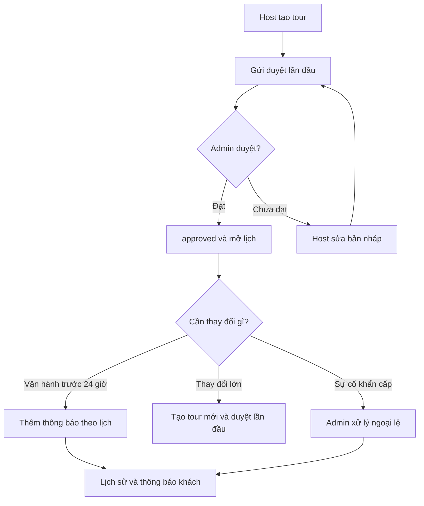

<a id="sec-019"></a>

## 4 1 Đăng ký đăng nhập và phân quyền

1. Khách đăng ký Tourist bằng email duy nhất; PHP hash mật khẩu trước khi lưu [S09].

2. Đăng nhập: lấy bản ghi nội bộ, password_verify và kiểm tra active; tạo session, đổi session id sau đăng nhập.

3. Router áp dụng quyền theo route; thao tác theo id kiểm tra sở hữu. Khóa tài khoản khiến yêu cầu sau không còn quyền hoạt động.

4. Admin cấp tài khoản Host riêng. Không chuyển qua lại vai trò bằng nút ở giao diện hoặc tham số client.

<a id="sec-020"></a>

## 4 2 Tìm xem và gửi booking

1. Khách xem tour approved và lịch, phân biệt rõ giá cố định, khoảng giá hoặc miễn phí.

2. Tourist chọn lịch, số người và payment_plan hợp lệ. Server báo giá, deadline và chính sách.

3. Nếu giá thay đổi từ lúc xem đến lúc gửi, hiển thị lại giá để khách xác nhận, không âm thầm nhận giá mới.

4. Server tính và lưu snapshot, acceptance booking, mã yêu cầu chống trùng; tạo pending trong transaction.

5. Hiển thị booking cho Tourist và Host; chưa giữ chỗ cho pending.

<a id="sec-021"></a>

## Hình 4 Luồng đặt và xác nhận booking

<a id="diagram-booking_flow"></a>

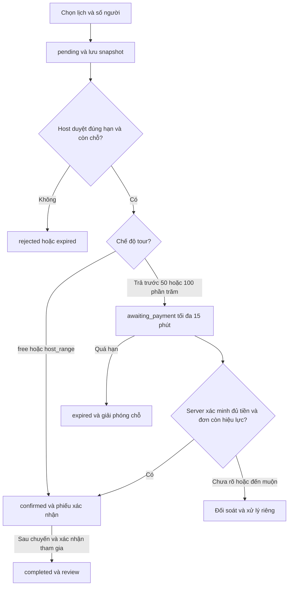

<a id="sec-022"></a>

## Hình 5 Vòng đời booking

<a id="diagram-booking_state"></a>

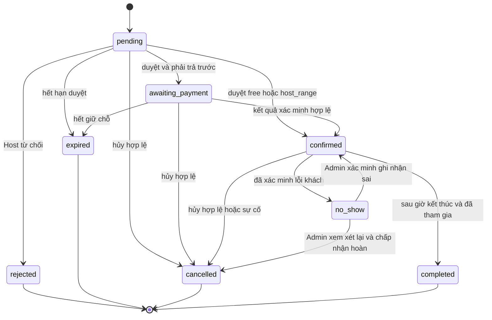

Hồ sơ vắng mặt và hoàn tiền có vòng đời riêng. Không có chuyển expired/cancelled sang confirmed do IPN muộn.

<a id="sec-023"></a>

## 4 3 Duyệt từ chối và hết hạn

1. Host mở danh sách chờ theo thời điểm tạo. Server kiểm tra deadline và sở hữu.

2. Khóa lịch, khóa booking, tính chỗ còn và kiểm tra lịch chưa hủy/tour còn được phép duyệt.

3. Đủ chỗ: free/host_range -> confirmed; deposit/full -> awaiting_payment và deadline. Thiếu chỗ: không xác nhận, trả lý do rõ; booking không được giữ chỗ ngầm.

4. Từ chối có lý do -> rejected; quá hạn -> expired. Lưu event và thông báo cùng transaction.

5. Tác vụ hết hạn và các thao tác đọc/duyệt đều kiểm tra deadline; không chỉ phụ thuộc thời điểm cron chạy.

<a id="sec-024"></a>

## 4 4 Thanh toán và đối soát

1. Tourist mở booking awaiting_payment, xem đúng số cần trả và tích chấp thuận bản chính sách đã chốt.

2. Tạo payment created và mã request/order duy nhất. Chặn lần mới khi có lần cũ chưa rõ kết quả.

3. Commit dữ liệu chuẩn bị, rồi mới gọi API MoMo; không giữ khóa CSDL trong lúc gọi mạng.

4. IPN hoặc tra cứu hợp lệ được backend xác minh chữ ký, partner/order/amount và kết quả. Redirect chỉ hiển thị trạng thái đã lưu [S03].

5. Trong transaction: khóa lịch rồi booking/payment; kết quả thành công hợp lệ và còn thời hạn áp dụng một lần, chuyển confirmed, phát biên nhận và thông báo.

6. Thu muộn hoặc thu trùng giữ payment succeeded nhưng needs_review; không giữ lại chỗ; tạo nghĩa vụ hoàn sau đối soát phù hợp.

7. Timeout hoặc chưa rõ kết quả: tra cứu yêu cầu cũ; không tự coi là thất bại và mở mã thanh toán mới [S05].

<a id="sec-025"></a>

## Hình 6 Luồng thu tiền và xử lý kết quả

<a id="diagram-payment_flow"></a>

```mermaid
flowchart TB
  consent["Đồng ý chính sách và số tiền"] --> prepare["Lưu payment created và mã duy nhất"]
  prepare --> call["Gọi MoMo ngoài transaction"]
  call --> checkout["Khách thanh toán"]
  checkout --> callback["IPN hoặc tra cứu phía server"]
  callback --> verify{"Chữ ký và dữ liệu khớp?"}
  verify -->|"Có"| lock["Khóa lịch rồi booking"]
  lock --> valid{"Booking còn hiệu lực và chưa áp dụng khoản khác?"}
  valid -->|"Có"| applied["succeeded applied và confirmed"]
  valid -->|"Không"| review["succeeded needs_review và xem xét hoàn"]
  call -->|"Chưa rõ kết quả"| unknown["Tra cứu trước khi thử mới"]
  unknown --> callback
  verify -->|"Không"| reject["Từ chối kết quả và ghi nhật ký"]
```

Redirect chỉ hiển thị kết quả đã lưu; không xác nhận booking bằng dữ liệu từ trình duyệt.

<a id="sec-026"></a>

## 4 5 Hủy booking và hủy lịch

1. Người có quyền gửi yêu cầu và lý do; server xác định hủy thông thường hay hồ sơ cần Admin xem xét.

2. Kiểm tra mốc thời gian, trạng thái booking và khoản thu đã xác minh.

3. Hủy hợp lệ: khóa lịch rồi booking, chuyển cancelled, ghi event; tạo refund nếu có khoản online cần trả.

4. Hủy lịch: khóa lịch một lần, xử lý các booking còn hiệu lực theo id; từng nghĩa vụ hoàn có khóa duy nhất. Không gọi API hoàn trong transaction hủy.

5. Thông báo lý do hủy và hồ sơ hoàn cho khách. Pending/awaiting chưa thu không cần phiếu hoàn tiền giả.

<a id="sec-027"></a>

## 4 6 Hoàn tiền và theo dõi

1. Hệ thống lập hồ sơ từ khoản thực thu. Một payment có tối đa một nghĩa vụ hoàn toàn bộ trong bản cơ bản.

2. Admin xem danh sách, đối chiếu và duyệt; mỗi hồ sơ có người duyệt và thời điểm riêng.

3. Chuẩn bị refund_attempt và mã idempotency, chặn lần đang processing/unknown; commit rồi gọi API hoàn.

4. Kết quả thành công đã xác minh cập nhật hồ sơ và mã tham chiếu; thất bại rõ có thể xem xét thử lại; chưa rõ phải tra cứu.

5. Phiếu hiển thị số tiền, lý do, hạn xử lý, trạng thái cổng và phản hồi khách riêng biệt.

6. Khách bấm đã nhận -> lưu xác nhận; chưa nhận sau hạn -> tạo yêu cầu kiểm tra gắn hồ sơ, không chi lại.

7. Mục tiêu 24 giờ từ hủy, không dời khi Admin duyệt/retry. Khoản đến muộn mới được xác minh sau mốc đó vẫn giữ mốc hủy và hiện trễ; thu trùng không có hủy lấy mốc phát hiện.

8. Cổng báo hoàn thành công không đồng nghĩa khách đã bấm xác nhận. Không hứa thời gian ghi có thực tế ngoài khả năng đã kiểm chứng.

Thiết kế dùng API hoàn gắn giao dịch gốc và API tra cứu hoàn [S04]. Cần nghiệm thu bằng tài khoản sandbox được cấp trước khi coi tích hợp là hoàn thành.

<a id="sec-028"></a>

## Hình 7 Luồng hoàn tiền

<a id="diagram-refund_flow"></a>

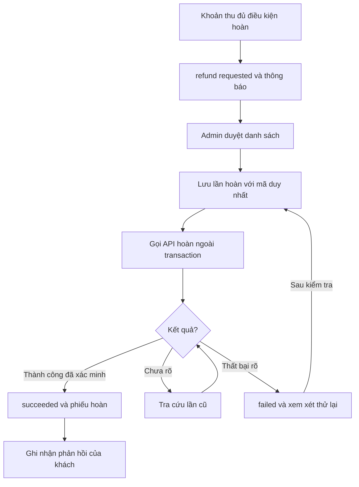

Mỗi payment có một nghĩa vụ hoàn trong bản cơ bản. Nút chưa nhận không phát lệnh hoàn mới.

<a id="sec-029"></a>

## 4 7 Khách không tham gia

1. Host mở hồ sơ cho booking confirmed, cung cấp căn cứ sau giờ tập trung; cùng transaction tạo thông báo và hạn phản hồi 48 giờ.

2. Khách nhận lỗi không xin ngoại lệ: xác minh điều kiện, lưu phản hồi và kết luận theo thỏa thuận.

3. Khách xin ngoại lệ/tranh chấp hoặc không phản hồi sau 48 giờ: needs_review để Admin đánh giá; không tự chuyển lỗi khách.

4. Lỗi khách, Host đúng cam kết: no_show và không hoàn khoản đã trả; payment vẫn succeeded.

5. Đủ điều kiện hoàn: cancelled và tạo nghĩa vụ hoàn; ghi nhận sai: dismissed, không dùng để tước quyền khách.

6. Trong lúc chưa kết luận, không cho Host đánh completed để bỏ qua hồ sơ. Phản hồi muộn vẫn lưu và có đường báo cáo xem xét lại.

<a id="sec-030"></a>

## Hình 8 Luồng xác minh khách không tham gia

<a id="diagram-no_show"></a>

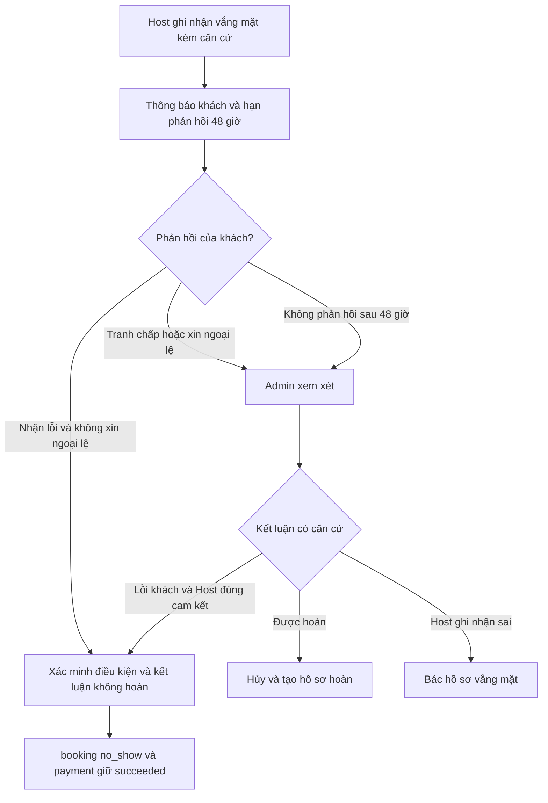

Im lặng không đồng nghĩa nhận lỗi. Hồ sơ chưa kết luận chặn hoàn tất booking theo luồng thông thường.

<a id="sec-031"></a>

## 4 8 Kết thúc chuyến review và báo cáo

1. Sau ends_at, Host chỉ complete booking đã xác nhận thực sự tham gia và không bị hồ sơ vắng mặt chưa kết luận chặn.

2. Tourist tạo tối đa một review cho booking completed; server suy ra tour/người viết từ booking.

3. Người dùng gửi báo cáo dịch vụ; nếu có booking thì đối chiếu đúng chủ và cùng tour. Báo cáo không đòi completed.

4. Admin phân công, yêu cầu thông tin khi cần, lưu diễn biến và kết luận; nếu cần khóa/hủy/hoàn thì gọi đúng thủ tục tương ứng.

5. Thông báo kết quả; xem xét lại có căn cứ giữ cả lịch sử cũ.

<a id="sec-032"></a>

## 4 9 Thảo luận và thông báo

1. Thành viên active tạo chủ đề hoặc trả lời chủ đề gốc visible cùng tour; escape khi hiển thị.

2. Tác giả sửa/ẩn đúng quyền; Admin ẩn vi phạm có lý do. Truy vấn công khai áp dụng trạng thái cha và con.

3. Sự kiện booking, vận hành, hoàn, vắng mặt, báo cáo tạo notification cùng transaction với khóa chống lặp.

4. Website lấy danh sách thông báo theo người nhận; đã đọc/ẩn là thao tác UI, không đổi nghĩa vụ nghiệp vụ.

<a id="sec-033"></a>

# 5 Trạng thái và hợp đồng chuyển trạng thái

| Đối tượng    | Trạng thái                                                                          | Điều kiện quan trọng                                                       |
| ------------ | ----------------------------------------------------------------------------------- | -------------------------------------------------------------------------- |
| Booking      | pending                                                                             | Chưa giữ chỗ; chỉ Host đúng sở hữu được duyệt trước deadline.              |
| Booking      | awaiting_payment                                                                    | Đã tạm giữ chỗ; chỉ số tiền online_due hợp lệ được áp dụng.                |
| Booking      | confirmed                                                                           | Đã giữ chỗ; không đồng nghĩa đã trả hết tiền cho Host.                     |
| Booking      | completed                                                                           | Sau ends_at và đã tham gia; mở quyền review.                               |
| Booking      | rejected / expired / cancelled                                                      | Kết thúc tương ứng; không tự khôi phục qua IPN muộn.                       |
| Booking      | no_show                                                                             | Kết luận lỗi khách sau xác minh; không phải trạng thái tự gán khi hết giờ. |
| Payment      | created / pending / succeeded / failed / cancelled                                  | Kết quả khoản thu; succeeded được giữ khi hoàn tiền.                       |
| Allocation   | unapplied / applied / needs_review                                                  | Tách khỏi kết quả thu tiền và khỏi hoàn tiền.                              |
| Refund       | requested / approved / processing / needs_review / succeeded / failed / rejected    | Quá hạn là cờ suy ra; phản hồi khách lưu riêng.                            |
| No show case | awaiting_response / needs_review / resolved_no_refund / resolved_refund / dismissed | Không phản hồi chỉ chuyển needs_review.                                    |

| Chuyển booking                                  | Ai thực hiện          | Điều kiện và tác động                                                        |
| ----------------------------------------------- | --------------------- | ---------------------------------------------------------------------------- |
| pending -> confirmed                            | Host                  | Free/range; đúng hạn, còn chỗ; event và thông báo.                           |
| pending -> awaiting_payment                     | Host                  | Deposit/full; đúng hạn, còn chỗ; đặt payment_expires_at.                     |
| awaiting_payment -> confirmed                   | PaymentService        | Khoản thu verified đúng tiền, booking còn hiệu lực, chỉ một payment áp dụng. |
| pending -> rejected                             | Host                  | Có lý do, chưa hết hạn.                                                      |
| pending/awaiting_payment -> expired             | Tác vụ hoặc nghiệp vụ | Đến deadline; giải phóng chỗ và ghi event một lần.                           |
| pending/awaiting_payment/confirmed -> cancelled | Đúng quyền hủy        | Kiểm tra deadline/ngoại lệ, tạo refund nếu cần.                              |
| confirmed -> completed                          | Host                  | Đã tham gia, sau kết thúc, không có case chưa kết luận.                      |
| confirmed -> no_show                            | Kết luận xác minh     | Lỗi khách và Host đúng cam kết; giữ payment succeeded.                       |

Ngoại lệ xem xét lại: Admin mở lại hồ sơ có căn cứ mới và lịch sử báo cáo. Nếu ghi nhận sai, no_show -> confirmed để xử lý lại đúng thực tế; nếu được hoàn, no_show -> cancelled và tạo nghĩa vụ hoàn. Không cho Host hoặc client tự khôi phục trạng thái này.

Đây là bảng cho phép cùng ngoại lệ xem xét lại vừa nêu: các chuyển khác bị từ chối bằng INVALID_STATE. API gọi lại sau thành công trả trạng thái hiện tại khi có cùng idempotency key; không thực hiện tác động phụ hai lần.
# 6 Thiết kế cơ sở dữ liệu

<a id="sec-035"></a>

## 6 1 Quy ước vật lý

- Tất cả 25 bảng nghiệp vụ mang tiền tố tbl_. Tên trường snake_case; khóa chính BIGINT UNSIGNED; các FK dùng cùng kiểu.

- MySQL InnoDB, utf8mb4; cấu hình SQL mode nghiêm ngặt. Thiết kế tham chiếu cú pháp MySQL 8.4 [S06–S08].

- Tiền VND DECIMAL(14,0); tỷ lệ DECIMAL(5,2); phần điều chỉnh tiền giảm DECIMAL(8,4), điều chỉnh trả trước DECIMAL(6,2).

- Lưu thời gian UTC DATETIME(6). JSON chỉ dùng snapshot, dữ liệu căn cứ và nội dung phụ; FK nghiệp vụ quan trọng được khai báo tường minh.

- ON DELETE RESTRICT cho dữ liệu lịch sử; dùng khóa/ẩn/archive/hủy. Bảng append-only không có PROCEDURE sửa/xóa tùy ý.

- Tất cả thay đổi nghiệp vụ qua PROCEDURE; đọc cũng có PROCEDURE riêng. Runtime chỉ có quyền EXECUTE theo danh sách; migration dùng tài khoản riêng.

<a id="sec-036"></a>

## Hình 9  ERD tổng hợp toàn hệ thống

<a id="diagram-erd_full"></a>


Mũi tên đi từ bảng con tới bảng cha; nhãn ghi FK và số lượng phía con : phía cha. ERD tổng hợp có đủ 25 bảng và 49 FK; góc nhìn chi tiết hiện thêm cột FK. Từ điển dữ liệu mô tả đầy đủ trường.

<a id="sec-037"></a>

## Hình 10  ERD chi tiết tour booking và thanh toán

<a id="diagram-erd_booking"></a>


Mũi tên đi từ bảng con tới bảng cha; nhãn ghi FK và số lượng phía con : phía cha. ERD tổng hợp có đủ 25 bảng và 49 FK; góc nhìn chi tiết hiện thêm cột FK. Từ điển dữ liệu mô tả đầy đủ trường.

<a id="sec-038"></a>

## Hình 11  ERD chi tiết cộng đồng và xử lý

<a id="diagram-erd_community"></a>


Mũi tên đi từ bảng con tới bảng cha; nhãn ghi FK và số lượng phía con : phía cha. ERD tổng hợp có đủ 25 bảng và 49 FK; góc nhìn chi tiết hiện thêm cột FK. Từ điển dữ liệu mô tả đầy đủ trường.

<a id="sec-039"></a>

## 6 2 Từ điển dữ liệu đầy đủ

PK là khóa chính, FK là khóa ngoại, UK là duy nhất. Bảng dưới mô tả nhóm trường cùng kiểu trên một dòng khi phù hợp; mỗi tên trong nhóm là một cột riêng. Các nhóm trạng thái dùng VARCHAR kèm CHECK; kiểm tra xuyên bảng/role đặt trong PROCEDURE.

<a id="sec-040"></a>

### 6 2 1 tbl_users

Tài khoản có đúng một vai trò; Host và Tourist dùng tài khoản riêng.

| Trường | Kiểu | Vai trò và điều kiện |
| --- | --- | --- |
| id | BIGINT UNSIGNED | PK |
| email | VARCHAR(254) | UK; chuẩn hóa trước khi so sánh |
| name | VARCHAR(150) | NOT NULL |
| password_hash | VARCHAR(255) | Hash do PHP tạo; không lưu mật khẩu gốc |
| role | VARCHAR(16) | tourist \| local \| admin |
| phone | VARCHAR(32) | Có thể trống |
| status | VARCHAR(16) | active \| locked |
| created_at, updated_at | DATETIME(6) | NOT NULL |

Không gộp vai trò. Admin cấp tài khoản Host riêng; tài khoản Host/Admin không được tạo booking.

Khóa tài khoản không tự hủy booking; lịch sử vẫn được bảo toàn.

<a id="sec-041"></a>

### 6 2 2 tbl_categories

Danh mục tour và trải nghiệm.

| Trường | Kiểu | Vai trò và điều kiện |
| --- | --- | --- |
| id | BIGINT UNSIGNED | PK |
| name | VARCHAR(150) | NOT NULL |
| slug | VARCHAR(180) | UK |
| description | TEXT | Có thể trống |
| status | VARCHAR(16) | active \| archived |
| created_at, updated_at | DATETIME(6) | NOT NULL |

Không xóa danh mục đã được tour tham chiếu.

<a id="sec-042"></a>

### 6 2 3 tbl_services

Nội dung và cam kết của tour, cùng chế độ giá và thanh toán.

| Trường | Kiểu | Vai trò và điều kiện |
| --- | --- | --- |
| id | BIGINT UNSIGNED | PK |
| local_id | BIGINT UNSIGNED | FK tbl_users.id; role local |
| category_id | BIGINT UNSIGNED | FK tbl_categories.id |
| title | VARCHAR(255) | NOT NULL |
| description, itinerary | TEXT | NOT NULL |
| location_name | VARCHAR(255) | NOT NULL |
| lat, lng | DECIMAL(10,7) | Có thể trống; kiểm tra miền tọa độ |
| duration_label | VARCHAR(80) | Nhãn mô tả; lịch dùng thời gian thực |
| thumbnail | VARCHAR(512) | Đường dẫn ảnh đã kiểm tra |
| payment_mode | VARCHAR(24) | free \| host_range \| fixed_choice \| prepaid_full |
| price | DECIMAL(14,0) | 0 với free; >0 với fixed_choice/prepaid_full; NULL với host_range |
| price_min, price_max | DECIMAL(14,0) | Chỉ có giá trị với host_range; 0 < min <= max |
| included_costs, excluded_costs | TEXT | Nêu rõ phạm vi giá và mua thêm tự nguyện |
| status | VARCHAR(20) | draft \| pending \| approved \| rejected \| suspended \| archived |
| approved_by | BIGINT UNSIGNED | FK tbl_users.id; nullable; Admin |
| approved_at | DATETIME(6) | Nullable |
| created_at, updated_at | DATETIME(6) | NOT NULL |

Có lưu trú => payment_mode = prepaid_full; kiểm tra xuyên bảng trong PROCEDURE.

Sau khi có booking đang chờ/còn hiệu lực, không ghi đè nội dung cam kết; thay đổi lớn tạo tour mới.

Sửa vận hành dùng tbl_schedule_updates. Tour suspended/archived ngừng nhận mới, không tự hủy lịch.

<a id="sec-043"></a>

### 6 2 4 tbl_service_accommodations

Một khối lưu trú nằm trong gói của một tour.

| Trường | Kiểu | Vai trò và điều kiện |
| --- | --- | --- |
| service_id | BIGINT UNSIGNED | PK và FK tbl_services.id |
| name | VARCHAR(255) | NOT NULL |
| address | VARCHAR(500) | NOT NULL |
| nights | SMALLINT UNSIGNED | >=1 |
| room_details, notes | TEXT | Cách bố trí phòng và lưu ý |
| created_at, updated_at | DATETIME(6) | NOT NULL |

Không có bản ghi nghĩa là tour không có lưu trú. Chưa quản lý tồn phòng theo đêm.

Không thay đổi/xóa khỏi tour có cam kết đang hiệu lực; Host bảo đảm phòng trước khi duyệt.

<a id="sec-044"></a>

### 6 2 5 tbl_service_schedules

Lịch khởi hành, hạn đăng ký và sức chứa theo người.

| Trường | Kiểu | Vai trò và điều kiện |
| --- | --- | --- |
| id | BIGINT UNSIGNED | PK |
| service_id | BIGINT UNSIGNED | FK tbl_services.id |
| starts_at, ends_at | DATETIME(6) | starts_at < ends_at |
| booking_closes_at | DATETIME(6) | <= starts_at |
| meeting_at | DATETIME(6) | Thời điểm tập trung công bố; <= starts_at |
| meeting_location | VARCHAR(500) | Địa điểm tập trung |
| capacity | INT UNSIGNED | >0 |
| status | VARCHAR(16) | open \| closed \| cancelled |
| cancelled_at | DATETIME(6) | Nullable |
| cancel_reason | TEXT | Bắt buộc khi hủy |
| cancelled_by | BIGINT UNSIGNED | FK tbl_users.id; nullable |
| created_at, updated_at | DATETIME(6) | NOT NULL |

UK(id, service_id) hỗ trợ FK ghép của booking.

Closed chỉ ngừng nhận yêu cầu mới; pending đã tạo vẫn được xét trước deadline nếu không có quyết định hủy.

Không đổi ngày giờ khi có booking hiệu lực; không hạ capacity dưới chỗ đã giữ.

<a id="sec-045"></a>

### 6 2 6 tbl_promotions

Khuyến mãi phần trăm do Admin quản lý.

| Trường | Kiểu | Vai trò và điều kiện |
| --- | --- | --- |
| id | BIGINT UNSIGNED | PK |
| created_by | BIGINT UNSIGNED | FK tbl_users.id; Admin |
| name | VARCHAR(200) | NOT NULL |
| description | TEXT | Nullable |
| discount_percent | DECIMAL(5,2) | 0 < giá trị <=90 |
| starts_at, ends_at | DATETIME(6) | starts_at < ends_at |
| status | VARCHAR(16) | active \| disabled \| archived |
| created_at, updated_at | DATETIME(6) | NOT NULL |

Chỉ gắn tour fixed_choice/prepaid_full; không giảm giá tour free/host_range.

Một booking dùng tối đa một chương trình; cao nhất trước, cùng tỷ lệ chọn id nhỏ nhất.

<a id="sec-046"></a>

### 6 2 7 tbl_promotion_services

Liên kết khuyến mãi với tour.

| Trường | Kiểu | Vai trò và điều kiện |
| --- | --- | --- |
| promotion_id | BIGINT UNSIGNED | PK ghép; FK tbl_promotions.id |
| service_id | BIGINT UNSIGNED | PK ghép; FK tbl_services.id |
| created_at | DATETIME(6) | NOT NULL |

PK(promotion_id, service_id). Có thể bỏ liên kết cho tương lai; booking cũ giữ snapshot.

<a id="sec-047"></a>

### 6 2 8 tbl_policy_versions

Các phiên bản chính sách được công bố và lưu bất biến.

| Trường | Kiểu | Vai trò và điều kiện |
| --- | --- | --- |
| id | BIGINT UNSIGNED | PK |
| version_code | VARCHAR(50) | UK |
| title | VARCHAR(200) | NOT NULL |
| content | LONGTEXT | Chính sách hủy, vắng mặt, thanh toán |
| content_hash | CHAR(64) | SHA256 nội dung chuẩn hóa |
| status | VARCHAR(16) | draft \| published \| retired |
| published_by | BIGINT UNSIGNED | FK tbl_users.id; nullable |
| published_at | DATETIME(6) | Nullable |
| created_at | DATETIME(6) | NOT NULL |

Chỉ sửa bản draft. Published không sửa nội dung; thay đổi phải công bố phiên bản mới.

Retired không dùng cho booking mới; booking cũ vẫn tra cứu và áp dụng phiên bản đã chốt.

<a id="sec-048"></a>

### 6 2 9 tbl_bookings

Yêu cầu đặt tour và toàn bộ dữ liệu cam kết đã chốt.

| Trường | Kiểu | Vai trò và điều kiện |
| --- | --- | --- |
| id | BIGINT UNSIGNED | PK |
| booking_code | VARCHAR(40) | UK |
| tourist_id | BIGINT UNSIGNED | FK tbl_users.id; role tourist |
| service_id | BIGINT UNSIGNED | FK tbl_services.id |
| schedule_id | BIGINT UNSIGNED | FK tbl_service_schedules.id; FK ghép đúng tour |
| promotion_id | BIGINT UNSIGNED | FK tbl_promotions.id; nullable |
| policy_version_id | BIGINT UNSIGNED | FK tbl_policy_versions.id |
| participant_count | INT UNSIGNED | >0; không vượt sức chứa toàn lịch |
| contact_name | VARCHAR(150) | NOT NULL |
| contact_phone | VARCHAR(32) | NOT NULL |
| message | TEXT | Nullable |
| status | VARCHAR(24) | pending \| awaiting_payment \| confirmed \| completed \| rejected \| cancelled \| expired \| no_show |
| payment_plan | VARCHAR(20) | none \| host_direct \| deposit_50 \| full_online |
| payment_mode_snapshot | VARCHAR(24) | Chế độ tour tại lúc đặt |
| unit_price, original_price | DECIMAL(14,0) | Nullable với host_range |
| discount_percent | DECIMAL(5,2) | 0 nếu không có khuyến mãi |
| discount_amount, total_price | DECIMAL(14,0) | Nullable với host_range; 0 với free |
| discount_rounding_adjustment | DECIMAL(8,4) | Chênh lệch tiền giảm sau làm tròn; giữ đủ phần lẻ |
| online_due, host_balance | DECIMAL(14,0) | 0 với free; NULL với host_range; host_balance không phải xác nhận đã thu |
| deposit_rounding_adjustment | DECIMAL(6,2) | Chênh lệch khoản 50%; thường 0 hoặc +0.50 |
| price_min_snapshot, price_max_snapshot | DECIMAL(14,0) | Chỉ dành cho host_range |
| promotion_name_snapshot | VARCHAR(200) | Nullable |
| service_title_snapshot, host_name_snapshot | VARCHAR(255) | NOT NULL |
| starts_at_snapshot, ends_at_snapshot | DATETIME(6) | NOT NULL |
| commitment_snapshot | JSON | Lịch trình, địa điểm, gồm/chưa gồm, lưu trú, điểm/giờ tập trung |
| request_expires_at, payment_expires_at | DATETIME(6) | Hạn duyệt bắt buộc; hạn trả tiền nullable |
| applied_payment_id | BIGINT UNSIGNED | FK tbl_payments.id; nullable; UK khi có giá trị |
| client_request_id | VARCHAR(80) | UK ghép với tourist_id |
| approved_at, cancelled_at, completed_at | DATETIME(6) | Nullable |
| created_at, updated_at | DATETIME(6) | NOT NULL |

UK(tourist_id, client_request_id); từ chối token lặp nhưng payload khác.

FK(schedule_id,service_id) -> tbl_service_schedules(id,service_id). applied_payment phải cùng booking, kiểm tra bằng PROCEDURE.

online_due + host_balance = total_price cho tour cố định; khoản thực thu online = online_due.

Không đổi số người, lịch, giá hoặc payment_plan sau tạo; cần hủy và đặt mới theo điều kiện.

Không sửa snapshot. Chỉ chuyển trạng thái qua thủ tục nghiệp vụ.

<a id="sec-049"></a>

### 6 2 10 tbl_booking_events

Lịch sử thay đổi trạng thái booking.

| Trường | Kiểu | Vai trò và điều kiện |
| --- | --- | --- |
| id | BIGINT UNSIGNED | PK |
| booking_id | BIGINT UNSIGNED | FK tbl_bookings.id |
| actor_id | BIGINT UNSIGNED | FK tbl_users.id; NULL với tác vụ hệ thống |
| event_key | VARCHAR(100) | UK; chống ghi lặp |
| event_type | VARCHAR(50) | approve \| expire \| cancel \| complete \| no_show... |
| from_status, to_status | VARCHAR(24) | NOT NULL |
| reason | TEXT | Nullable |
| details_json | JSON | Nullable |
| created_at | DATETIME(6) | NOT NULL |

Chỉ thêm và đọc; không sửa/xóa lịch sử.

<a id="sec-050"></a>

### 6 2 11 tbl_payments

Mỗi lần thử thu tiền online qua MoMo sandbox.

| Trường | Kiểu | Vai trò và điều kiện |
| --- | --- | --- |
| id | BIGINT UNSIGNED | PK |
| booking_id | BIGINT UNSIGNED | FK tbl_bookings.id |
| provider | VARCHAR(20) | momo |
| environment | VARCHAR(16) | sandbox |
| merchant_order_id, request_id | VARCHAR(100) | UK riêng cho từng trường |
| provider_transaction_id | VARCHAR(100) | UK(provider,environment,provider_transaction_id); nullable |
| amount | DECIMAL(14,0) | Số tiền thực thu; từ booking.online_due |
| currency | CHAR(3) | VND |
| status | VARCHAR(16) | created \| pending \| succeeded \| failed \| cancelled |
| allocation_status | VARCHAR(20) | unapplied \| applied \| needs_review |
| result_code | VARCHAR(30) | Nullable; kết quả gốc |
| request_snapshot, verified_result | JSON | Dữ liệu đã lọc khóa bí mật |
| paid_at, verified_at | DATETIME(6) | Nullable |
| created_at, updated_at | DATETIME(6) | NOT NULL |

Không lấy amount từ trình duyệt. Succeeded không bị ghi đè thành failed do thông báo cũ.

Một booking chỉ có một payment áp dụng; các khoản thu thừa xử lý riêng.

Refund không đổi payment succeeded; trạng thái hoàn được suy ra từ hồ sơ hoàn.

<a id="sec-051"></a>

### 6 2 12 tbl_receipts

Biên nhận của khoản thu online đã xác minh.

| Trường | Kiểu | Vai trò và điều kiện |
| --- | --- | --- |
| id | BIGINT UNSIGNED | PK |
| payment_id | BIGINT UNSIGNED | UK và FK tbl_payments.id |
| receipt_number | VARCHAR(50) | UK |
| amount | DECIMAL(14,0) | Bằng khoản payment đã thu |
| currency | CHAR(3) | VND |
| snapshot_json | JSON | Dữ liệu chứng từ bất biến; có nhãn SANDBOX |
| issued_at | DATETIME(6) | NOT NULL |

Chỉ phát hành cho succeeded đã verified. Không sửa/xóa hoặc đổi thành biên nhận tổng tour.

<a id="sec-052"></a>

### 6 2 13 tbl_refunds

Một nghĩa vụ hoàn toàn bộ khoản thu của một payment.

| Trường | Kiểu | Vai trò và điều kiện |
| --- | --- | --- |
| id | BIGINT UNSIGNED | PK |
| refund_code | VARCHAR(50) | UK |
| payment_id | BIGINT UNSIGNED | UK và FK tbl_payments.id |
| reason_type | VARCHAR(40) | booking_cancelled \| late_payment \| duplicate_payment \| resolved_complaint |
| reason | TEXT | NOT NULL |
| amount | DECIMAL(14,0) | Khoản đã thu cần hoàn, không vượt payment.amount |
| status | VARCHAR(20) | requested \| approved \| processing \| needs_review \| succeeded \| failed \| rejected |
| requested_at, due_at | DATETIME(6) | NOT NULL |
| approved_by | BIGINT UNSIGNED | FK tbl_users.id; nullable |
| approved_at | DATETIME(6) | Nullable |
| refund_reference | VARCHAR(100) | Mã hoàn xác minh; nullable |
| verified_at | DATETIME(6) | Nullable |
| customer_receipt_status | VARCHAR(16) | unknown \| received \| not_received |
| customer_confirmed_at | DATETIME(6) | Nullable |
| created_at, updated_at | DATETIME(6) | NOT NULL |

Bản cơ bản hoàn toàn bộ khoản online cần trả, chưa hỗ trợ hoàn từng phần tự nguyện.

Hủy có thu tiền: due_at = cancelled_at +24 giờ. Khoản thu trùng không có hủy: mốc phát hiện +24 giờ.

Quá hạn là thuộc tính suy ra; retry/duyệt không dời due_at. Nút khách không tạo lệnh chi mới.

<a id="sec-053"></a>

### 6 2 14 tbl_refund_attempts

Từng lần gửi và tra cứu một yêu cầu hoàn.

| Trường | Kiểu | Vai trò và điều kiện |
| --- | --- | --- |
| id | BIGINT UNSIGNED | PK |
| refund_id | BIGINT UNSIGNED | FK tbl_refunds.id |
| attempt_no | INT UNSIGNED | UK ghép refund_id |
| merchant_refund_order_id, request_id | VARCHAR(100) | UK riêng |
| amount | DECIMAL(14,0) | Bằng nghĩa vụ còn phải hoàn |
| status | VARCHAR(20) | prepared \| processing \| unknown \| succeeded \| failed |
| provider_refund_id | VARCHAR(100) | UK khi có giá trị |
| result_code | VARCHAR(30) | Nullable |
| request_snapshot, verified_result | JSON | Không lưu khóa bí mật |
| sent_at, checked_at, verified_at | DATETIME(6) | Nullable |
| created_at, updated_at | DATETIME(6) | NOT NULL |

Chỉ một lần chưa rõ kết quả được hoạt động cho một refund; unknown phải tra cứu trước lần mới.

Prepared được lưu trước gọi mạng; thành công không bị hạ trạng thái.

<a id="sec-054"></a>

### 6 2 15 tbl_discussions

Chủ đề và trả lời một cấp theo tour.

| Trường | Kiểu | Vai trò và điều kiện |
| --- | --- | --- |
| id | BIGINT UNSIGNED | PK |
| service_id | BIGINT UNSIGNED | FK tbl_services.id |
| user_id | BIGINT UNSIGNED | FK tbl_users.id |
| parent_id | BIGINT UNSIGNED | FK tbl_discussions.id; NULL với chủ đề |
| title | VARCHAR(255) | Chỉ chủ đề; nullable |
| content | TEXT | NOT NULL |
| visibility | VARCHAR(20) | visible \| author_hidden \| admin_hidden |
| moderation_reason | TEXT | Nullable |
| moderated_by | BIGINT UNSIGNED | FK tbl_users.id; nullable |
| created_at, updated_at | DATETIME(6) | NOT NULL |

Trả lời cùng tour, parent phải là chủ đề gốc. Không nhận trả lời mới nếu chủ đề bị ẩn.

Tác giả ẩn gốc: hiện nhãn thay nội dung, giữ trả lời hợp lệ. Admin ẩn gốc: ẩn cả nhánh công khai.

Khôi phục gốc không đổi visibility riêng của các trả lời. Admin-hidden chỉ Admin khôi phục.

<a id="sec-055"></a>

### 6 2 16 tbl_reviews

Đánh giá chuyến đi hoàn tất; một review cho một booking.

| Trường | Kiểu | Vai trò và điều kiện |
| --- | --- | --- |
| id | BIGINT UNSIGNED | PK |
| booking_id | BIGINT UNSIGNED | UK và FK tbl_bookings.id |
| rating | TINYINT UNSIGNED | 1..5 |
| comment | TEXT | Nullable |
| created_at | DATETIME(6) | NOT NULL |

Người viết suy ra từ booking. Chỉ chủ booking completed được tạo; không tự coi hết giờ là đã tham gia.

Giữ quyền báo cáo độc lập với quyền review; no_show không được review theo luồng completed.

<a id="sec-056"></a>

### 6 2 17 tbl_posts

Bài viết và cẩm nang do Admin quản lý.

| Trường | Kiểu | Vai trò và điều kiện |
| --- | --- | --- |
| id | BIGINT UNSIGNED | PK |
| author_id | BIGINT UNSIGNED | FK tbl_users.id; Admin |
| title | VARCHAR(255) | NOT NULL |
| slug | VARCHAR(255) | UK |
| content | LONGTEXT | NOT NULL |
| thumbnail | VARCHAR(512) | Nullable |
| status | VARCHAR(16) | draft \| published \| archived |
| created_at, updated_at | DATETIME(6) | NOT NULL |

Người dùng khác chỉ đọc nội dung published.

<a id="sec-057"></a>

### 6 2 18 tbl_schedule_updates

Thông báo vận hành bổ sung theo từng lịch.

| Trường | Kiểu | Vai trò và điều kiện |
| --- | --- | --- |
| id | BIGINT UNSIGNED | PK |
| schedule_id | BIGINT UNSIGNED | FK tbl_service_schedules.id |
| created_by | BIGINT UNSIGNED | FK tbl_users.id |
| update_type | VARCHAR(30) | guide \| contact \| meal_time \| emergency |
| title | VARCHAR(255) | NOT NULL |
| old_value, new_value | TEXT | Giữ cả trước và sau nếu có |
| reason | TEXT | NOT NULL |
| is_emergency | BOOLEAN | FALSE mặc định; Admin kiểm soát ngoại lệ |
| created_at | DATETIME(6) | NOT NULL |

Không dùng để đổi tuyến/giá/lưu trú đã cam kết. Thông thường phải trước starts_at -24 giờ.

Chỉ thêm và đọc; đính chính bằng bản mới; không ghi đè.

<a id="sec-058"></a>

### 6 2 19 tbl_notifications

Thông báo trong website cho một người nhận.

| Trường | Kiểu | Vai trò và điều kiện |
| --- | --- | --- |
| id | BIGINT UNSIGNED | PK |
| user_id | BIGINT UNSIGNED | FK tbl_users.id |
| event_key | VARCHAR(160) | UK ghép user_id; chống phát lặp |
| type | VARCHAR(40) | booking \| schedule_update \| refund \| no_show \| report |
| title | VARCHAR(255) | NOT NULL |
| body | TEXT | NOT NULL |
| payload_json | JSON | Mã liên quan/đường dẫn nội bộ; không là FK đa hình |
| created_at | DATETIME(6) | NOT NULL |
| read_at, archived_at | DATETIME(6) | Nullable |

Đã đọc chỉ là trạng thái UI, không phải bằng chứng khách chấp nhận thay đổi hay nhận tiền.

<a id="sec-059"></a>

### 6 2 20 tbl_reports

Hồ sơ phản ánh dịch vụ hoặc tranh chấp liên quan.

| Trường | Kiểu | Vai trò và điều kiện |
| --- | --- | --- |
| id | BIGINT UNSIGNED | PK |
| reporter_id | BIGINT UNSIGNED | FK tbl_users.id |
| service_id | BIGINT UNSIGNED | FK tbl_services.id |
| booking_id | BIGINT UNSIGNED | FK tbl_bookings.id; nullable |
| refund_id | BIGINT UNSIGNED | FK tbl_refunds.id; nullable |
| no_show_case_id | BIGINT UNSIGNED | FK tbl_no_show_cases.id; nullable |
| category | VARCHAR(30) | price \| quality \| cancellation \| refund \| no_show \| other |
| description | TEXT | NOT NULL |
| evidence_json | JSON | Tham chiếu tệp đã kiểm tra; nullable |
| status | VARCHAR(20) | open \| reviewing \| resolved \| rejected |
| assigned_admin_id | BIGINT UNSIGNED | FK tbl_users.id; nullable |
| resolution | TEXT | Nullable; bắt buộc khi kết luận |
| resolved_at | DATETIME(6) | Nullable |
| created_at, updated_at | DATETIME(6) | NOT NULL |

Các FK tùy chọn phải cùng tour/booking thực tế, kiểm tra trong PROCEDURE.

Không yêu cầu booking completed để báo cáo. Số báo cáo không tự động kết luận Host vi phạm.

<a id="sec-060"></a>

### 6 2 21 tbl_report_events

Lịch sử xử lý hồ sơ báo cáo.

| Trường | Kiểu | Vai trò và điều kiện |
| --- | --- | --- |
| id | BIGINT UNSIGNED | PK |
| report_id | BIGINT UNSIGNED | FK tbl_reports.id |
| actor_id | BIGINT UNSIGNED | FK tbl_users.id; nullable với hệ thống |
| event_type | VARCHAR(40) | submitted \| assigned \| evidence_added \| resolved \| reopened |
| content | TEXT | NOT NULL |
| evidence_json | JSON | Nullable |
| created_at | DATETIME(6) | NOT NULL |

Chỉ thêm/đọc; kết luận cũ vẫn được lưu khi xem xét lại.

<a id="sec-061"></a>

### 6 2 22 tbl_no_show_cases

Xác minh việc khách không tham gia; không tự động tịch thu tiền.

| Trường | Kiểu | Vai trò và điều kiện |
| --- | --- | --- |
| id | BIGINT UNSIGNED | PK |
| booking_id | BIGINT UNSIGNED | UK và FK tbl_bookings.id |
| reported_by | BIGINT UNSIGNED | FK tbl_users.id; Host sở hữu lịch |
| reported_at | DATETIME(6) | Sau thời điểm tập trung công bố |
| evidence_json | JSON | Căn cứ vắng mặt và việc đã thử liên hệ |
| status | VARCHAR(24) | awaiting_response \| needs_review \| resolved_no_refund \| resolved_refund \| dismissed |
| response_due_at | DATETIME(6) | reported_at +48 giờ; phải tạo thông báo cùng giao dịch |
| resolved_by | BIGINT UNSIGNED | FK tbl_users.id; nullable; Admin nếu tranh chấp/không phản hồi |
| resolution_reason | TEXT | Nullable |
| resolved_at | DATETIME(6) | Nullable |
| created_at, updated_at | DATETIME(6) | NOT NULL |

Chỉ mở cho confirmed; chặn complete khi hồ sơ chưa kết luận. Khách nhận lỗi có thể kết luận theo thỏa thuận.

Không phản hồi sau 48 giờ => needs_review; không tự suy ra có lỗi. Không tự mất quyền khiếu nại.

Khách có lỗi, Host đúng cam kết => booking no_show; payment vẫn succeeded; không tạo refund.

<a id="sec-062"></a>

### 6 2 23 tbl_no_show_responses

Phản hồi và bằng chứng của khách đối với hồ sơ vắng mặt.

| Trường | Kiểu | Vai trò và điều kiện |
| --- | --- | --- |
| id | BIGINT UNSIGNED | PK |
| case_id | BIGINT UNSIGNED | FK tbl_no_show_cases.id |
| submitted_by | BIGINT UNSIGNED | FK tbl_users.id; chủ booking |
| response_type | VARCHAR(24) | acknowledge_fault \| request_exception \| dispute |
| content | TEXT | NOT NULL |
| evidence_json | JSON | Nullable |
| is_late | BOOLEAN | Suy ra tại lúc nhận so với deadline |
| submitted_at | DATETIME(6) | NOT NULL |

Chỉ thêm/đọc. Phản hồi sau hạn vẫn ghi nhận và chuyển xem xét; không xóa phản hồi trước.

<a id="sec-063"></a>

### 6 2 24 tbl_policy_acceptances

Bằng chứng chủ động đồng ý với phiên bản chính sách.

| Trường | Kiểu | Vai trò và điều kiện |
| --- | --- | --- |
| id | BIGINT UNSIGNED | PK |
| booking_id | BIGINT UNSIGNED | FK tbl_bookings.id |
| policy_version_id | BIGINT UNSIGNED | FK tbl_policy_versions.id |
| accepted_by | BIGINT UNSIGNED | FK tbl_users.id; chủ booking |
| purpose | VARCHAR(16) | booking \| payment |
| content_hash | CHAR(64) | Hash bản chính sách đã hiển thị |
| amounts_snapshot | JSON | Tổng giá, khoản trả trước, số còn lại, điều chỉnh làm tròn |
| accepted_at | DATETIME(6) | NOT NULL |

UK(booking_id, policy_version_id, purpose). Không tích sẵn; không tạo payment nếu thiếu acceptance payment hợp lệ.

Chỉ thêm/đọc. Đồng ý không loại bỏ quyền phản ánh/khiếu nại.

<a id="sec-064"></a>

### 6 2 25 tbl_audit_logs

Nhật ký thao tác quan trọng và kiểm duyệt.

| Trường | Kiểu | Vai trò và điều kiện |
| --- | --- | --- |
| id | BIGINT UNSIGNED | PK |
| actor_id | BIGINT UNSIGNED | FK tbl_users.id; NULL với hệ thống |
| action | VARCHAR(80) | NOT NULL |
| entity_type | VARCHAR(50) | Tên loại bản ghi |
| entity_id | BIGINT UNSIGNED | Tham chiếu logic, không FK đa hình |
| event_key | VARCHAR(160) | UK |
| details_json | JSON | Bỏ dữ liệu nhạy cảm/khóa |
| created_at | DATETIME(6) | NOT NULL |

Chỉ ghi qua thủ tục nội bộ và đọc theo quyền; không sửa/xóa trong bản cơ bản.

<a id="sec-065"></a>

## 6 3 Ràng buộc liên bảng và chỉ mục

- Cặp booking(schedule_id,service_id) tham chiếu lịch(id,service_id); không nhận booking cho lịch của tour khác.

- Thêm FK applied_payment_id sau khi cả tbl_bookings và tbl_payments đã được tạo; không tắt FOREIGN_KEY_CHECKS để bỏ qua dữ liệu sai. PROCEDURE kiểm tra payment thuộc đúng booking.

- Một payment chỉ áp dụng một booking; khóa booking đảm bảo chỉ có một applied_payment_id. Trước khi áp dụng kiểm tra lại deadline dưới khóa.

- Thứ tự khóa nhất quán: lịch -> booking theo id -> payment -> refund/attempt -> lịch sử/thông báo. Các thủ tục chỉ đọc/ghi thông báo không chiếm khóa lịch.

- Chỉ mục chính: tbl_services(status,category_id), schedules(service_id,starts_at), tbl_bookings(schedule_id,status,payment_expires_at), tbl_bookings(tourist_id,created_at), tbl_bookings(status,request_expires_at).

- Thêm tbl_payments(booking_id,status), tbl_refunds(status,due_at), tbl_refund_attempts(refund_id,status), tbl_no_show_cases(status,response_due_at), tbl_notifications(user_id,read_at,created_at), tbl_reports(status,created_at).

- Thảo luận: (service_id,parent_id,created_at); khuyến mãi: (status,starts_at,ends_at); events theo FK và created_at; UK nghiệp vụ chống lặp như từ điển.

- CHECK giữ rating 1..5, phần trăm (0,90], số người/capacity dương, khoảng giá hợp lệ và thời gian đúng thứ tự. CHECK không thay thế kiểm tra xuyên bảng [S08].

<a id="sec-066"></a>

# 6 Thiết kế cơ sở dữ liệu

<a id="sec-035"></a>

## 6 1 Quy ước vật lý

- Tất cả 25 bảng nghiệp vụ mang tiền tố tbl_. Tên trường snake_case; khóa chính BIGINT UNSIGNED; các FK dùng cùng kiểu.

- MySQL InnoDB, utf8mb4; cấu hình SQL mode nghiêm ngặt. Thiết kế tham chiếu cú pháp MySQL 8.4 [S06–S08].

- Tiền VND DECIMAL(14,0); tỷ lệ DECIMAL(5,2); phần điều chỉnh tiền giảm DECIMAL(8,4), điều chỉnh trả trước DECIMAL(6,2).

- Lưu thời gian UTC DATETIME(6). JSON chỉ dùng snapshot, dữ liệu căn cứ và nội dung phụ; FK nghiệp vụ quan trọng được khai báo tường minh.

- ON DELETE RESTRICT cho dữ liệu lịch sử; dùng khóa/ẩn/archive/hủy. Bảng append-only không có PROCEDURE sửa/xóa tùy ý.

- Tất cả thay đổi nghiệp vụ qua PROCEDURE; đọc cũng có PROCEDURE riêng. Runtime chỉ có quyền EXECUTE theo danh sách; migration dùng tài khoản riêng.

<a id="sec-036"></a>

## Hình 9  ERD tổng hợp toàn hệ thống

<a id="diagram-erd_full"></a>

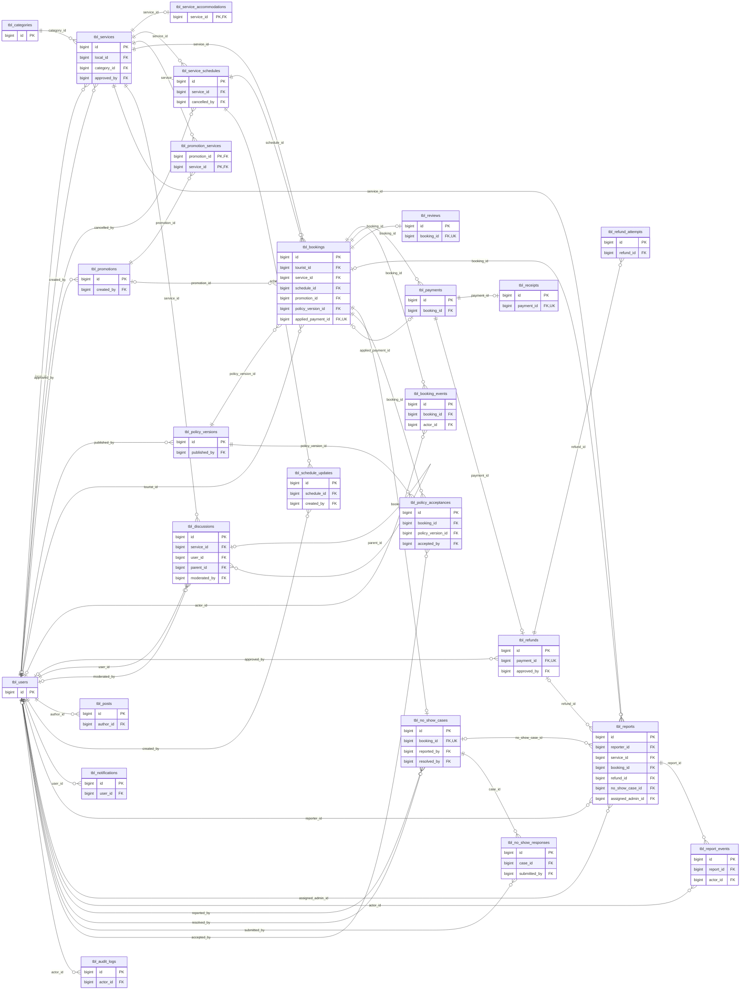

Mũi tên đi từ bảng con tới bảng cha; nhãn ghi FK và số lượng phía con : phía cha. ERD tổng hợp có đủ 25 bảng và 49 FK; góc nhìn chi tiết hiện thêm cột FK. Từ điển dữ liệu mô tả đầy đủ trường.

<a id="sec-037"></a>

## Hình 10  ERD chi tiết tour booking và thanh toán

<a id="diagram-erd_booking"></a>

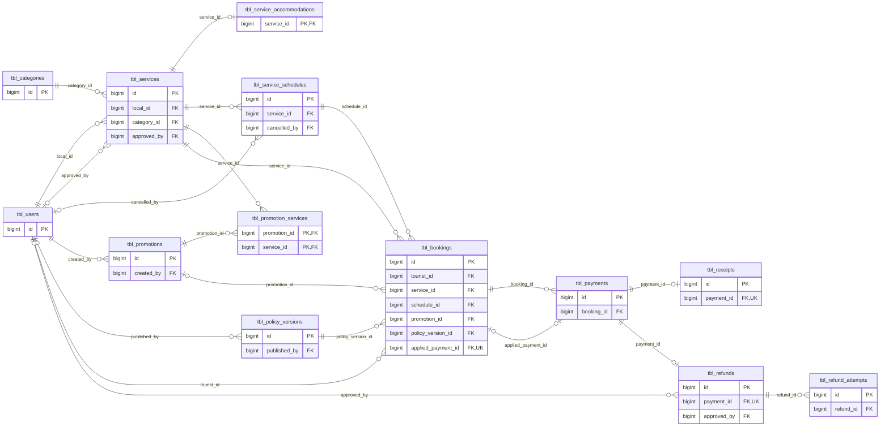

Mũi tên đi từ bảng con tới bảng cha; nhãn ghi FK và số lượng phía con : phía cha. ERD tổng hợp có đủ 25 bảng và 49 FK; góc nhìn chi tiết hiện thêm cột FK. Từ điển dữ liệu mô tả đầy đủ trường.

<a id="sec-038"></a>

## Hình 11  ERD chi tiết cộng đồng và xử lý

<a id="diagram-erd_community"></a>

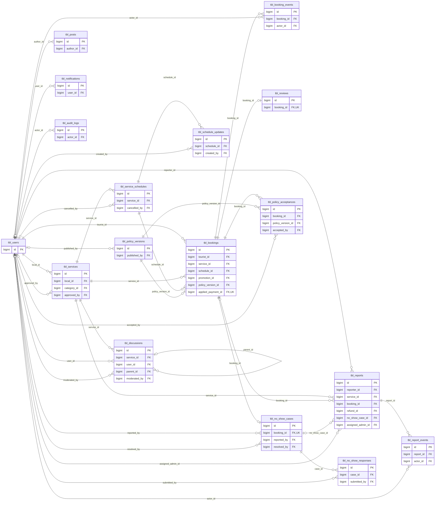

Mũi tên đi từ bảng con tới bảng cha; nhãn ghi FK và số lượng phía con : phía cha. ERD tổng hợp có đủ 25 bảng và 49 FK; góc nhìn chi tiết hiện thêm cột FK. Từ điển dữ liệu mô tả đầy đủ trường.

<a id="sec-039"></a>

## 6 2 Từ điển dữ liệu đầy đủ

PK là khóa chính, FK là khóa ngoại, UK là duy nhất. Bảng dưới mô tả nhóm trường cùng kiểu trên một dòng khi phù hợp; mỗi tên trong nhóm là một cột riêng. Các nhóm trạng thái dùng VARCHAR kèm CHECK; kiểm tra xuyên bảng/role đặt trong PROCEDURE.

<a id="sec-040"></a>

### 6 2 1 tbl_users

Tài khoản có đúng một vai trò; Host và Tourist dùng tài khoản riêng.

| Trường | Kiểu | Vai trò và điều kiện |
| --- | --- | --- |
| id | BIGINT UNSIGNED | PK |
| email | VARCHAR(254) | UK; chuẩn hóa trước khi so sánh |
| name | VARCHAR(150) | NOT NULL |
| password_hash | VARCHAR(255) | Hash do PHP tạo; không lưu mật khẩu gốc |
| role | VARCHAR(16) | tourist \| local \| admin |
| phone | VARCHAR(32) | Có thể trống |
| status | VARCHAR(16) | active \| locked |
| created_at, updated_at | DATETIME(6) | NOT NULL |

Không gộp vai trò. Admin cấp tài khoản Host riêng; tài khoản Host/Admin không được tạo booking.

Khóa tài khoản không tự hủy booking; lịch sử vẫn được bảo toàn.

<a id="sec-041"></a>

### 6 2 2 tbl_categories

Danh mục tour và trải nghiệm.

| Trường | Kiểu | Vai trò và điều kiện |
| --- | --- | --- |
| id | BIGINT UNSIGNED | PK |
| name | VARCHAR(150) | NOT NULL |
| slug | VARCHAR(180) | UK |
| description | TEXT | Có thể trống |
| status | VARCHAR(16) | active \| archived |
| created_at, updated_at | DATETIME(6) | NOT NULL |

Không xóa danh mục đã được tour tham chiếu.

<a id="sec-042"></a>

### 6 2 3 tbl_services

Nội dung và cam kết của tour, cùng chế độ giá và thanh toán.

| Trường | Kiểu | Vai trò và điều kiện |
| --- | --- | --- |
| id | BIGINT UNSIGNED | PK |
| local_id | BIGINT UNSIGNED | FK tbl_users.id; role local |
| category_id | BIGINT UNSIGNED | FK tbl_categories.id |
| title | VARCHAR(255) | NOT NULL |
| description, itinerary | TEXT | NOT NULL |
| location_name | VARCHAR(255) | NOT NULL |
| lat, lng | DECIMAL(10,7) | Có thể trống; kiểm tra miền tọa độ |
| duration_label | VARCHAR(80) | Nhãn mô tả; lịch dùng thời gian thực |
| thumbnail | VARCHAR(512) | Đường dẫn ảnh đã kiểm tra |
| payment_mode | VARCHAR(24) | free \| host_range \| fixed_choice \| prepaid_full |
| price | DECIMAL(14,0) | 0 với free; >0 với fixed_choice/prepaid_full; NULL với host_range |
| price_min, price_max | DECIMAL(14,0) | Chỉ có giá trị với host_range; 0 < min <= max |
| included_costs, excluded_costs | TEXT | Nêu rõ phạm vi giá và mua thêm tự nguyện |
| status | VARCHAR(20) | draft \| pending \| approved \| rejected \| suspended \| archived |
| approved_by | BIGINT UNSIGNED | FK tbl_users.id; nullable; Admin |
| approved_at | DATETIME(6) | Nullable |
| created_at, updated_at | DATETIME(6) | NOT NULL |

Có lưu trú => payment_mode = prepaid_full; kiểm tra xuyên bảng trong PROCEDURE.

Sau khi có booking đang chờ/còn hiệu lực, không ghi đè nội dung cam kết; thay đổi lớn tạo tour mới.

Sửa vận hành dùng tbl_schedule_updates. Tour suspended/archived ngừng nhận mới, không tự hủy lịch.

<a id="sec-043"></a>

### 6 2 4 tbl_service_accommodations

Một khối lưu trú nằm trong gói của một tour.

| Trường | Kiểu | Vai trò và điều kiện |
| --- | --- | --- |
| service_id | BIGINT UNSIGNED | PK và FK tbl_services.id |
| name | VARCHAR(255) | NOT NULL |
| address | VARCHAR(500) | NOT NULL |
| nights | SMALLINT UNSIGNED | >=1 |
| room_details, notes | TEXT | Cách bố trí phòng và lưu ý |
| created_at, updated_at | DATETIME(6) | NOT NULL |

Không có bản ghi nghĩa là tour không có lưu trú. Chưa quản lý tồn phòng theo đêm.

Không thay đổi/xóa khỏi tour có cam kết đang hiệu lực; Host bảo đảm phòng trước khi duyệt.

<a id="sec-044"></a>

### 6 2 5 tbl_service_schedules

Lịch khởi hành, hạn đăng ký và sức chứa theo người.

| Trường | Kiểu | Vai trò và điều kiện |
| --- | --- | --- |
| id | BIGINT UNSIGNED | PK |
| service_id | BIGINT UNSIGNED | FK tbl_services.id |
| starts_at, ends_at | DATETIME(6) | starts_at < ends_at |
| booking_closes_at | DATETIME(6) | <= starts_at |
| meeting_at | DATETIME(6) | Thời điểm tập trung công bố; <= starts_at |
| meeting_location | VARCHAR(500) | Địa điểm tập trung |
| capacity | INT UNSIGNED | >0 |
| status | VARCHAR(16) | open \| closed \| cancelled |
| cancelled_at | DATETIME(6) | Nullable |
| cancel_reason | TEXT | Bắt buộc khi hủy |
| cancelled_by | BIGINT UNSIGNED | FK tbl_users.id; nullable |
| created_at, updated_at | DATETIME(6) | NOT NULL |

UK(id, service_id) hỗ trợ FK ghép của booking.

Closed chỉ ngừng nhận yêu cầu mới; pending đã tạo vẫn được xét trước deadline nếu không có quyết định hủy.

Không đổi ngày giờ khi có booking hiệu lực; không hạ capacity dưới chỗ đã giữ.

<a id="sec-045"></a>

### 6 2 6 tbl_promotions

Khuyến mãi phần trăm do Admin quản lý.

| Trường | Kiểu | Vai trò và điều kiện |
| --- | --- | --- |
| id | BIGINT UNSIGNED | PK |
| created_by | BIGINT UNSIGNED | FK tbl_users.id; Admin |
| name | VARCHAR(200) | NOT NULL |
| description | TEXT | Nullable |
| discount_percent | DECIMAL(5,2) | 0 < giá trị <=90 |
| starts_at, ends_at | DATETIME(6) | starts_at < ends_at |
| status | VARCHAR(16) | active \| disabled \| archived |
| created_at, updated_at | DATETIME(6) | NOT NULL |

Chỉ gắn tour fixed_choice/prepaid_full; không giảm giá tour free/host_range.

Một booking dùng tối đa một chương trình; cao nhất trước, cùng tỷ lệ chọn id nhỏ nhất.

<a id="sec-046"></a>

### 6 2 7 tbl_promotion_services

Liên kết khuyến mãi với tour.

| Trường | Kiểu | Vai trò và điều kiện |
| --- | --- | --- |
| promotion_id | BIGINT UNSIGNED | PK ghép; FK tbl_promotions.id |
| service_id | BIGINT UNSIGNED | PK ghép; FK tbl_services.id |
| created_at | DATETIME(6) | NOT NULL |

PK(promotion_id, service_id). Có thể bỏ liên kết cho tương lai; booking cũ giữ snapshot.

<a id="sec-047"></a>

### 6 2 8 tbl_policy_versions

Các phiên bản chính sách được công bố và lưu bất biến.

| Trường | Kiểu | Vai trò và điều kiện |
| --- | --- | --- |
| id | BIGINT UNSIGNED | PK |
| version_code | VARCHAR(50) | UK |
| title | VARCHAR(200) | NOT NULL |
| content | LONGTEXT | Chính sách hủy, vắng mặt, thanh toán |
| content_hash | CHAR(64) | SHA256 nội dung chuẩn hóa |
| status | VARCHAR(16) | draft \| published \| retired |
| published_by | BIGINT UNSIGNED | FK tbl_users.id; nullable |
| published_at | DATETIME(6) | Nullable |
| created_at | DATETIME(6) | NOT NULL |

Chỉ sửa bản draft. Published không sửa nội dung; thay đổi phải công bố phiên bản mới.

Retired không dùng cho booking mới; booking cũ vẫn tra cứu và áp dụng phiên bản đã chốt.

<a id="sec-048"></a>

### 6 2 9 tbl_bookings

Yêu cầu đặt tour và toàn bộ dữ liệu cam kết đã chốt.

| Trường | Kiểu | Vai trò và điều kiện |
| --- | --- | --- |
| id | BIGINT UNSIGNED | PK |
| booking_code | VARCHAR(40) | UK |
| tourist_id | BIGINT UNSIGNED | FK tbl_users.id; role tourist |
| service_id | BIGINT UNSIGNED | FK tbl_services.id |
| schedule_id | BIGINT UNSIGNED | FK tbl_service_schedules.id; FK ghép đúng tour |
| promotion_id | BIGINT UNSIGNED | FK tbl_promotions.id; nullable |
| policy_version_id | BIGINT UNSIGNED | FK tbl_policy_versions.id |
| participant_count | INT UNSIGNED | >0; không vượt sức chứa toàn lịch |
| contact_name | VARCHAR(150) | NOT NULL |
| contact_phone | VARCHAR(32) | NOT NULL |
| message | TEXT | Nullable |
| status | VARCHAR(24) | pending \| awaiting_payment \| confirmed \| completed \| rejected \| cancelled \| expired \| no_show |
| payment_plan | VARCHAR(20) | none \| host_direct \| deposit_50 \| full_online |
| payment_mode_snapshot | VARCHAR(24) | Chế độ tour tại lúc đặt |
| unit_price, original_price | DECIMAL(14,0) | Nullable với host_range |
| discount_percent | DECIMAL(5,2) | 0 nếu không có khuyến mãi |
| discount_amount, total_price | DECIMAL(14,0) | Nullable với host_range; 0 với free |
| discount_rounding_adjustment | DECIMAL(8,4) | Chênh lệch tiền giảm sau làm tròn; giữ đủ phần lẻ |
| online_due, host_balance | DECIMAL(14,0) | 0 với free; NULL với host_range; host_balance không phải xác nhận đã thu |
| deposit_rounding_adjustment | DECIMAL(6,2) | Chênh lệch khoản 50%; thường 0 hoặc +0.50 |
| price_min_snapshot, price_max_snapshot | DECIMAL(14,0) | Chỉ dành cho host_range |
| promotion_name_snapshot | VARCHAR(200) | Nullable |
| service_title_snapshot, host_name_snapshot | VARCHAR(255) | NOT NULL |
| starts_at_snapshot, ends_at_snapshot | DATETIME(6) | NOT NULL |
| commitment_snapshot | JSON | Lịch trình, địa điểm, gồm/chưa gồm, lưu trú, điểm/giờ tập trung |
| request_expires_at, payment_expires_at | DATETIME(6) | Hạn duyệt bắt buộc; hạn trả tiền nullable |
| applied_payment_id | BIGINT UNSIGNED | FK tbl_payments.id; nullable; UK khi có giá trị |
| client_request_id | VARCHAR(80) | UK ghép với tourist_id |
| approved_at, cancelled_at, completed_at | DATETIME(6) | Nullable |
| created_at, updated_at | DATETIME(6) | NOT NULL |

UK(tourist_id, client_request_id); từ chối token lặp nhưng payload khác.

FK(schedule_id,service_id) -> tbl_service_schedules(id,service_id). applied_payment phải cùng booking, kiểm tra bằng PROCEDURE.

online_due + host_balance = total_price cho tour cố định; khoản thực thu online = online_due.

Không đổi số người, lịch, giá hoặc payment_plan sau tạo; cần hủy và đặt mới theo điều kiện.

Không sửa snapshot. Chỉ chuyển trạng thái qua thủ tục nghiệp vụ.

<a id="sec-049"></a>

### 6 2 10 tbl_booking_events

Lịch sử thay đổi trạng thái booking.

| Trường | Kiểu | Vai trò và điều kiện |
| --- | --- | --- |
| id | BIGINT UNSIGNED | PK |
| booking_id | BIGINT UNSIGNED | FK tbl_bookings.id |
| actor_id | BIGINT UNSIGNED | FK tbl_users.id; NULL với tác vụ hệ thống |
| event_key | VARCHAR(100) | UK; chống ghi lặp |
| event_type | VARCHAR(50) | approve \| expire \| cancel \| complete \| no_show... |
| from_status, to_status | VARCHAR(24) | NOT NULL |
| reason | TEXT | Nullable |
| details_json | JSON | Nullable |
| created_at | DATETIME(6) | NOT NULL |

Chỉ thêm và đọc; không sửa/xóa lịch sử.

<a id="sec-050"></a>

### 6 2 11 tbl_payments

Mỗi lần thử thu tiền online qua MoMo sandbox.

| Trường | Kiểu | Vai trò và điều kiện |
| --- | --- | --- |
| id | BIGINT UNSIGNED | PK |
| booking_id | BIGINT UNSIGNED | FK tbl_bookings.id |
| provider | VARCHAR(20) | momo |
| environment | VARCHAR(16) | sandbox |
| merchant_order_id, request_id | VARCHAR(100) | UK riêng cho từng trường |
| provider_transaction_id | VARCHAR(100) | UK(provider,environment,provider_transaction_id); nullable |
| amount | DECIMAL(14,0) | Số tiền thực thu; từ booking.online_due |
| currency | CHAR(3) | VND |
| status | VARCHAR(16) | created \| pending \| succeeded \| failed \| cancelled |
| allocation_status | VARCHAR(20) | unapplied \| applied \| needs_review |
| result_code | VARCHAR(30) | Nullable; kết quả gốc |
| request_snapshot, verified_result | JSON | Dữ liệu đã lọc khóa bí mật |
| paid_at, verified_at | DATETIME(6) | Nullable |
| created_at, updated_at | DATETIME(6) | NOT NULL |

Không lấy amount từ trình duyệt. Succeeded không bị ghi đè thành failed do thông báo cũ.

Một booking chỉ có một payment áp dụng; các khoản thu thừa xử lý riêng.

Refund không đổi payment succeeded; trạng thái hoàn được suy ra từ hồ sơ hoàn.

<a id="sec-051"></a>

### 6 2 12 tbl_receipts

Biên nhận của khoản thu online đã xác minh.

| Trường | Kiểu | Vai trò và điều kiện |
| --- | --- | --- |
| id | BIGINT UNSIGNED | PK |
| payment_id | BIGINT UNSIGNED | UK và FK tbl_payments.id |
| receipt_number | VARCHAR(50) | UK |
| amount | DECIMAL(14,0) | Bằng khoản payment đã thu |
| currency | CHAR(3) | VND |
| snapshot_json | JSON | Dữ liệu chứng từ bất biến; có nhãn SANDBOX |
| issued_at | DATETIME(6) | NOT NULL |

Chỉ phát hành cho succeeded đã verified. Không sửa/xóa hoặc đổi thành biên nhận tổng tour.

<a id="sec-052"></a>

### 6 2 13 tbl_refunds

Một nghĩa vụ hoàn toàn bộ khoản thu của một payment.

| Trường | Kiểu | Vai trò và điều kiện |
| --- | --- | --- |
| id | BIGINT UNSIGNED | PK |
| refund_code | VARCHAR(50) | UK |
| payment_id | BIGINT UNSIGNED | UK và FK tbl_payments.id |
| reason_type | VARCHAR(40) | booking_cancelled \| late_payment \| duplicate_payment \| resolved_complaint |
| reason | TEXT | NOT NULL |
| amount | DECIMAL(14,0) | Khoản đã thu cần hoàn, không vượt payment.amount |
| status | VARCHAR(20) | requested \| approved \| processing \| needs_review \| succeeded \| failed \| rejected |
| requested_at, due_at | DATETIME(6) | NOT NULL |
| approved_by | BIGINT UNSIGNED | FK tbl_users.id; nullable |
| approved_at | DATETIME(6) | Nullable |
| refund_reference | VARCHAR(100) | Mã hoàn xác minh; nullable |
| verified_at | DATETIME(6) | Nullable |
| customer_receipt_status | VARCHAR(16) | unknown \| received \| not_received |
| customer_confirmed_at | DATETIME(6) | Nullable |
| created_at, updated_at | DATETIME(6) | NOT NULL |

Bản cơ bản hoàn toàn bộ khoản online cần trả, chưa hỗ trợ hoàn từng phần tự nguyện.

Hủy có thu tiền: due_at = cancelled_at +24 giờ. Khoản thu trùng không có hủy: mốc phát hiện +24 giờ.

Quá hạn là thuộc tính suy ra; retry/duyệt không dời due_at. Nút khách không tạo lệnh chi mới.

<a id="sec-053"></a>

### 6 2 14 tbl_refund_attempts

Từng lần gửi và tra cứu một yêu cầu hoàn.

| Trường | Kiểu | Vai trò và điều kiện |
| --- | --- | --- |
| id | BIGINT UNSIGNED | PK |
| refund_id | BIGINT UNSIGNED | FK tbl_refunds.id |
| attempt_no | INT UNSIGNED | UK ghép refund_id |
| merchant_refund_order_id, request_id | VARCHAR(100) | UK riêng |
| amount | DECIMAL(14,0) | Bằng nghĩa vụ còn phải hoàn |
| status | VARCHAR(20) | prepared \| processing \| unknown \| succeeded \| failed |
| provider_refund_id | VARCHAR(100) | UK khi có giá trị |
| result_code | VARCHAR(30) | Nullable |
| request_snapshot, verified_result | JSON | Không lưu khóa bí mật |
| sent_at, checked_at, verified_at | DATETIME(6) | Nullable |
| created_at, updated_at | DATETIME(6) | NOT NULL |

Chỉ một lần chưa rõ kết quả được hoạt động cho một refund; unknown phải tra cứu trước lần mới.

Prepared được lưu trước gọi mạng; thành công không bị hạ trạng thái.

<a id="sec-054"></a>

### 6 2 15 tbl_discussions

Chủ đề và trả lời một cấp theo tour.

| Trường | Kiểu | Vai trò và điều kiện |
| --- | --- | --- |
| id | BIGINT UNSIGNED | PK |
| service_id | BIGINT UNSIGNED | FK tbl_services.id |
| user_id | BIGINT UNSIGNED | FK tbl_users.id |
| parent_id | BIGINT UNSIGNED | FK tbl_discussions.id; NULL với chủ đề |
| title | VARCHAR(255) | Chỉ chủ đề; nullable |
| content | TEXT | NOT NULL |
| visibility | VARCHAR(20) | visible \| author_hidden \| admin_hidden |
| moderation_reason | TEXT | Nullable |
| moderated_by | BIGINT UNSIGNED | FK tbl_users.id; nullable |
| created_at, updated_at | DATETIME(6) | NOT NULL |

Trả lời cùng tour, parent phải là chủ đề gốc. Không nhận trả lời mới nếu chủ đề bị ẩn.

Tác giả ẩn gốc: hiện nhãn thay nội dung, giữ trả lời hợp lệ. Admin ẩn gốc: ẩn cả nhánh công khai.

Khôi phục gốc không đổi visibility riêng của các trả lời. Admin-hidden chỉ Admin khôi phục.

<a id="sec-055"></a>

### 6 2 16 tbl_reviews

Đánh giá chuyến đi hoàn tất; một review cho một booking.

| Trường | Kiểu | Vai trò và điều kiện |
| --- | --- | --- |
| id | BIGINT UNSIGNED | PK |
| booking_id | BIGINT UNSIGNED | UK và FK tbl_bookings.id |
| rating | TINYINT UNSIGNED | 1..5 |
| comment | TEXT | Nullable |
| created_at | DATETIME(6) | NOT NULL |

Người viết suy ra từ booking. Chỉ chủ booking completed được tạo; không tự coi hết giờ là đã tham gia.

Giữ quyền báo cáo độc lập với quyền review; no_show không được review theo luồng completed.

<a id="sec-056"></a>

### 6 2 17 tbl_posts

Bài viết và cẩm nang do Admin quản lý.

| Trường | Kiểu | Vai trò và điều kiện |
| --- | --- | --- |
| id | BIGINT UNSIGNED | PK |
| author_id | BIGINT UNSIGNED | FK tbl_users.id; Admin |
| title | VARCHAR(255) | NOT NULL |
| slug | VARCHAR(255) | UK |
| content | LONGTEXT | NOT NULL |
| thumbnail | VARCHAR(512) | Nullable |
| status | VARCHAR(16) | draft \| published \| archived |
| created_at, updated_at | DATETIME(6) | NOT NULL |

Người dùng khác chỉ đọc nội dung published.

<a id="sec-057"></a>

### 6 2 18 tbl_schedule_updates

Thông báo vận hành bổ sung theo từng lịch.

| Trường | Kiểu | Vai trò và điều kiện |
| --- | --- | --- |
| id | BIGINT UNSIGNED | PK |
| schedule_id | BIGINT UNSIGNED | FK tbl_service_schedules.id |
| created_by | BIGINT UNSIGNED | FK tbl_users.id |
| update_type | VARCHAR(30) | guide \| contact \| meal_time \| emergency |
| title | VARCHAR(255) | NOT NULL |
| old_value, new_value | TEXT | Giữ cả trước và sau nếu có |
| reason | TEXT | NOT NULL |
| is_emergency | BOOLEAN | FALSE mặc định; Admin kiểm soát ngoại lệ |
| created_at | DATETIME(6) | NOT NULL |

Không dùng để đổi tuyến/giá/lưu trú đã cam kết. Thông thường phải trước starts_at -24 giờ.

Chỉ thêm và đọc; đính chính bằng bản mới; không ghi đè.

<a id="sec-058"></a>

### 6 2 19 tbl_notifications

Thông báo trong website cho một người nhận.

| Trường | Kiểu | Vai trò và điều kiện |
| --- | --- | --- |
| id | BIGINT UNSIGNED | PK |
| user_id | BIGINT UNSIGNED | FK tbl_users.id |
| event_key | VARCHAR(160) | UK ghép user_id; chống phát lặp |
| type | VARCHAR(40) | booking \| schedule_update \| refund \| no_show \| report |
| title | VARCHAR(255) | NOT NULL |
| body | TEXT | NOT NULL |
| payload_json | JSON | Mã liên quan/đường dẫn nội bộ; không là FK đa hình |
| created_at | DATETIME(6) | NOT NULL |
| read_at, archived_at | DATETIME(6) | Nullable |

Đã đọc chỉ là trạng thái UI, không phải bằng chứng khách chấp nhận thay đổi hay nhận tiền.

<a id="sec-059"></a>

### 6 2 20 tbl_reports

Hồ sơ phản ánh dịch vụ hoặc tranh chấp liên quan.

| Trường | Kiểu | Vai trò và điều kiện |
| --- | --- | --- |
| id | BIGINT UNSIGNED | PK |
| reporter_id | BIGINT UNSIGNED | FK tbl_users.id |
| service_id | BIGINT UNSIGNED | FK tbl_services.id |
| booking_id | BIGINT UNSIGNED | FK tbl_bookings.id; nullable |
| refund_id | BIGINT UNSIGNED | FK tbl_refunds.id; nullable |
| no_show_case_id | BIGINT UNSIGNED | FK tbl_no_show_cases.id; nullable |
| category | VARCHAR(30) | price \| quality \| cancellation \| refund \| no_show \| other |
| description | TEXT | NOT NULL |
| evidence_json | JSON | Tham chiếu tệp đã kiểm tra; nullable |
| status | VARCHAR(20) | open \| reviewing \| resolved \| rejected |
| assigned_admin_id | BIGINT UNSIGNED | FK tbl_users.id; nullable |
| resolution | TEXT | Nullable; bắt buộc khi kết luận |
| resolved_at | DATETIME(6) | Nullable |
| created_at, updated_at | DATETIME(6) | NOT NULL |

Các FK tùy chọn phải cùng tour/booking thực tế, kiểm tra trong PROCEDURE.

Không yêu cầu booking completed để báo cáo. Số báo cáo không tự động kết luận Host vi phạm.

<a id="sec-060"></a>

### 6 2 21 tbl_report_events

Lịch sử xử lý hồ sơ báo cáo.

| Trường | Kiểu | Vai trò và điều kiện |
| --- | --- | --- |
| id | BIGINT UNSIGNED | PK |
| report_id | BIGINT UNSIGNED | FK tbl_reports.id |
| actor_id | BIGINT UNSIGNED | FK tbl_users.id; nullable với hệ thống |
| event_type | VARCHAR(40) | submitted \| assigned \| evidence_added \| resolved \| reopened |
| content | TEXT | NOT NULL |
| evidence_json | JSON | Nullable |
| created_at | DATETIME(6) | NOT NULL |

Chỉ thêm/đọc; kết luận cũ vẫn được lưu khi xem xét lại.

<a id="sec-061"></a>

### 6 2 22 tbl_no_show_cases

Xác minh việc khách không tham gia; không tự động tịch thu tiền.

| Trường | Kiểu | Vai trò và điều kiện |
| --- | --- | --- |
| id | BIGINT UNSIGNED | PK |
| booking_id | BIGINT UNSIGNED | UK và FK tbl_bookings.id |
| reported_by | BIGINT UNSIGNED | FK tbl_users.id; Host sở hữu lịch |
| reported_at | DATETIME(6) | Sau thời điểm tập trung công bố |
| evidence_json | JSON | Căn cứ vắng mặt và việc đã thử liên hệ |
| status | VARCHAR(24) | awaiting_response \| needs_review \| resolved_no_refund \| resolved_refund \| dismissed |
| response_due_at | DATETIME(6) | reported_at +48 giờ; phải tạo thông báo cùng giao dịch |
| resolved_by | BIGINT UNSIGNED | FK tbl_users.id; nullable; Admin nếu tranh chấp/không phản hồi |
| resolution_reason | TEXT | Nullable |
| resolved_at | DATETIME(6) | Nullable |
| created_at, updated_at | DATETIME(6) | NOT NULL |

Chỉ mở cho confirmed; chặn complete khi hồ sơ chưa kết luận. Khách nhận lỗi có thể kết luận theo thỏa thuận.

Không phản hồi sau 48 giờ => needs_review; không tự suy ra có lỗi. Không tự mất quyền khiếu nại.

Khách có lỗi, Host đúng cam kết => booking no_show; payment vẫn succeeded; không tạo refund.

<a id="sec-062"></a>

### 6 2 23 tbl_no_show_responses

Phản hồi và bằng chứng của khách đối với hồ sơ vắng mặt.

| Trường | Kiểu | Vai trò và điều kiện |
| --- | --- | --- |
| id | BIGINT UNSIGNED | PK |
| case_id | BIGINT UNSIGNED | FK tbl_no_show_cases.id |
| submitted_by | BIGINT UNSIGNED | FK tbl_users.id; chủ booking |
| response_type | VARCHAR(24) | acknowledge_fault \| request_exception \| dispute |
| content | TEXT | NOT NULL |
| evidence_json | JSON | Nullable |
| is_late | BOOLEAN | Suy ra tại lúc nhận so với deadline |
| submitted_at | DATETIME(6) | NOT NULL |

Chỉ thêm/đọc. Phản hồi sau hạn vẫn ghi nhận và chuyển xem xét; không xóa phản hồi trước.

<a id="sec-063"></a>

### 6 2 24 tbl_policy_acceptances

Bằng chứng chủ động đồng ý với phiên bản chính sách.

| Trường | Kiểu | Vai trò và điều kiện |
| --- | --- | --- |
| id | BIGINT UNSIGNED | PK |
| booking_id | BIGINT UNSIGNED | FK tbl_bookings.id |
| policy_version_id | BIGINT UNSIGNED | FK tbl_policy_versions.id |
| accepted_by | BIGINT UNSIGNED | FK tbl_users.id; chủ booking |
| purpose | VARCHAR(16) | booking \| payment |
| content_hash | CHAR(64) | Hash bản chính sách đã hiển thị |
| amounts_snapshot | JSON | Tổng giá, khoản trả trước, số còn lại, điều chỉnh làm tròn |
| accepted_at | DATETIME(6) | NOT NULL |

UK(booking_id, policy_version_id, purpose). Không tích sẵn; không tạo payment nếu thiếu acceptance payment hợp lệ.

Chỉ thêm/đọc. Đồng ý không loại bỏ quyền phản ánh/khiếu nại.

<a id="sec-064"></a>

### 6 2 25 tbl_audit_logs

Nhật ký thao tác quan trọng và kiểm duyệt.

| Trường | Kiểu | Vai trò và điều kiện |
| --- | --- | --- |
| id | BIGINT UNSIGNED | PK |
| actor_id | BIGINT UNSIGNED | FK tbl_users.id; NULL với hệ thống |
| action | VARCHAR(80) | NOT NULL |
| entity_type | VARCHAR(50) | Tên loại bản ghi |
| entity_id | BIGINT UNSIGNED | Tham chiếu logic, không FK đa hình |
| event_key | VARCHAR(160) | UK |
| details_json | JSON | Bỏ dữ liệu nhạy cảm/khóa |
| created_at | DATETIME(6) | NOT NULL |

Chỉ ghi qua thủ tục nội bộ và đọc theo quyền; không sửa/xóa trong bản cơ bản.

<a id="sec-065"></a>

## 6 3 Ràng buộc liên bảng và chỉ mục

- Cặp booking(schedule_id,service_id) tham chiếu lịch(id,service_id); không nhận booking cho lịch của tour khác.

- Thêm FK applied_payment_id sau khi cả tbl_bookings và tbl_payments đã được tạo; không tắt FOREIGN_KEY_CHECKS để bỏ qua dữ liệu sai. PROCEDURE kiểm tra payment thuộc đúng booking.

- Một payment chỉ áp dụng một booking; khóa booking đảm bảo chỉ có một applied_payment_id. Trước khi áp dụng kiểm tra lại deadline dưới khóa.

- Thứ tự khóa nhất quán: lịch -> booking theo id -> payment -> refund/attempt -> lịch sử/thông báo. Các thủ tục chỉ đọc/ghi thông báo không chiếm khóa lịch.

- Chỉ mục chính: tbl_services(status,category_id), schedules(service_id,starts_at), tbl_bookings(schedule_id,status,payment_expires_at), tbl_bookings(tourist_id,created_at), tbl_bookings(status,request_expires_at).

- Thêm tbl_payments(booking_id,status), tbl_refunds(status,due_at), tbl_refund_attempts(refund_id,status), tbl_no_show_cases(status,response_due_at), tbl_notifications(user_id,read_at,created_at), tbl_reports(status,created_at).

- Thảo luận: (service_id,parent_id,created_at); khuyến mãi: (status,starts_at,ends_at); events theo FK và created_at; UK nghiệp vụ chống lặp như từ điển.

- CHECK giữ rating 1..5, phần trăm (0,90], số người/capacity dương, khoảng giá hợp lệ và thời gian đúng thứ tự. CHECK không thay thế kiểm tra xuyên bảng [S08].

<a id="sec-066"></a>

# 7 Kiến trúc lớp và tổ chức chương trình

Kiến trúc giữ Front Controller và MVC, bổ sung tầng Service để điều phối và Repository để gọi PROCEDURE. Class diagram tập trung các lớp có ảnh hưởng trực tiếp đến booking, thanh toán, hoàn tiền và xác minh vắng mặt.

<a id="sec-067"></a>

## Hình 12  Kiến trúc ứng dụng

<a id="diagram-architecture"></a>

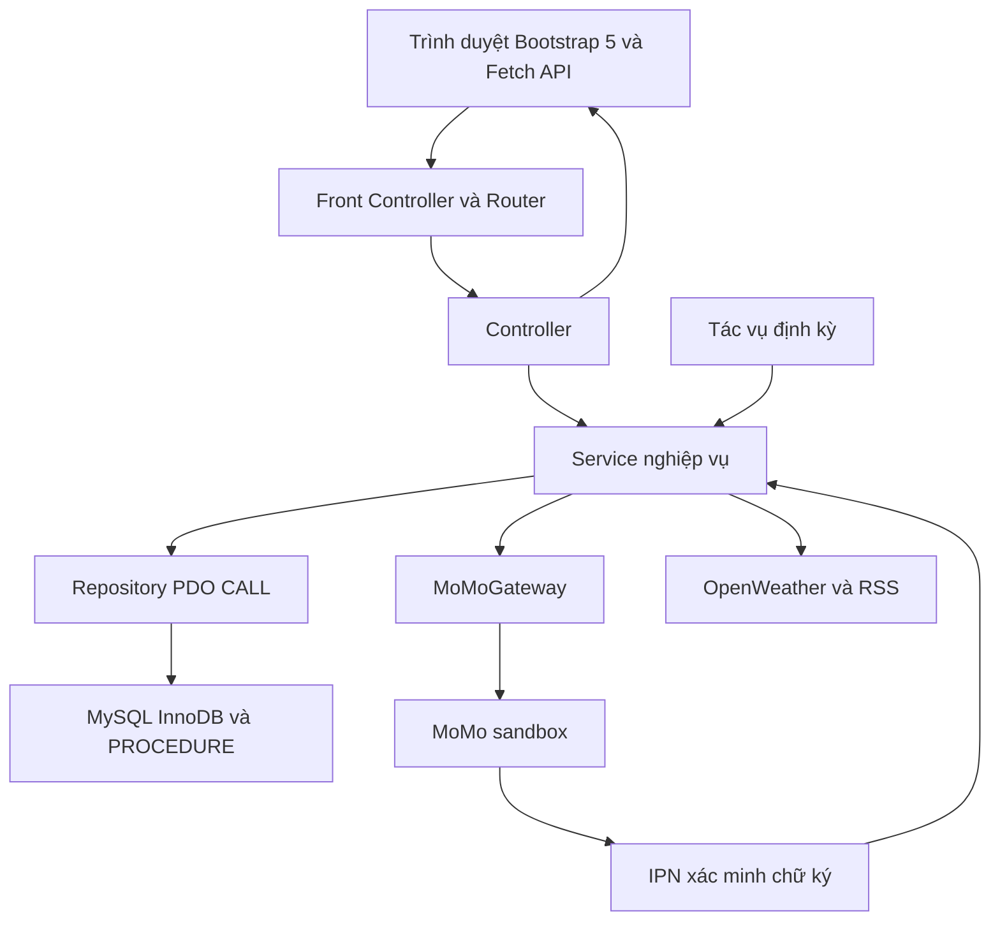

Gọi mạng không nằm trong transaction đang giữ khóa lịch hoặc booking.

<a id="sec-068"></a>

## Hình 13  Class diagram các thành phần nghiệp vụ

<a id="diagram-class"></a>

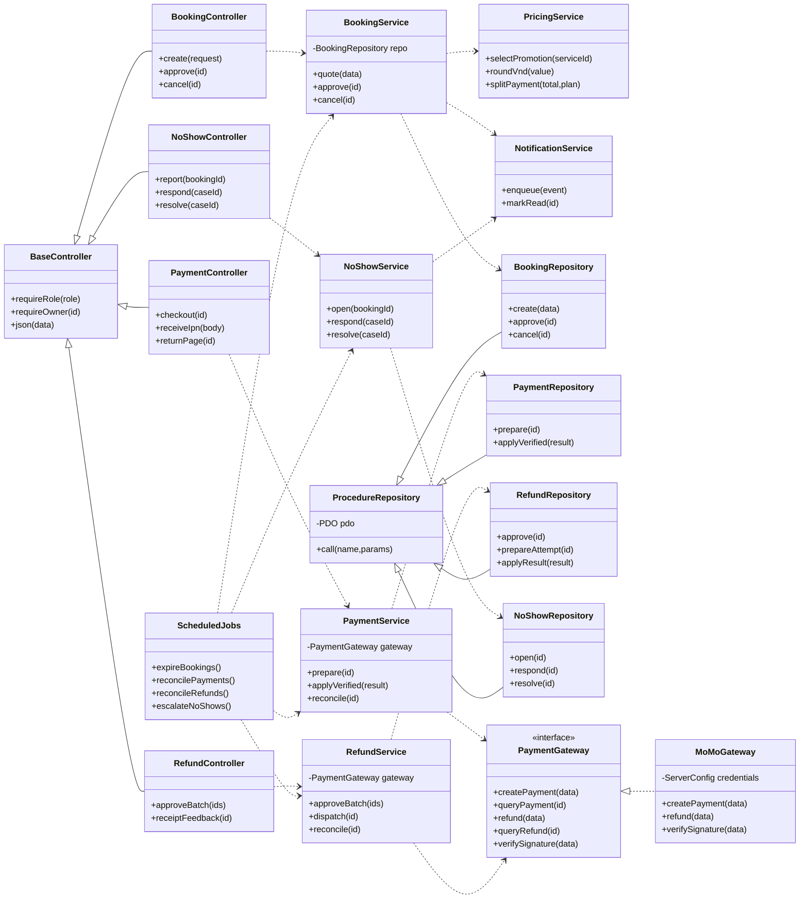

Mô tả lớp chính. Các Controller/Service/Repository còn lại áp dụng cùng cấu trúc trong cây thư mục; không dùng lớp con để gộp vai trò tài khoản.

<a id="sec-069"></a>

## 7 1 Trách nhiệm từng tầng

| Tầng | Trách nhiệm | Không thực hiện |
| --- | --- | --- |
| Controller | Parse request, session, quyền, validation hình thức, trả HTML/JSON | Không tự tính lại giá hoặc đổi booking bằng SQL rời |
| Service | Điều phối nghiệp vụ, gateway, xác minh, chọn thủ tục và xử lý lỗi | Không gọi mạng khi thủ tục đang giữ transaction |
| Repository | Gọi CALL có tham số, đọc result set, chuẩn hóa lỗi | Không dùng chuỗi SQL từ client |
| PROCEDURE | Ràng buộc dữ liệu, khóa và thay đổi nhiều bảng nguyên tử | Không thực hiện HTTP tới MoMo |
| Gateway | Ký tạo/tra cứu/hoàn và xác minh chữ ký | Không tự quyết booking đã xác nhận |
| View | Hiển thị dữ liệu đã chốt và điều khiển tương tác | Không dùng số tiền trình duyệt làm nguồn quyết định |

Mỗi Repository chuyên biệt kế thừa ProcedureRepository. PaymentGateway là interface; MoMoGateway triển khai. ScheduledJobs gọi cùng Services như request thông thường. Các lớp miền được biểu diễn bằng dữ liệu Booking, Payment, Refund và Schedule; mỗi tài khoản có một role, không dùng đa kế thừa để gộp Tourist và Host.

<a id="sec-070"></a>

## 7 2 Cây thư mục đề xuất

```text
online-traveller/
  app/
    controllers/
      AuthController.php        ServiceController.php
      ScheduleController.php    BookingController.php
      PaymentController.php     RefundController.php
      NoShowController.php      DiscussionController.php
      ReviewController.php      ReportController.php
      PromotionController.php   PolicyController.php
      NotificationController.php PostController.php
      AdminController.php
    services/
      AuthService.php           TourService.php
      BookingService.php        PricingService.php
      PaymentService.php        RefundService.php
      NoShowService.php         CommunityService.php
      ReportService.php         NotificationService.php
      PolicyService.php         ExternalInfoService.php
    repositories/
      ProcedureRepository.php
      UserRepository.php        ServiceRepository.php
      ScheduleRepository.php    BookingRepository.php
      PaymentRepository.php     RefundRepository.php
      NoShowRepository.php      DiscussionRepository.php
      ReviewRepository.php      ReportRepository.php
      PromotionRepository.php   PolicyRepository.php
      NotificationRepository.php PostRepository.php
      AuditRepository.php
    gateways/
      PaymentGateway.php        MoMoGateway.php
    models/
      Booking.php  Payment.php  Refund.php  Schedule.php
      User.php     Service.php  Report.php  NoShowCase.php
    views/
      layouts/  public/  tourist/  host/  admin/
    validators/  exceptions/  support/
  core/
    Router.php  Database.php  BaseController.php
    Auth.php    Csrf.php      Response.php
  config/
    app.php  database.php  routes.php  payment.php
  public/
    index.php
    assets/css/  assets/js/  assets/images/
  storage/
    uploads/evidence/  uploads/tours/  logs/  cache/
  database/
    migrations/
      001_tables.sql  002_foreign_keys.sql  003_indexes.sql
    procedures/
      01_accounts.sql  02_tours.sql  03_bookings.sql
      04_payments.sql  05_refunds.sql  06_community.sql
      07_reports.sql   08_policies.sql
    seeds/  grants.sql
  jobs/
    expire_bookings.php       reconcile_payments.php
    dispatch_refunds.php      reconcile_refunds.php
    escalate_no_shows.php
  tests/
    integration/  acceptance/
  composer.json  .env.example  .gitignore
```

storage nằm ngoài public; minh chứng chỉ truy cập qua route kiểm tra quyền. .env thật không đưa vào mã công khai. app/models là lớp dữ liệu miền; repositories là nơi gọi PROCEDURE, tránh trùng hai nguồn SQL.

<a id="sec-071"></a>

# 8 Thiết kế PROCEDURE và giao dịch

<a id="sec-072"></a>

## 8 1 Nguyên tắc và mức độ đặc tả

Danh mục dưới gồm 117 PROCEDURE cho đủ 25 bảng, vượt yêu cầu tối thiểu 12. Đây là đặc tả tên, tham số, quyền và hợp đồng nghiệp vụ cho triển khai; phụ lục B cung cấp ba thân SQL minh họa. Tài liệu không tuyên bố toàn bộ 117 thân thủ tục đã được triển khai hoặc chạy kiểm thử trên MySQL.

Mỗi bảng có get/list và các thao tác ghi hợp lệ. Bảng bất biến chỉ append/issue và đọc; không tạo UPDATE/DELETE giả để đủ CRUD. Bảng trạng thái dùng thao tác nghiệp vụ hoặc archive thay vì xóa lịch sử. Tất cả routine trong danh mục là PROCEDURE, không yêu cầu FUNCTION/TRIGGER để thay thế số lượng.

- Tham số p_actor_id do server lấy từ session; JSON có schema được kiểm tra theo bảng dữ liệu, không chứa lệnh SQL.

- ID dùng BIGINT UNSIGNED khi cài đặt; chữ ký rút gọn bên dưới ghi BIGINT cho dễ đọc. Các tham số liệt kê đều là IN; kết quả trả bằng result set.

- Một kết quả thành công chuẩn: id, status, changed và dữ liệu nghiệp vụ cần thiết; lỗi dùng SIGNAL SQLSTATE 45000 cùng mã miền.

- Get/list kiểm tra quyền và lọc trường nhạy cảm; các bảng lịch sử chỉ người liên quan/Admin được xem.

- Thủ tục public tự BEGIN/COMMIT với EXIT HANDLER ROLLBACK; thủ tục nội bộ kế thừa transaction không tự COMMIT. PHP không mở transaction bao ngoài CALL tự quản lý [S06].

- Không tạo PROCEDURE chung cho phép caller truyền tên bảng/cột để UPDATE tùy ý. SQL SECURITY DEFINER dùng tài khoản triển khai chuyên biệt với quyền tối thiểu.

- Mã lỗi thống nhất: NOT_FOUND, FORBIDDEN, INVALID_STATE, DEADLINE_PASSED, NOT_ENOUGH_SEATS, INVALID_AMOUNT, PAYMENT_UNRESOLVED, DUPLICATE_REQUEST, POLICY_NOT_ACCEPTED.

<a id="sec-073"></a>

## 8 2 Ma trận phủ PROCEDURE theo bảng

| Bảng | Số thủ tục | Các thao tác ghi |
| --- | --- | --- |
| tbl_users | 7 | register, create_host, update_profile, set_status, find_login |
| tbl_categories | 4 | save, archive |
| tbl_services | 7 | create, update, submit, moderate, archive |
| tbl_service_accommodations | 4 | save, remove |
| tbl_service_schedules | 6 | create, update, set_closed, cancel |
| tbl_promotions | 4 | save, set_status |
| tbl_promotion_services | 5 | attach, detach, replace |
| tbl_policy_versions | 6 | create, update_draft, publish, retire |
| tbl_bookings | 9 | quote, create, approve, reject, cancel, complete, expire_due |
| tbl_booking_events | 3 | append |
| tbl_payments | 4 | prepare, apply_verified |
| tbl_receipts | 3 | issue |
| tbl_refunds | 6 | request, approve, reject, customer_feedback |
| tbl_refund_attempts | 4 | prepare, apply_verified |
| tbl_discussions | 5 | create, edit, set_visibility |
| tbl_reviews | 3 | create |
| tbl_posts | 5 | create, update, set_status |
| tbl_schedule_updates | 3 | publish |
| tbl_notifications | 5 | enqueue, mark_read, archive |
| tbl_reports | 6 | create, assign, resolve, reopen |
| tbl_report_events | 3 | append |
| tbl_no_show_cases | 6 | open, resolve, escalate_due, reopen |
| tbl_no_show_responses | 3 | append |
| tbl_policy_acceptances | 3 | append |
| tbl_audit_logs | 3 | append |

<a id="sec-074"></a>

## 8 3 Hợp đồng chi tiết từng thủ tục

<a id="sec-075"></a>

### tbl_users

sp_users_get

```sql
(p_actor_id BIGINT, p_id BIGINT)
```

Quyền: Theo vai trò và sở hữu. Transaction: Không. Đọc một bản ghi theo quyền. Trả mã NOT_FOUND nếu không tồn tại/không được phép; không lộ hash hoặc dữ liệu riêng ra API công khai.

sp_users_list

```sql
(p_actor_id BIGINT, p_filters JSON, p_page INT, p_page_size INT)
```

Quyền: Theo vai trò và sở hữu. Transaction: Không. Danh sách có phân trang, phạm vi quyền tại server; page_size 1..100. JSON chỉ chứa bộ lọc được cho phép; không chứa SQL.

sp_users_register

```sql
(p_email VARCHAR(254), p_name VARCHAR(150), p_hash VARCHAR(255), p_phone VARCHAR(32))
```

Quyền: Công khai qua AuthController. Transaction: Có. Tạo Tourist active, chặn email trùng. PHP băm mật khẩu trước CALL; không cho client truyền role.

sp_users_create_host

```sql
(p_actor_id BIGINT, p_data JSON)
```

Quyền: Admin. Transaction: Có. Admin tạo tài khoản Host riêng, không gộp quyền với tài khoản Tourist.

sp_users_update_profile

```sql
(p_actor_id BIGINT, p_name VARCHAR(150), p_phone VARCHAR(32))
```

Quyền: Theo vai trò và sở hữu. Transaction: Có. Chỉ sửa hồ sơ của mình; không đổi role/status/email tùy ý.

sp_users_set_status

```sql
(p_actor_id BIGINT, p_target_id BIGINT, p_status VARCHAR(16), p_reason TEXT)
```

Quyền: Admin. Transaction: Có. Khóa/mở theo quyền, ghi audit; không tự hủy booking.

sp_users_find_login

```sql
(p_email VARCHAR(254))
```

Quyền: AuthService nội bộ. Transaction: Không. Trả bản ghi xác thực nội bộ gồm hash/role/status cho PHP password_verify; không đưa hash vào response.

<a id="sec-076"></a>

### tbl_categories

sp_categories_get

```sql
(p_actor_id BIGINT, p_id BIGINT)
```

Quyền: Theo vai trò và sở hữu. Transaction: Không. Đọc một bản ghi theo quyền. Trả mã NOT_FOUND nếu không tồn tại/không được phép; không lộ hash hoặc dữ liệu riêng ra API công khai.

sp_categories_list

```sql
(p_actor_id BIGINT, p_filters JSON, p_page INT, p_page_size INT)
```

Quyền: Theo vai trò và sở hữu. Transaction: Không. Danh sách có phân trang, phạm vi quyền tại server; page_size 1..100. JSON chỉ chứa bộ lọc được cho phép; không chứa SQL.

sp_categories_save

```sql
(p_actor_id BIGINT, p_id BIGINT, p_data JSON)
```

Quyền: Admin. Transaction: Có. Thêm/sửa tên, slug, mô tả; slug duy nhất.

sp_categories_archive

```sql
(p_actor_id BIGINT, p_id BIGINT)
```

Quyền: Admin. Transaction: Có. Đổi archived; không DELETE dữ liệu đang được tham chiếu.

<a id="sec-077"></a>

### tbl_services

sp_services_get

```sql
(p_actor_id BIGINT, p_id BIGINT)
```

Quyền: Theo vai trò và sở hữu. Transaction: Không. Đọc một bản ghi theo quyền. Trả mã NOT_FOUND nếu không tồn tại/không được phép; không lộ hash hoặc dữ liệu riêng ra API công khai.

sp_services_list

```sql
(p_actor_id BIGINT, p_filters JSON, p_page INT, p_page_size INT)
```

Quyền: Theo vai trò và sở hữu. Transaction: Không. Danh sách có phân trang, phạm vi quyền tại server; page_size 1..100. JSON chỉ chứa bộ lọc được cho phép; không chứa SQL.

sp_services_create

```sql
(p_actor_id BIGINT, p_data JSON)
```

Quyền: Host. Transaction: Có. Tạo draft, local_id lấy từ actor; kiểm tra bốn chế độ và giá.

sp_services_update

```sql
(p_actor_id BIGINT, p_id BIGINT, p_data JSON)
```

Quyền: Host sở hữu. Transaction: Có. Chỉ sửa trường hợp lệ; khóa nội dung cam kết khi có booking chờ/còn hiệu lực. Không đổi gói lớn bằng sửa tour approved.

sp_services_submit

```sql
(p_actor_id BIGINT, p_id BIGINT)
```

Quyền: Host sở hữu. Transaction: Có. draft/rejected -> pending nếu đủ nội dung; kiểm tra lưu trú phải prepaid_full.

sp_services_moderate

```sql
(p_actor_id BIGINT, p_id BIGINT, p_decision VARCHAR(20), p_reason TEXT)
```

Quyền: Admin. Transaction: Có. Duyệt lần đầu hoặc tạm ngừng sau xác minh vi phạm; lưu quyết định và audit. Không tự hủy lịch.

sp_services_archive

```sql
(p_actor_id BIGINT, p_id BIGINT, p_reason TEXT)
```

Quyền: Host sở hữu / Admin. Transaction: Có. Ngừng nhận mới; không xóa tour hoặc dữ liệu khách đã đặt.

<a id="sec-078"></a>

### tbl_service_accommodations

sp_service_accommodations_get

```sql
(p_actor_id BIGINT, p_service_id BIGINT)
```

Quyền: Theo vai trò và sở hữu. Transaction: Không. Đọc một bản ghi theo quyền. Trả mã NOT_FOUND nếu không tồn tại/không được phép; không lộ hash hoặc dữ liệu riêng ra API công khai.

sp_service_accommodations_list

```sql
(p_actor_id BIGINT, p_filters JSON, p_page INT, p_page_size INT)
```

Quyền: Theo vai trò và sở hữu. Transaction: Không. Danh sách có phân trang, phạm vi quyền tại server; page_size 1..100. JSON chỉ chứa bộ lọc được cho phép; không chứa SQL.

sp_service_accommodations_save

```sql
(p_actor_id BIGINT, p_service_id BIGINT, p_data JSON)
```

Quyền: Host sở hữu. Transaction: Có. Thêm/sửa khối lưu trú nếu cam kết chưa bị khóa; đòi tour prepaid_full.

sp_service_accommodations_remove

```sql
(p_actor_id BIGINT, p_service_id BIGINT)
```

Quyền: Host sở hữu. Transaction: Có. Chỉ bỏ khi không phá cam kết booking và tour còn được chỉnh; ghi audit.

<a id="sec-079"></a>

### tbl_service_schedules

sp_service_schedules_get

```sql
(p_actor_id BIGINT, p_id BIGINT)
```

Quyền: Theo vai trò và sở hữu. Transaction: Không. Đọc một bản ghi theo quyền. Trả mã NOT_FOUND nếu không tồn tại/không được phép; không lộ hash hoặc dữ liệu riêng ra API công khai.

sp_service_schedules_list

```sql
(p_actor_id BIGINT, p_filters JSON, p_page INT, p_page_size INT)
```

Quyền: Theo vai trò và sở hữu. Transaction: Không. Danh sách có phân trang, phạm vi quyền tại server; page_size 1..100. JSON chỉ chứa bộ lọc được cho phép; không chứa SQL.

sp_service_schedules_create

```sql
(p_actor_id BIGINT, p_service_id BIGINT, p_data JSON)
```

Quyền: Host sở hữu. Transaction: Có. Tạo lịch hợp lệ, capacity dương, hạn nhận không sau khởi hành.

sp_service_schedules_update

```sql
(p_actor_id BIGINT, p_id BIGINT, p_data JSON)
```

Quyền: Host sở hữu. Transaction: Có. Khóa lịch, không sửa giờ khi có booking hiệu lực; capacity không thấp hơn chỗ giữ.

sp_service_schedules_set_closed

```sql
(p_actor_id BIGINT, p_id BIGINT, p_closed BOOLEAN)
```

Quyền: Host sở hữu. Transaction: Có. Đóng/mở nhận mới nếu lịch chưa hủy/chưa kết thúc; không tự hủy pending.

sp_service_schedules_cancel

```sql
(p_actor_id BIGINT, p_id BIGINT, p_reason TEXT, p_emergency BOOLEAN)
```

Quyền: Host trước mốc / Admin. Transaction: Có. Khóa lịch rồi booking theo id; hủy các đơn còn hiệu lực, lập sự kiện/hoàn/thông báo cùng giao dịch. Sau mốc 24 giờ chỉ Admin xử lý ngoại lệ.

<a id="sec-080"></a>

### tbl_promotions

sp_promotions_get

```sql
(p_actor_id BIGINT, p_id BIGINT)
```

Quyền: Theo vai trò và sở hữu. Transaction: Không. Đọc một bản ghi theo quyền. Trả mã NOT_FOUND nếu không tồn tại/không được phép; không lộ hash hoặc dữ liệu riêng ra API công khai.

sp_promotions_list

```sql
(p_actor_id BIGINT, p_filters JSON, p_page INT, p_page_size INT)
```

Quyền: Theo vai trò và sở hữu. Transaction: Không. Danh sách có phân trang, phạm vi quyền tại server; page_size 1..100. JSON chỉ chứa bộ lọc được cho phép; không chứa SQL.

sp_promotions_save

```sql
(p_actor_id BIGINT, p_id BIGINT, p_data JSON)
```

Quyền: Admin. Transaction: Có. Tạo/sửa tên, thời gian và tỷ lệ 0 < percent <=90; booking đã chốt không bị tính lại.

sp_promotions_set_status

```sql
(p_actor_id BIGINT, p_id BIGINT, p_status VARCHAR(16))
```

Quyền: Admin. Transaction: Có. Bật, tắt hoặc archive chương trình.

<a id="sec-081"></a>

### tbl_promotion_services

sp_promotion_services_get

```sql
(p_actor_id BIGINT, p_promotion_id BIGINT, p_service_id BIGINT)
```

Quyền: Theo vai trò và sở hữu. Transaction: Không. Đọc một bản ghi theo quyền. Trả mã NOT_FOUND nếu không tồn tại/không được phép; không lộ hash hoặc dữ liệu riêng ra API công khai.

sp_promotion_services_list

```sql
(p_actor_id BIGINT, p_filters JSON, p_page INT, p_page_size INT)
```

Quyền: Theo vai trò và sở hữu. Transaction: Không. Danh sách có phân trang, phạm vi quyền tại server; page_size 1..100. JSON chỉ chứa bộ lọc được cho phép; không chứa SQL.

sp_promotion_services_attach

```sql
(p_actor_id BIGINT, p_promotion_id BIGINT, p_service_id BIGINT)
```

Quyền: Admin. Transaction: Có. Thêm liên kết; chỉ tour fixed_choice/prepaid_full; lặp cùng cặp là không đổi.

sp_promotion_services_detach

```sql
(p_actor_id BIGINT, p_promotion_id BIGINT, p_service_id BIGINT)
```

Quyền: Admin. Transaction: Có. Bỏ áp dụng tương lai; không xóa snapshot booking.

sp_promotion_services_replace

```sql
(p_actor_id BIGINT, p_promotion_id BIGINT, p_service_ids JSON)
```

Quyền: Admin. Transaction: Có. Thay danh sách tour áp dụng trong một transaction; validate toàn bộ trước thay đổi.

<a id="sec-082"></a>

### tbl_policy_versions

sp_policy_versions_get

```sql
(p_actor_id BIGINT, p_id BIGINT)
```

Quyền: Theo vai trò và sở hữu. Transaction: Không. Đọc một bản ghi theo quyền. Trả mã NOT_FOUND nếu không tồn tại/không được phép; không lộ hash hoặc dữ liệu riêng ra API công khai.

sp_policy_versions_list

```sql
(p_actor_id BIGINT, p_filters JSON, p_page INT, p_page_size INT)
```

Quyền: Theo vai trò và sở hữu. Transaction: Không. Danh sách có phân trang, phạm vi quyền tại server; page_size 1..100. JSON chỉ chứa bộ lọc được cho phép; không chứa SQL.

sp_policy_versions_create

```sql
(p_actor_id BIGINT, p_version_code VARCHAR(50), p_title VARCHAR(200), p_content LONGTEXT)
```

Quyền: Admin. Transaction: Có. Tạo draft chính sách, mã phiên bản duy nhất.

sp_policy_versions_update_draft

```sql
(p_actor_id BIGINT, p_id BIGINT, p_content LONGTEXT)
```

Quyền: Admin. Transaction: Có. Chỉ sửa draft; không sửa nội dung đã công bố.

sp_policy_versions_publish

```sql
(p_actor_id BIGINT, p_id BIGINT)
```

Quyền: Admin. Transaction: Có. Công bố, lưu hash và thời điểm; phiên bản mới dùng cho booking mới.

sp_policy_versions_retire

```sql
(p_actor_id BIGINT, p_id BIGINT)
```

Quyền: Admin. Transaction: Có. Ngừng dùng cho booking mới; giữ đọc và áp dụng booking cũ.

<a id="sec-083"></a>

### tbl_bookings

sp_bookings_get

```sql
(p_actor_id BIGINT, p_id BIGINT)
```

Quyền: Theo vai trò và sở hữu. Transaction: Không. Đọc một bản ghi theo quyền. Trả mã NOT_FOUND nếu không tồn tại/không được phép; không lộ hash hoặc dữ liệu riêng ra API công khai.

sp_bookings_list

```sql
(p_actor_id BIGINT, p_filters JSON, p_page INT, p_page_size INT)
```

Quyền: Theo vai trò và sở hữu. Transaction: Không. Danh sách có phân trang, phạm vi quyền tại server; page_size 1..100. JSON chỉ chứa bộ lọc được cho phép; không chứa SQL.

sp_bookings_quote

```sql
(p_actor_id BIGINT, p_service_id BIGINT, p_schedule_id BIGINT, p_count INT, p_plan VARCHAR(20))
```

Quyền: Tourist. Transaction: Không. Báo giá phía server, chọn khuyến mãi, kiểm tra cổng; chưa tạo/giữ chỗ. Khi tạo phải tính lại và yêu cầu xác nhận nếu giá đổi.

sp_bookings_create

```sql
(p_actor_id BIGINT, p_data JSON, p_client_request_id VARCHAR(80))
```

Quyền: Tourist. Transaction: Có. Tạo pending, snapshot giá/nội dung/chính sách, deadline và acceptance booking. Chặn lặp token khác payload; không tin số tiền client.

sp_bookings_approve

```sql
(p_actor_id BIGINT, p_booking_id BIGINT)
```

Quyền: Host sở hữu. Transaction: Có. Khóa lịch rồi booking; kiểm tra chủ tour, deadline, trạng thái và chỗ. Free/range -> confirmed; còn lại -> awaiting_payment, cấp hạn 15 phút.

sp_bookings_reject

```sql
(p_actor_id BIGINT, p_booking_id BIGINT, p_reason TEXT)
```

Quyền: Host sở hữu. Transaction: Có. Chỉ pending chưa hết hạn; từ chối có lý do, ghi event và thông báo.

sp_bookings_cancel

```sql
(p_actor_id BIGINT, p_booking_id BIGINT, p_reason TEXT, p_case_type VARCHAR(30))
```

Quyền: Tourist đúng điều kiện / Host / Admin. Transaction: Có. Kiểm tra mốc 24 giờ/ngoại lệ; hủy, giải phóng chỗ, tạo nghĩa vụ hoàn nếu có. Lệnh hủy lặp không tạo nghĩa vụ trùng.

sp_bookings_complete

```sql
(p_actor_id BIGINT, p_booking_id BIGINT)
```

Quyền: Host sở hữu. Transaction: Có. Sau ends_at, confirmed và đã xác nhận tham gia; không có hồ sơ vắng mặt chưa kết luận. Không dựa riêng vào hết giờ.

sp_bookings_expire_due

```sql
(p_batch_size INT)
```

Quyền: ScheduledJobs nội bộ. Transaction: Có. Xử lý pending/awaiting_payment quá hạn theo từng transaction nhỏ; khóa lịch trước booking, ghi event/thông báo một lần.

<a id="sec-084"></a>

### tbl_booking_events

sp_booking_events_get

```sql
(p_actor_id BIGINT, p_id BIGINT)
```

Quyền: Theo vai trò và sở hữu. Transaction: Không. Đọc một bản ghi theo quyền. Trả mã NOT_FOUND nếu không tồn tại/không được phép; không lộ hash hoặc dữ liệu riêng ra API công khai.

sp_booking_events_list

```sql
(p_actor_id BIGINT, p_filters JSON, p_page INT, p_page_size INT)
```

Quyền: Theo vai trò và sở hữu. Transaction: Không. Danh sách có phân trang, phạm vi quyền tại server; page_size 1..100. JSON chỉ chứa bộ lọc được cho phép; không chứa SQL.

sp_booking_events_append

```sql
(p_actor_id BIGINT, p_booking_id BIGINT, p_event_key VARCHAR(100), p_data JSON)
```

Quyền: Thủ tục nghiệp vụ nội bộ. Transaction: Kế thừa. Thêm bất biến; nội bộ cùng transaction đổi booking, không COMMIT riêng.

<a id="sec-085"></a>

### tbl_payments

sp_payments_get

```sql
(p_actor_id BIGINT, p_id BIGINT)
```

Quyền: Theo vai trò và sở hữu. Transaction: Không. Đọc một bản ghi theo quyền. Trả mã NOT_FOUND nếu không tồn tại/không được phép; không lộ hash hoặc dữ liệu riêng ra API công khai.

sp_payments_list

```sql
(p_actor_id BIGINT, p_filters JSON, p_page INT, p_page_size INT)
```

Quyền: Theo vai trò và sở hữu. Transaction: Không. Danh sách có phân trang, phạm vi quyền tại server; page_size 1..100. JSON chỉ chứa bộ lọc được cho phép; không chứa SQL.

sp_payments_prepare

```sql
(p_actor_id BIGINT, p_booking_id BIGINT, p_acceptance_id BIGINT)
```

Quyền: Tourist. Transaction: Có. Khóa booking/lịch; đúng chủ, awaiting_payment còn hạn, acceptance hợp lệ và chưa có lần chưa rõ; tạo payment amount=online_due.

sp_payments_apply_verified

```sql
(p_payment_id BIGINT, p_verified_result JSON)
```

Quyền: PaymentService sau xác minh. Transaction: Có. Chỉ nhận kết quả đã xác minh backend; khóa lịch rồi booking/payment; cập nhật một lần, áp dụng hoặc needs_review, phát biên nhận; thu muộn/trùng lập nghĩa vụ hoàn khi đủ căn cứ.

<a id="sec-086"></a>

### tbl_receipts

sp_receipts_get

```sql
(p_actor_id BIGINT, p_id BIGINT)
```

Quyền: Theo vai trò và sở hữu. Transaction: Không. Đọc một bản ghi theo quyền. Trả mã NOT_FOUND nếu không tồn tại/không được phép; không lộ hash hoặc dữ liệu riêng ra API công khai.

sp_receipts_list

```sql
(p_actor_id BIGINT, p_filters JSON, p_page INT, p_page_size INT)
```

Quyền: Theo vai trò và sở hữu. Transaction: Không. Danh sách có phân trang, phạm vi quyền tại server; page_size 1..100. JSON chỉ chứa bộ lọc được cho phép; không chứa SQL.

sp_receipts_issue

```sql
(p_payment_id BIGINT)
```

Quyền: Thanh toán nội bộ. Transaction: Kế thừa. Phát hành một lần từ payment succeeded đã verified; amount=payment.amount; không COMMIT riêng.

<a id="sec-087"></a>

### tbl_refunds

sp_refunds_get

```sql
(p_actor_id BIGINT, p_id BIGINT)
```

Quyền: Theo vai trò và sở hữu. Transaction: Không. Đọc một bản ghi theo quyền. Trả mã NOT_FOUND nếu không tồn tại/không được phép; không lộ hash hoặc dữ liệu riêng ra API công khai.

sp_refunds_list

```sql
(p_actor_id BIGINT, p_filters JSON, p_page INT, p_page_size INT)
```

Quyền: Theo vai trò và sở hữu. Transaction: Không. Danh sách có phân trang, phạm vi quyền tại server; page_size 1..100. JSON chỉ chứa bộ lọc được cho phép; không chứa SQL.

sp_refunds_request

```sql
(p_actor_id BIGINT, p_payment_id BIGINT, p_reason_type VARCHAR(40), p_reason TEXT)
```

Quyền: Nghiệp vụ nội bộ. Transaction: Kế thừa. Tạo một nghĩa vụ cho payment, tính mốc xử lý, chặn trùng; được gọi cùng transaction hủy/kết luận.

sp_refunds_approve

```sql
(p_actor_id BIGINT, p_refund_id BIGINT)
```

Quyền: Admin. Transaction: Có. Admin kiểm tra khoản thực thu/chưa hoàn và duyệt; lặp cùng trạng thái là không đổi. Danh sách duyệt gọi từng hồ sơ có kết quả riêng.

sp_refunds_reject

```sql
(p_actor_id BIGINT, p_refund_id BIGINT, p_reason TEXT)
```

Quyền: Admin. Transaction: Có. Chỉ hồ sơ chưa thực hiện và có căn cứ; không xóa quyền phản ánh.

sp_refunds_customer_feedback

```sql
(p_actor_id BIGINT, p_refund_id BIGINT, p_feedback VARCHAR(20), p_content TEXT)
```

Quyền: Tourist sở hữu. Transaction: Có. Chủ booking xác nhận received hoặc yêu cầu kiểm tra sau hạn; ghi phản hồi/báo cáo và thông báo, không phát lệnh hoàn mới.

<a id="sec-088"></a>

### tbl_refund_attempts

sp_refund_attempts_get

```sql
(p_actor_id BIGINT, p_id BIGINT)
```

Quyền: Theo vai trò và sở hữu. Transaction: Không. Đọc một bản ghi theo quyền. Trả mã NOT_FOUND nếu không tồn tại/không được phép; không lộ hash hoặc dữ liệu riêng ra API công khai.

sp_refund_attempts_list

```sql
(p_actor_id BIGINT, p_filters JSON, p_page INT, p_page_size INT)
```

Quyền: Theo vai trò và sở hữu. Transaction: Không. Danh sách có phân trang, phạm vi quyền tại server; page_size 1..100. JSON chỉ chứa bộ lọc được cho phép; không chứa SQL.

sp_refund_attempts_prepare

```sql
(p_refund_id BIGINT)
```

Quyền: RefundService nội bộ. Transaction: Có. Tạo mã hoàn duy nhất sau approve; chặn prepared/processing/unknown còn hiệu lực; đánh dấu processing trước khi gọi mạng.

sp_refund_attempts_apply_verified

```sql
(p_attempt_id BIGINT, p_verified_result JSON)
```

Quyền: RefundService sau xác minh. Transaction: Có. Ghi kết quả xác minh; cập nhật nghĩa vụ, mã tham chiếu và thông báo. Unknown yêu cầu tra cứu, không tự tạo mã mới.

<a id="sec-089"></a>

### tbl_discussions

sp_discussions_get

```sql
(p_actor_id BIGINT, p_id BIGINT)
```

Quyền: Theo vai trò và sở hữu. Transaction: Không. Đọc một bản ghi theo quyền. Trả mã NOT_FOUND nếu không tồn tại/không được phép; không lộ hash hoặc dữ liệu riêng ra API công khai.

sp_discussions_list

```sql
(p_actor_id BIGINT, p_filters JSON, p_page INT, p_page_size INT)
```

Quyền: Theo vai trò và sở hữu. Transaction: Không. Danh sách có phân trang, phạm vi quyền tại server; page_size 1..100. JSON chỉ chứa bộ lọc được cho phép; không chứa SQL.

sp_discussions_create

```sql
(p_actor_id BIGINT, p_service_id BIGINT, p_parent_id BIGINT, p_title VARCHAR(255), p_content TEXT)
```

Quyền: Theo vai trò và sở hữu. Transaction: Có. Thành viên active; nếu trả lời phải cùng tour, parent gốc visible; chỉ một cấp.

sp_discussions_edit

```sql
(p_actor_id BIGINT, p_id BIGINT, p_content TEXT)
```

Quyền: Theo vai trò và sở hữu. Transaction: Có. Chỉ tác giả; không tự phục hồi admin_hidden sau sửa. Ghi audit.

sp_discussions_set_visibility

```sql
(p_actor_id BIGINT, p_id BIGINT, p_action VARCHAR(24), p_reason TEXT)
```

Quyền: Theo vai trò và sở hữu. Transaction: Có. Tác giả tự ẩn/khôi phục author_hidden; Admin kiểm duyệt/khôi phục admin_hidden; không đổi trạng thái riêng của con.

<a id="sec-090"></a>

### tbl_reviews

sp_reviews_get

```sql
(p_actor_id BIGINT, p_id BIGINT)
```

Quyền: Theo vai trò và sở hữu. Transaction: Không. Đọc một bản ghi theo quyền. Trả mã NOT_FOUND nếu không tồn tại/không được phép; không lộ hash hoặc dữ liệu riêng ra API công khai.

sp_reviews_list

```sql
(p_actor_id BIGINT, p_filters JSON, p_page INT, p_page_size INT)
```

Quyền: Theo vai trò và sở hữu. Transaction: Không. Danh sách có phân trang, phạm vi quyền tại server; page_size 1..100. JSON chỉ chứa bộ lọc được cho phép; không chứa SQL.

sp_reviews_create

```sql
(p_actor_id BIGINT, p_booking_id BIGINT, p_rating TINYINT, p_comment TEXT)
```

Quyền: Tourist. Transaction: Có. Chỉ chủ booking completed, rating 1..5 và chưa có review. UNIQUE chặn gửi lặp.

<a id="sec-091"></a>

### tbl_posts

sp_posts_get

```sql
(p_actor_id BIGINT, p_id BIGINT)
```

Quyền: Theo vai trò và sở hữu. Transaction: Không. Đọc một bản ghi theo quyền. Trả mã NOT_FOUND nếu không tồn tại/không được phép; không lộ hash hoặc dữ liệu riêng ra API công khai.

sp_posts_list

```sql
(p_actor_id BIGINT, p_filters JSON, p_page INT, p_page_size INT)
```

Quyền: Theo vai trò và sở hữu. Transaction: Không. Danh sách có phân trang, phạm vi quyền tại server; page_size 1..100. JSON chỉ chứa bộ lọc được cho phép; không chứa SQL.

sp_posts_create

```sql
(p_actor_id BIGINT, p_data JSON)
```

Quyền: Admin. Transaction: Có. Tạo bài draft, slug duy nhất.

sp_posts_update

```sql
(p_actor_id BIGINT, p_id BIGINT, p_data JSON)
```

Quyền: Admin. Transaction: Có. Cập nhật nội dung, giữ author và lịch sử thao tác.

sp_posts_set_status

```sql
(p_actor_id BIGINT, p_id BIGINT, p_status VARCHAR(16))
```

Quyền: Admin. Transaction: Có. Xuất bản/thu hồi/archive; không DELETE tùy ý.

<a id="sec-092"></a>

### tbl_schedule_updates

sp_schedule_updates_get

```sql
(p_actor_id BIGINT, p_id BIGINT)
```

Quyền: Theo vai trò và sở hữu. Transaction: Không. Đọc một bản ghi theo quyền. Trả mã NOT_FOUND nếu không tồn tại/không được phép; không lộ hash hoặc dữ liệu riêng ra API công khai.

sp_schedule_updates_list

```sql
(p_actor_id BIGINT, p_filters JSON, p_page INT, p_page_size INT)
```

Quyền: Theo vai trò và sở hữu. Transaction: Không. Danh sách có phân trang, phạm vi quyền tại server; page_size 1..100. JSON chỉ chứa bộ lọc được cho phép; không chứa SQL.

sp_schedule_updates_publish

```sql
(p_actor_id BIGINT, p_schedule_id BIGINT, p_data JSON)
```

Quyền: Host sở hữu / Admin. Transaction: Có. Kiểm tra loại thay đổi, mốc 24 giờ/ngoại lệ; thêm lịch sử, tạo thông báo theo các booking liên quan, không sửa snapshot.

<a id="sec-093"></a>

### tbl_notifications

sp_notifications_get

```sql
(p_actor_id BIGINT, p_id BIGINT)
```

Quyền: Theo vai trò và sở hữu. Transaction: Không. Đọc một bản ghi theo quyền. Trả mã NOT_FOUND nếu không tồn tại/không được phép; không lộ hash hoặc dữ liệu riêng ra API công khai.

sp_notifications_list

```sql
(p_actor_id BIGINT, p_filters JSON, p_page INT, p_page_size INT)
```

Quyền: Theo vai trò và sở hữu. Transaction: Không. Danh sách có phân trang, phạm vi quyền tại server; page_size 1..100. JSON chỉ chứa bộ lọc được cho phép; không chứa SQL.

sp_notifications_enqueue

```sql
(p_user_id BIGINT, p_event_key VARCHAR(160), p_data JSON)
```

Quyền: Nội bộ. Transaction: Kế thừa. Thêm một lần theo UK(user_id,event_key), nằm trong transaction nghiệp vụ.

sp_notifications_mark_read

```sql
(p_actor_id BIGINT, p_id BIGINT)
```

Quyền: Theo vai trò và sở hữu. Transaction: Có. Chỉ người nhận; ghi read_at nếu chưa đọc. Không đổi bất cứ quyền hay trạng thái tiền nào.

sp_notifications_archive

```sql
(p_actor_id BIGINT, p_id BIGINT)
```

Quyền: Theo vai trò và sở hữu. Transaction: Có. Chỉ người nhận, ghi archived_at; không xóa hồ sơ nguồn.

<a id="sec-094"></a>

### tbl_reports

sp_reports_get

```sql
(p_actor_id BIGINT, p_id BIGINT)
```

Quyền: Theo vai trò và sở hữu. Transaction: Không. Đọc một bản ghi theo quyền. Trả mã NOT_FOUND nếu không tồn tại/không được phép; không lộ hash hoặc dữ liệu riêng ra API công khai.

sp_reports_list

```sql
(p_actor_id BIGINT, p_filters JSON, p_page INT, p_page_size INT)
```

Quyền: Theo vai trò và sở hữu. Transaction: Không. Danh sách có phân trang, phạm vi quyền tại server; page_size 1..100. JSON chỉ chứa bộ lọc được cho phép; không chứa SQL.

sp_reports_create

```sql
(p_actor_id BIGINT, p_data JSON)
```

Quyền: Theo vai trò và sở hữu. Transaction: Có. Tạo phản ánh, kiểm tra FK cùng tour; không đòi completed; thêm event và thông báo.

sp_reports_assign

```sql
(p_actor_id BIGINT, p_id BIGINT, p_admin_id BIGINT)
```

Quyền: Admin. Transaction: Có. Phân công xử lý cho Admin active, ghi event.

sp_reports_resolve

```sql
(p_actor_id BIGINT, p_id BIGINT, p_decision VARCHAR(20), p_reason TEXT)
```

Quyền: Admin. Transaction: Có. Kết luận có căn cứ; thao tác hủy/hoàn/khóa liên quan gọi đúng nghiệp vụ; không tự xử chỉ vì số báo cáo.

sp_reports_reopen

```sql
(p_actor_id BIGINT, p_id BIGINT, p_reason TEXT)
```

Quyền: Admin. Transaction: Có. Xem xét lại khi có căn cứ/bằng chứng; không ghi đè kết luận cũ.

<a id="sec-095"></a>

### tbl_report_events

sp_report_events_get

```sql
(p_actor_id BIGINT, p_id BIGINT)
```

Quyền: Theo vai trò và sở hữu. Transaction: Không. Đọc một bản ghi theo quyền. Trả mã NOT_FOUND nếu không tồn tại/không được phép; không lộ hash hoặc dữ liệu riêng ra API công khai.

sp_report_events_list

```sql
(p_actor_id BIGINT, p_filters JSON, p_page INT, p_page_size INT)
```

Quyền: Theo vai trò và sở hữu. Transaction: Không. Danh sách có phân trang, phạm vi quyền tại server; page_size 1..100. JSON chỉ chứa bộ lọc được cho phép; không chứa SQL.

sp_report_events_append

```sql
(p_actor_id BIGINT, p_report_id BIGINT, p_data JSON)
```

Quyền: Người liên quan theo quyền / nội bộ. Transaction: Kế thừa. Ghi diễn biến/bằng chứng bổ sung; không COMMIT riêng khi gọi từ reports.

<a id="sec-096"></a>

### tbl_no_show_cases

sp_no_show_cases_get

```sql
(p_actor_id BIGINT, p_id BIGINT)
```

Quyền: Theo vai trò và sở hữu. Transaction: Không. Đọc một bản ghi theo quyền. Trả mã NOT_FOUND nếu không tồn tại/không được phép; không lộ hash hoặc dữ liệu riêng ra API công khai.

sp_no_show_cases_list

```sql
(p_actor_id BIGINT, p_filters JSON, p_page INT, p_page_size INT)
```

Quyền: Theo vai trò và sở hữu. Transaction: Không. Danh sách có phân trang, phạm vi quyền tại server; page_size 1..100. JSON chỉ chứa bộ lọc được cho phép; không chứa SQL.

sp_no_show_cases_open

```sql
(p_actor_id BIGINT, p_booking_id BIGINT, p_evidence JSON)
```

Quyền: Host sở hữu. Transaction: Có. Host đúng sở hữu, booking confirmed, sau giờ tập trung; tạo hồ sơ và thông báo cùng giao dịch, response_due_at=reported_at+48 giờ.

sp_no_show_cases_resolve

```sql
(p_actor_id BIGINT, p_case_id BIGINT, p_decision VARCHAR(24), p_reason TEXT)
```

Quyền: Admin / nghiệp vụ xác nhận nhận lỗi. Transaction: Có. Xác minh điều kiện: no_refund -> booking no_show; refund -> cancelled + nghĩa vụ hoàn; dismissed giữ quyền khách. Khách nhận lỗi được xử theo chính sách; tranh chấp/im lặng do Admin xét.

sp_no_show_cases_escalate_due

```sql
(p_batch_size INT)
```

Quyền: ScheduledJobs nội bộ. Transaction: Có. Hết 48 giờ chưa phản hồi thì needs_review và thông báo Admin; không kết luận lỗi khách.

sp_no_show_cases_reopen

```sql
(p_actor_id BIGINT, p_case_id BIGINT, p_report_id BIGINT, p_reason TEXT)
```

Quyền: Admin. Transaction: Có. Admin tiếp nhận căn cứ mới, chuyển needs_review và giữ lịch sử qua báo cáo/audit. Nếu kết luận cũ sai, chỉ Admin được chuyển no_show về confirmed hoặc cancelled theo quyết định có căn cứ.

<a id="sec-097"></a>

### tbl_no_show_responses

sp_no_show_responses_get

```sql
(p_actor_id BIGINT, p_id BIGINT)
```

Quyền: Theo vai trò và sở hữu. Transaction: Không. Đọc một bản ghi theo quyền. Trả mã NOT_FOUND nếu không tồn tại/không được phép; không lộ hash hoặc dữ liệu riêng ra API công khai.

sp_no_show_responses_list

```sql
(p_actor_id BIGINT, p_filters JSON, p_page INT, p_page_size INT)
```

Quyền: Theo vai trò và sở hữu. Transaction: Không. Danh sách có phân trang, phạm vi quyền tại server; page_size 1..100. JSON chỉ chứa bộ lọc được cho phép; không chứa SQL.

sp_no_show_responses_append

```sql
(p_actor_id BIGINT, p_case_id BIGINT, p_data JSON)
```

Quyền: Tourist sở hữu. Transaction: Có. Chỉ chủ booking; lưu nhận lỗi/xin ngoại lệ/tranh chấp, minh chứng và cờ trễ. Phản hồi muộn vẫn được lưu.

<a id="sec-098"></a>

### tbl_policy_acceptances

sp_policy_acceptances_get

```sql
(p_actor_id BIGINT, p_id BIGINT)
```

Quyền: Theo vai trò và sở hữu. Transaction: Không. Đọc một bản ghi theo quyền. Trả mã NOT_FOUND nếu không tồn tại/không được phép; không lộ hash hoặc dữ liệu riêng ra API công khai.

sp_policy_acceptances_list

```sql
(p_actor_id BIGINT, p_filters JSON, p_page INT, p_page_size INT)
```

Quyền: Theo vai trò và sở hữu. Transaction: Không. Danh sách có phân trang, phạm vi quyền tại server; page_size 1..100. JSON chỉ chứa bộ lọc được cho phép; không chứa SQL.

sp_policy_acceptances_append

```sql
(p_actor_id BIGINT, p_booking_id BIGINT, p_purpose VARCHAR(16), p_content_hash CHAR(64))
```

Quyền: Tourist sở hữu. Transaction: Có. Chỉ chủ booking, đúng phiên bản đã hiển thị; số tiền snapshot lấy từ server. Chặn tích sẵn/gửi thiếu xác nhận; dùng lại chỉ khi nội dung và số tiền không đổi.

<a id="sec-099"></a>

### tbl_audit_logs

sp_audit_logs_get

```sql
(p_actor_id BIGINT, p_id BIGINT)
```

Quyền: Theo vai trò và sở hữu. Transaction: Không. Đọc một bản ghi theo quyền. Trả mã NOT_FOUND nếu không tồn tại/không được phép; không lộ hash hoặc dữ liệu riêng ra API công khai.

sp_audit_logs_list

```sql
(p_actor_id BIGINT, p_filters JSON, p_page INT, p_page_size INT)
```

Quyền: Theo vai trò và sở hữu. Transaction: Không. Danh sách có phân trang, phạm vi quyền tại server; page_size 1..100. JSON chỉ chứa bộ lọc được cho phép; không chứa SQL.

sp_audit_logs_append

```sql
(p_actor_id BIGINT, p_event_key VARCHAR(160), p_action VARCHAR(80), p_entity_type VARCHAR(50), p_entity_id BIGINT, p_details JSON)
```

Quyền: Nội bộ. Transaction: Kế thừa. Ghi một lần và lọc khóa/thông tin nhạy cảm; chỉ thủ tục nội bộ, không COMMIT riêng.

<a id="sec-100"></a>

## 8 4 Thuật toán nguyên tử quan trọng

Ví dụ duyệt dùng READ COMMITTED để phép tổng hợp sức chứa đọc dữ liệu đã commit sau khi lấy khóa lịch [S17]. Luôn lấy thời gian kiểm tra sau khi đã chờ khóa, tránh dùng mốc cũ để duyệt quá hạn. Có thể chọn isolation khác khi triển khai nếu vẫn chứng minh được current read và khóa đúng trên mọi đường thay đổi chỗ.

| Nghiệp vụ | Khóa và thay đổi cùng transaction |
| --- | --- |
| Tạo booking | Khóa dữ liệu tour/lịch đủ để đọc snapshot nhất quán, kiểm tra chính sách/khuyến mãi; tạo booking và acceptance; không giữ chỗ pending. |
| Duyệt | Lịch -> booking; kiểm tra hạn/chỗ; cập nhật trạng thái, event, notification, audit. |
| Áp dụng payment | Lịch -> booking -> payment; xác minh kết quả đã qua backend; áp dụng một lần hoặc needs_review, receipt và nghĩa vụ hoàn khi cần. |
| Hủy lịch | Lịch -> các booking theo id -> các payment liên quan; hủy, refund request, event, notification; không gọi mạng. |
| Hoàn tiền | Chuẩn bị attempt và commit; gọi mạng; transaction ngắn khác ghi kết quả. Unknown tra cứu lại cùng yêu cầu. |
| Xác minh vắng mặt | Khóa booking/case; lưu phản hồi hoặc kết luận, chuyển booking/refund nếu phù hợp, thông báo và audit. |
| Công bố vận hành | Khóa lịch để kiểm tra mốc/quyền; thêm update và notification chống lặp; giữ snapshot. |

<a id="sec-101"></a>

