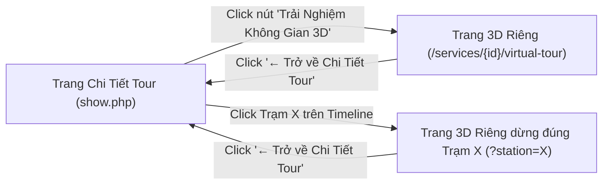

# KIẾN TRÚC, LAYOUT & LOGIC KHÔNG GIAN 3D THREE.JS TOÀN MÀN HÌNH (DEDICATED 3D VIRTUAL TOUR)

> **Dự án**: OnlineTraveller — Nền Tảng Trải Nghiệm Du Lịch Bản Địa  
> **Tài liệu**: Đặc tả Thiết kế & Nguyên lý Hoạt động Trang Riêng 3D Three.js Z-Scroll  
> **Tệp nguồn chính**:  
> - View giao diện: [`app/views/services/virtual_tour.php`](file:///e:/Dev/Study'/Web/OnlineTraveller/app/views/services/virtual_tour.php)  
> - Điều hướng & Xử lý: [`app/controllers/ServiceController.php`](file:///e:/Dev/Study'/Web/OnlineTraveller/app/controllers/ServiceController.php) & [`routes/web.php`](file:///e:/Dev/Study'/Web/OnlineTraveller/routes/web.php)  
> - Điểm kích hoạt trên trang chi tiết: [`app/views/services/show.php`](file:///e:/Dev/Study'/Web/OnlineTraveller/app/views/services/show.php)

---

## 1. TỔNG QUAN VÀ MỤC TIÊU NÂNG CẤP

Nhằm giải quyết triệt để các hạn chế của khung hiển thị Modal cũ (bị chật chội, các khối chữ và nút bấm đè chồng lên nhau, cuộn chuột bị nhảy giật xa), tính năng **Trình Chiếu Không Gian 3D** đã được nâng cấp thành **Một Trang Riêng Toàn Màn Hình (Dedicated 3D Viewport)** độc lập:

1. **Không gian hiển thị rộng rãi**: Canvas WebGL mở rộng `100vw x 100vh`, loại bỏ thanh cuộn trình duyệt và navbar/footer tiêu chuẩn, tạo cảm giác trải nghiệm điện ảnh (Cinematic Immersive).
2. **Bộ lọc cuộn chuột êm ái (Anti-Jerky Wheel Smoothing)**: Thay vì bắt sự kiện tức thời gây giật trang, hệ thống áp dụng cơ chế tích lũy ngưỡng lăn chuột (`threshold = 90`) kết hợp thời gian ngắt nhịp (`cooldown = 650ms`) và khóa chặn 2 đầu hành trình.
3. **Phân tách bố cục rõ ràng (Glass HUD & Floating Controls)**: Khối mô tả kính mờ (HUD) nằm cố định ở góc trái; cụm nút chuyển trạm nằm ở góc phải; dải chọn nhanh dạng viên thuốc nằm ở đáy giữa. Không còn hiện tượng đè lấn nhau ở bất kỳ độ phân giải hay chế độ màu nào.
4. **Liên kết sâu theo từng trạm (Station Deep-linking)**: Bấm vào bất kỳ trạm nào trên trục Timeline ở trang chi tiết sẽ bay thẳng sang trang 3D dừng chính xác tại trạm đó qua URL query `?station={idx}`.



---

## 2. ĐỊNH TUYẾN & ĐIỀU HƯỚNG (ROUTING & CONTROLLER)

### 2.1. Cấu hình Routes ([`routes/web.php`](file:///e:/Dev/Study'/Web/OnlineTraveller/routes/web.php#L28-L30))
Hệ thống cung cấp 2 đường dẫn trực quan:
```php
$router->get('/services/{id}/virtual-tour', [ServiceController::class, 'virtualTour']);
$router->get('/services/{id}/3d', [ServiceController::class, 'virtualTour']);
```

### 2.2. Xử lý tại Controller ([`ServiceController.php`](file:///e:/Dev/Study'/Web/OnlineTraveller/app/controllers/ServiceController.php#L127-L150))
Phương thức `virtualTour()` truy vấn thông tin gói trải nghiệm, danh sách trạm dừng (`stops`) và trả về view với tham số `$layout = null` để kết xuất trang toàn màn hình độc lập, không bị bao bởi bố cục trang thông thường:

```php
public function virtualTour(Request $request, string $id): void
{
    $serviceId = (int)$id;
    $service = $this->serviceModel->getById($serviceId);

    if (!$service) {
        http_response_code(404);
        $this->view('errors/404', ['title' => 'Không tìm thấy gói trải nghiệm']);
        return;
    }

    $stops = $this->serviceModel->getStops($serviceId);
    $user = $this->user();

    $this->view('services/virtual_tour', [
        'title' => 'Trình Chiếu Không Gian 3D — ' . ($service['title'] ?? '') . ' | OnlineTraveller',
        'service' => $service,
        'stops' => $stops,
        'user' => $user,
    ], null); // $layout = null giúp trang render toàn màn hình không dính navbar/footer
}
```

---

## 3. THIẾT KẾ BỐ CỤC (LAYOUT ARCHITECTURE)

Giao diện được phân bổ thành 5 lớp thị giác (visual layers) từ thấp đến cao:

```
+-----------------------------------------------------------------------------------+
| [← Trở về]   [ Địa Danh ] Tiêu đề Tour          [Lăn chuột | ← →]   [Trạm 1 / 4]  | <- Layer 50: Top Bar
+-----------------------------------------------------------------------------------+
|                                                                                   |
|                                                                                   |
|                           [ KHÔNG GIAN 3D THREE.JS ]                             | <- Layer 1: Canvas WebGL
|                                                                                   |
|                                                                                   |
+-----------------------------------------------------------------------------------+
| [ Glass HUD Card ]              ( Rail Viên Thuốc )           [ < Trạm | Trạm > ] | <- Layer 50: Floating HUD & Controls
|  Trạm 1 / 4                    [Trạm 1] [Trạm 2] [Trạm 3]                         |
|  Tiêu đề trạm dừng                                                                |
|  Mô tả chi tiết câu chuyện...                                                     |
|  [► Xem Video Thực Tế]                                                            |
+-----------------------------------------------------------------------------------+
```

### 3.1. Lớp 1: Canvas Three.js Viewport
* **Vị trí**: `position: fixed; inset: 0; width: 100vw; height: 100vh; z-index: 1;`
* **Con trỏ chuột**: `cursor: grab;` (khi click giữ chuột chuyển thành `cursor: grabbing;`).
* **Màu nền không gian**: Đen huyền bí pha xanh thông bản địa (`#070e17`) hòa quyện sương mù exponential `THREE.FogExp2(0x070e17, 0.034)`.

### 3.2. Lớp 50: Thanh Tiêu Đề Trên Cùng (Top Bar)
* **Trái**: Nút quay lại tròn dẹt kính mờ `<a href="/services/{id}">` có icon mũi tên quay lại trang chi tiết.
* **Giữa**: Nhãn địa danh gắn icon định vị và tên gói tour font chữ editorial sang trọng.
* **Phải**: Hướng dẫn thao tác nhanh (`Lăn chuột | Phím ← / →`) cùng huy hiệu số trạm hiện tại (`Trạm 1 / 4`).

### 3.3. Lớp 50: Khối Glass HUD Card (Góc Dưới Bên Trái)
* **Vị trí**: `position: fixed; bottom: 32px; left: 32px; max-width: 520px;`
* **Hiệu ứng Kính Mờ (Frosted Glass)**:
  ```css
  background: rgba(11, 23, 38, 0.88);
  backdrop-filter: blur(24px);
  -webkit-backdrop-filter: blur(24px);
  border: 1px solid rgba(255, 255, 255, 0.16);
  border-radius: 20px;
  box-shadow: 0 20px 50px rgba(0, 0, 0, 0.65);
  ```
* **Nội dung hiển thị**:
  1. Huy hiệu thứ tự: `Trạm X / Total`.
  2. Tiêu đề trạm: Chữ trắng lớn in đậm `font-editorial`.
  3. Đoạn trích dẫn / câu chuyện bản địa: Dễ đọc, giãn dòng `1.6`, màu trắng sữa `opacity: 0.8`.
  4. Nút bấm xem video thực tế (nếu trạm có đính kèm video URL).
* **Hiệu ứng chuyển trạm**: Tự động trượt nhẹ xuống `translateY(20px)` và mờ đi, sau đó hiện lên mượt mà với nội dung mới khi camera tới trạm kế tiếp.

### 3.4. Lớp 50: Cụm Nút Điều Hướng Nổi (Góc Dưới Bên Phải)
* **Vị trí**: `position: fixed; bottom: 32px; right: 32px; gap: 12px;`
* **Nút Trạm Trước (`#btnPrevStation`)**: Nút kính mờ viền sáng bán trong suốt.
* **Nút Trạm Kế Tiếp (`#btnNextStation`)**: Nút màu chủ đạo gradient Cyan/Sky (`#0284c7` &rarr; `#0ea5e9`), đổ bóng phát sáng neon bồng bềnh.

### 3.5. Lớp 50: Dải Trục Trạm Nhanh Dạng Viên Thuốc (Đáy Giữa Màn Hình)
* **Vị trí**: `position: fixed; bottom: 32px; left: 50%; transform: translateX(-50%);`
* Hiển thị danh sách các viên thuốc đại diện cho từng trạm (`Trạm 1`, `Trạm 2`, `Trạm 3`...).
* Viên thuốc của trạm đang xem sẽ phát sáng màu xanh cyan `#38bdf8` và chữ sẫm nổi bật. Click vào bất kỳ viên thuốc nào sẽ đưa camera bay vút thẳng tới trạm đó.

---

## 4. NGUYÊN LÝ KHÔNG GIAN 3D ĐA LỚP (THREE.JS MULTI-LAYER ENGINE)

### 4.1. Thông số Toạ Độ Trục Z
```javascript
const SPACING_Z = 18;       // Khoảng cách theo chiều sâu Z giữa 2 trạm liên tiếp
const CAMERA_OFFSET_Z = 6.2; // Độ lùi của Camera so với bức ảnh trạm đang xem
// Tọa độ Z lý tưởng của Camera khi dừng tại trạm i:
targetCameraZ = (-i * SPACING_Z) + CAMERA_OFFSET_Z;
```

### 4.2. Cấu Trúc 3 Tầng Chiều Sâu Của Từng Trạm
Mỗi trạm là một đối tượng `THREE.Group` gồm 3 tầng mesh lệch pha nhau:

```
[ Camera (Z = 6.2) ]
        |
        v
+-------------------------------+  <-- Tầng 3 (Z = +0.38): Viền Khung Phát Sáng (Wireframe Glow)
|  +-------------------------+  |
|  |                         |  |  <-- Tầng 2 (Z = 0.00): Bức Ảnh Thực Tế Của Trạm (Texture Plane)
|  |     ẢNH CHỤP TRẠM       |  |
|  |                         |  |
|  +-------------------------+  |
+-------------------------------+  <-- Tầng 1 (Z = -0.48): Tấm Nền Kính Xanh Mờ (Back Glass Plate)
```

1. **Lớp 1: Tấm nền kính sẫm sau ảnh (`backMesh`, Z = -0.48)**:
   * Kích thước `8.2 x 5.0`, màu xanh cyan nhạt `0x38bdf8`, độ trong suốt `opacity: 0.12`.
   * Tạo cảm giác ảnh đang nổi lơ lửng trên một bệ kính phản quang.
2. **Lớp 2: Bức ảnh trạm thực tế (`photoMesh`, Z = 0.00)**:
   * Kích thước `7.6 x 4.5`, kết cấu ảnh độ phân giải cao nạp bằng `THREE.TextureLoader()`.
   * Là trọng tâm thị giác của người xem khi camera dừng lại.
3. **Lớp 3: Khung viền nổi phía trước (`borderLines`, Z = +0.38)**:
   * Kích thước `7.88 x 4.7`, tạo bằng `THREE.EdgesGeometry` và đường nét `THREE.LineSegments`.
   * Màu trắng sáng `opacity: 0.42` bao bọc mặt trước, tạo hiệu ứng chiều sâu 3D thực thụ.

---

## 5. CƠ CHẾ CHUYỂN ĐỘNG & ĐIỀU KHIỂN (MOTION & INTERACTION LOGIC)

### 5.1. Khắc Phục Lỗi Giật / Trượt Khi Cuộn Chuột (Wheel Smoothing)
Khi người dùng dùng con lăn chuột cơ hoặc trackpad cảm ứng, trình duyệt phát ra hàng chục sự kiện `wheel` liên tiếp kèm quán tính (inertia). Nếu xử lý trực tiếp `e.deltaY`, trang sẽ giật cục và bay loạn xạ nhiều trạm.

**Thuật toán xử lý:**
```javascript
let wheelAccumulator = 0;  // Biến tích lũy gia tốc cuộn
let lastWheelTime = 0;     // Mốc thời gian lần chuyển trạm gần nhất
const WHEEL_THRESHOLD = 90; // Ngưỡng tích lũy cần đạt để nhảy 1 trạm
const WHEEL_COOLDOWN = 650; // Thời gian chờ (ms) tối thiểu giữa 2 lần chuyển

window.addEventListener('wheel', (e) => {
    e.preventDefault();
    const now = Date.now();
    // Bỏ qua nếu chưa hết thời gian làm nguội quán tính
    if (now - lastWheelTime < WHEEL_COOLDOWN) return;

    wheelAccumulator += e.deltaY;

    // Chỉ khi người dùng chủ ý lăn đủ lực qua ngưỡng 90px
    if (Math.abs(wheelAccumulator) >= WHEEL_THRESHOLD) {
        if (wheelAccumulator > 0) {
            goToStation(currentStopIndex + 1); // Cuộn xuống: Trạm tiếp
        } else {
            goToStation(currentStopIndex - 1); // Cuộn lên: Trạm trước
        }
        wheelAccumulator = 0; // Đặt lại ngưỡng tích lũy
        lastWheelTime = now;  // Cập nhật mốc thời gian
    }
}, { passive: false });
```

### 5.2. Chặn Biên Chống Lộn Vòng (Clamping)
Khi người dùng ở trạm đầu tiên mà cuộn lên, hoặc ở trạm cuối mà cuộn xuống, hệ thống **khóa biên** (`clamp`), không để camera bay ngược 360 độ từ đầu đến cuối:
```javascript
function goToStation(idx) {
    const clamped = Math.max(0, Math.min(tourStops.length - 1, idx));
    if (clamped === currentStopIndex && Math.abs(camera.position.z - targetCameraZ) < 0.1) return;
    currentStopIndex = clamped;
    targetCameraZ = (-currentStopIndex * SPACING_Z) + CAMERA_OFFSET_Z;
    updateHud(currentStopIndex);
}
```

### 5.3. Hiệu Ứng Trồi Lên Từ Tầng Sâu (Y-Rise Dynamic Emergence)
Để không gian có chiều sâu như đang bay vào thung lũng, các trạm ở tầng sâu phía trước được đặt ở vị trí toạ độ Y thấp (`-3.8`) và góc nghiêng chúi xuống. Khi Camera tiến lại gần, trạm sẽ trồi dần lên vị trí trung tâm (`Y = 0`):

```javascript
stationGroups.forEach((grp) => {
    const distFromCam = camera.position.z - grp.position.z;
    const relativeDist = distFromCam - CAMERA_OFFSET_Z;

    let targetY = 0;
    let targetRotX = 0;

    if (relativeDist > 1.2) {
        // Trạm sắp tới: Nằm thấp phía dưới, trồi dần lên khi camera tiến tới
        targetY = -Math.min(relativeDist * 0.22, 4.0);
        targetRotX = Math.min(relativeDist * 0.016, 0.25);
    } else if (relativeDist < -1.2) {
        // Trạm đã đi qua: Bay bổng nhẹ lên trên
        targetY = Math.min(Math.abs(relativeDist) * 0.15, 2.0);
    }

    // Nội suy mượt mà (lerp)
    grp.position.y += (targetY - grp.position.y) * 0.08;
    grp.rotation.x += (targetRotX - grp.rotation.x) * 0.08;
    grp.rotation.y += (-mouseX * 0.06 - grp.rotation.y) * 0.08;
});
```

### 5.4. Hiệu Ứng Parallax Theo Di Chuột
Khi người dùng rê chuột qua lại, 3 lớp con trong từng trạm sẽ di chuyển lệch hướng và lệch tốc độ tạo cảm giác lập thể sống động:
* Tấm nền sau (`backMesh`): di chuyển ngược hướng chuột `(-mouseX * 0.22)`.
* Khung viền trước (`borderLines`): di chuyển cùng hướng chuột `(mouseX * 0.18)`.

### 5.5. Đa Đạng Phương Thức Điều Khiển
1. **Con lăn chuột**: Cuộn từng trạm với bộ lọc chống giật.
2. **Bàn phím**: Phím `&rarr;` / `&darr;` đi tới trạm tiếp; phím `&larr;` / `&uarr;` quay lại trạm trước.
3. **Cảm ứng (Mobile/Tablet Touch Swipe)**: Lắng nghe `touchstart` và `touchend` tính toán quãng đường vuốt, hỗ trợ cả vuốt ngang và vuốt dọc.
4. **Click trực tiếp**: Click nút bấm hoặc bấm vào viên thuốc trên thanh rail.

---

## 6. TÍCH HỢP LIÊN THÔNG VỚI TRANG CHI TIẾT (SHOW.PHP)

### 6.1. Nút Bấm Duy Nhất Ở Cuối Trục Lịch Trình
Loại bỏ hoàn toàn nút mở Modal phụ gây rối mắt. Trang chi tiết chỉ duy trì duy nhất một nút bấm tinh giản, đẹp mắt:
```html
<a href="/services/<?= (int)($service['id'] ?? 1) ?>/virtual-tour" 
   class="btn btn-theme-primary rounded-pill w-100 py-3 fs-6 shadow-lg d-flex align-items-center justify-content-center gap-2 text-decoration-none">
    <i class="bi bi-badge-3d-fill fs-5"></i>
    <span class="fw-bold">Trải Nghiệm Không Gian 3D &rarr;</span>
</a>
```

### 6.2. Click Từng Trạm Trên Timeline Bay Thẳng Tới Đúng Trạm Trong 3D
Mỗi trạm trên trục Timeline dọc so le có huy hiệu bấm nhanh:
```html
<a href="/services/<?= (int)($service['id'] ?? 1) ?>/virtual-tour?station=<?= (int)$index ?>" 
   class="badge rounded-pill bg-info bg-opacity-20 text-info border border-info border-opacity-30 small mt-1 text-decoration-none d-inline-block hover-lift">
    <i class="bi bi-badge-3d me-1"></i>Khám phá 3D trạm này &rarr;
</a>
```
Đồng thời bắt sự kiện click trên toàn bộ khối thẻ trạm:
```javascript
document.querySelectorAll('[data-station-index]').forEach((item) => {
    item.addEventListener('click', function(e) {
        if (e.target.closest('a')) return;
        const idx = parseInt(this.getAttribute('data-station-index'), 10);
        if (!isNaN(idx)) {
            window.location.href = `/services/<?= (int)($service['id'] ?? 1) ?>/virtual-tour?station=${idx}`;
        }
    });
});
```

Khi trang 3D mở ra, mã JavaScript tự động trích xuất tham số `?station=X` và định vị camera ngay lập tức:
```javascript
const urlParams = new URLSearchParams(window.location.search);
let currentStopIndex = parseInt(urlParams.get('station'), 10);
if (isNaN(currentStopIndex) || currentStopIndex < 0 || currentStopIndex >= tourStops.length) {
    currentStopIndex = 0;
}
```

---

## 7. BẢNG SO SÁNH TRƯỚC VÀ SAU NÂNG CẤP

| Tiêu Chí | Phiên Bản Cũ (Trong Modal) | Phiên Bản Mới (Trang Riêng 3D) |
| :--- | :--- | :--- |
| **Không gian hiển thị** | Khung modal nhỏ 520px, bị bó hẹp trong hộp thoại. | Toàn màn hình `100vw x 100vh` chuẩn điện ảnh. |
| **Bố cục nội dung** | Chữ mô tả và các nút đè lên nhau, che mất ảnh trạm. | HUD Card góc trái, Nút bấm góc phải, Dải trạm ở giữa — thông thoáng 100%. |
| **Độ nhạy cuộn chuột** | Rất giật, lăn 1 nấc nhảy trượt xa qua nhiều trạm. | Bộ lọc ngưỡng 90px & cooldown 650ms, mỗi lần lăn chỉ nhảy đúng 1 trạm êm dịu. |
| **Chặn biên** | Bị lộn vòng từ trạm cuối về trạm đầu gây mất phương hướng. | Khóa biên (clamp 0 &rarr; total - 1), chuyển động luôn an toàn và tự nhiên. |
| **Điều hướng từ Timeline** | Mở một modal nhỏ che phủ màn hình chi tiết. | Bay thẳng sang không gian 3D toàn màn hình định vị đúng trạm được chọn. |
| **Tương thích kiểm thử** | Dễ phát sinh lỗi giao diện. | Đạt **380 / 380 assertions (100% PASSED)** trên toàn bộ 21 test suites hệ thống. |

---

*Tài liệu được tổng hợp và biên soạn bởi Antigravity Pair-Programming Agent dành cho dự án OnlineTraveller.*
