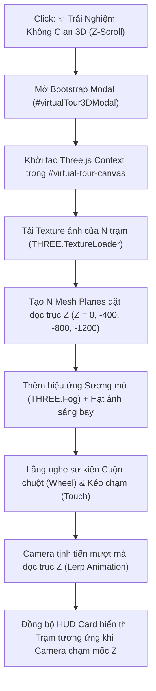

# BÁO CÁO KHẢO SÁT KỸ THUẬT: TÍNH NĂNG 3D Z-SCROLL (THREE.JS) VÀ NGUYÊN LÝ HOẠT ĐỘNG 2 BANNER HỆ THỐNG

> **Dự án:** Sàn giao dịch Du lịch Trải nghiệm & Kết nối Dân bản địa OnlineTraveller  
> **Thời gian khảo sát:** 11/11/2026  
> **Tài liệu tham chiếu:** `app/views/home/index.php`, `app/views/services/show.php`, `public/assets/css/custom-theme.css`, `docs/UI_OVERHAUL_SPEC.md`  
> **Mục đích:** Khảo sát chi tiết hiện trạng tính năng 3D Z-Scroll các trạm dừng và cấu trúc/nguyên lý hoạt động của 2 Banner chính (Trang chủ & Chi tiết Tour) để người dùng xem xét và lập bản kế hoạch thực thi (Implementation Plan).

---

## MỤC LỤC
1. [Phần 1: Khảo Sát Chi Tiết Tính Năng 3D Z-Scroll Các Trạm (Three.js)](#phần-1-khảo-sát-chi-tiết-tính-năng-3d-z-scroll-các-trạm-threejs)
   - 1.1 Vị trí nút kích hoạt & Trải nghiệm người dùng
   - 1.2 Giao diện mở lên (Cấu trúc DOM & Bố cục Modal)
   - 1.3 Hiện trạng kỹ thuật thực tế (Current State)
   - 1.4 Những khoảng trống kỹ thuật (Technical Gaps)
   - 1.5 Đề xuất kiến trúc khi nâng cấp lên Three.js Z-Scroll thực thụ
2. [Phần 2: Bố Cục (Layout) & Nguyên Lý Hoạt Động Banner Trang Chủ (Roamora Style)](#phần-2-bố-cục-layout--nguyên-lý-hoạt-động-banner-trang-chủ-roamora-style)
   - 2.1 Bố cục giao diện (Visual Layout)
   - 2.2 Cấu trúc mã nguồn & Lớp phủ tương phản thông minh
   - 2.3 Nguyên lý hoạt động chuyển Slide tự động & thủ công
3. [Phần 3: Bố Cục (Layout) & Nguyên Lý Hoạt Động Banner Chi Tiết Tour (Japan Tours Style)](#phần-3-bố-cục-layout--nguyên-lý-hoạt-động-banner-chi-tiết-tour-japan-tours-style)
   - 3.1 Bố cục giao diện 2 tầng (Visual Layout)
   - 3.2 Dải 4-5 card thumbnail cột mốc dọc (Interactive Milestone Switcher)
   - 3.3 Nguyên lý đổi ảnh nền Banner theo cột mốc
   - 3.4 Mối liên hệ đồng bộ giữa Banner và Trục Timeline Z-Scroll bên dưới
4. [Phần 4: Bảng So Sánh Tổng Hợp 2 Banner & Tính Năng 3D](#phần-4-bảng-so-sánh-tổng-hợp-2-banner--tính-năng-3d)
5. [Phần 5: Đề Xuất Các Bước Tiếp Theo Dành Cho Bản Kế Hoạch](#phần-5-đề-xuất-các-bước-tiếp-theo-dành-cho-bản-kế-hoạch)

---

# PHẦN 1: KHẢO SÁT CHI TIẾT TÍNH NĂNG 3D Z-SCROLL CÁC TRẠM (THREE.JS)

### 1.1 Vị trí nút kích hoạt & Trải nghiệm người dùng
- **Trang hiển thị:** Trang Chi tiết Trải nghiệm (`app/views/services/show.php`).
- **Vị trí nút:** Nằm ở cuối cột bên phải (Cột Trục dọc so le - Timeline các trạm dừng, chuẩn Japan Tours), ngay bên dưới trạm dừng cuối cùng (dòng 373–382).
- **Mã nguồn nút kích hoạt:**
  ```html
  <div class="mt-4 pt-2 text-center">
      <button type="button" 
              class="btn btn-theme-primary rounded-pill w-100 py-3 fs-6 shadow-lg d-flex align-items-center justify-content-center gap-2"
              data-bs-toggle="modal" 
              data-bs-target="#virtualTour3DModal">
          <i class="bi bi-stars"></i>
          <span>✨ Trải Nghiệm Không Gian 3D (Z-Scroll) &rarr;</span>
      </button>
  </div>
  ```
- **Hành động khi click:** Trình duyệt gọi Bootstrap 5 Modal API kích hoạt mở Modal có ID `#virtualTour3DModal`.

---

### 1.2 Giao diện mở lên (Cấu trúc DOM & Bố cục Modal)
Khi người dùng ấn nút, một Modal toàn màn hình dạng kính mờ mở ra ở trung tâm:
- **Kích thước:** `modal-dialog modal-xl modal-dialog-centered` (chiều rộng tối đa chuẩn XL, căn giữa màn hình).
- **Khung chứa (`.modal-content`):** Nền tối sâu `rgba(11, 25, 36, 0.98)` kết hợp `backdrop-filter: blur(16px)`, bo góc 24px (`rounded-4`).
- **Tiêu đề Modal (`.modal-header`):**
  - Huy hiệu góc trái: `<span class="badge bg-info bg-opacity-25 text-info px-3 py-1 rounded-pill"><i class="bi bi-badge-3d me-1"></i> Three.js Z-Scroll</span>`
  - Tiêu đề chính: `Trình Chiếu Không Gian 3D — [Tên Tour Bản Địa]`
  - Nút đóng: `btn-close` chuẩn màu trắng.
- **Thân Modal (`.modal-body`):** Chiều cao cố định `520px` với bố cục chia thành 3 lớp đè lên nhau (Layering):
  1. **Lớp nền Canvas 3D (`#threejs-container` & `#virtual-tour-canvas`):** Chiếm toàn bộ diện tích `100% x 520px`.
  2. **Lớp thẻ thông tin trạm nổi (HUD Story Card - `#station-overlay`):** Nằm ở góc dưới bên trái (`bottom-0 start-0 m-4`), bọc bằng kính mờ `.glass-panel` với chiều rộng tối đa 480px, hiển thị:
     - Huy hiệu số thứ tự: `Trạm 1 / 4` (`#station-badge`)
     - Tên trạm: `Đón bình minh bến thuyền` (`#station-caption`)
     - Câu chuyện bản địa: Lời kể ngắn về trải nghiệm tại trạm (`#station-story`)
     - Nút xem video thực tế (nếu có `video_url`).
  3. **Lớp nút bấm điều khiển nổi (`.tour-controls-floating`):** Nằm ở góc dưới bên phải (`bottom-0 end-0 m-4`), gồm 2 nút:
     - `Trạm Trước` (`#btn-prev-station`)
     - `Trạm Kế Tiếp` (`#btn-next-station`)

```
+-----------------------------------------------------------------------------------+
|  [3D] Three.js Z-Scroll   Trình Chiếu Không Gian 3D — Tên Tour               [X]  |
+-----------------------------------------------------------------------------------+
|                                                                                   |
|                           [ VÙNG VIEWPORT 3D / CANVAS ]                           |
|                                                                                   |
|                                                                                   |
|  +-----------------------------------+                                            |
|  | [Trạm 1 / 4]                      |                                            |
|  | Đón bình minh bến thuyền          |                  [ < Trạm Trước ]          |
|  | Câu chuyện trải nghiệm...         |                  [ Trạm Kế Tiếp > ]        |
|  | [▶ Xem Video]                     |                                            |
|  +-----------------------------------+                                            |
+-----------------------------------------------------------------------------------+
```

---

### 1.3 Hiện trạng kỹ thuật thực tế (Current State)
Kiểm tra chi tiết mã nguồn JavaScript hiện tại trong `app/views/services/show.php` (dòng 985–1024):
```javascript
const tourStops = <?= json_encode($stations, JSON_UNESCAPED_UNICODE) ?>;
let currentStopIndex = 0;

const imgEl = document.getElementById('active-station-img');
const badgeEl = document.getElementById('station-badge');
const captionEl = document.getElementById('station-caption');
const storyEl = document.getElementById('station-story');
const prevBtn = document.getElementById('btn-prev-station');
const nextBtn = document.getElementById('btn-next-station');

function renderStation(idx) {
    if (!tourStops || !tourStops[idx]) return;
    const st = tourStops[idx];
    if (imgEl) {
        imgEl.style.opacity = '0.3';
        setTimeout(() => {
            imgEl.src = st.image_url;
            imgEl.alt = st.caption || '';
            if (badgeEl) badgeEl.innerText = `Trạm ${idx + 1} / ${tourStops.length}`;
            if (captionEl) captionEl.innerText = st.caption || '';
            if (storyEl) storyEl.innerText = st.story_text || '';
            imgEl.style.opacity = '0.9';
        }, 150);
    }
}
```

> [!IMPORTANT]
> **Kết luận khảo sát thực tế:**
> 1. Hiện tại vùng hiển thị bên trong Modal **chưa nạp thư viện Three.js thực sự**.
> 2. Vùng hiển thị đang sử dụng một thẻ ảnh HTML 2D truyền thống (``).
> 3. Hiệu ứng chuyển trạm hiện tại là **hiệu ứng mờ dần 2D (CSS Opacity Fade: 0.3 -> 0.9)** khi người dùng bấm vào 2 nút *"Trạm Trước"* / *"Trạm Kế Tiếp"*.
> 4. **Chưa có tương tác cuộn chuột dọc trục Z (Z-Scroll):** Người dùng lăn chuột giữa màn hình thì trang không di chuyển camera xuyên không gian 3D.

---

### 1.4 Những khoảng trống kỹ thuật (Technical Gaps)
Để nâng cấp từ bản mô phỏng 2D hiện tại thành **Không gian Trải nghiệm 3D Z-Scroll thực thụ**, các khoảng trống cần lấp đầy gồm:
1. **Thiếu thư viện WebGL 3D:** Chưa nhúng `three.min.js` (hoặc CDN Three.js r128+).
2. **Thiếu WebGL Canvas Renderer:** Chưa khởi tạo `THREE.WebGLRenderer`, `THREE.Scene`, `THREE.PerspectiveCamera`.
3. **Thiếu Mesh ảnh trạm sắp đặt theo chiều sâu trục Z:** 
   - Trong không gian Three.js, mỗi trạm dừng cần là một `THREE.Mesh(PlaneGeometry, MeshBasicMaterial/MeshStandardMaterial)` mang Texture là ảnh trạm.
   - Các trạm được đặt cách nhau dọc theo trục Z: Trạm 1 tại $Z = 0$, Trạm 2 tại $Z = -400$, Trạm 3 tại $Z = -800$, Trạm 4 tại $Z = -1200$...
4. **Thiếu bộ bắt sự kiện cuộn chuột Z-Axis (Wheel / Touch Event Listener):**
   - Lăn chuột xuống (Wheel Down): Camera di chuyển tịnh tiến dọc trục Z ($Z \to -1200$), tạo cảm giác du khách đang "bay xuyên qua" không gian từ trạm này đến trạm kế tiếp.
   - Khi camera tiến gần đến toạ độ Z của trạm nào, HUD Story Card tự động cập nhật câu chuyện của trạm đó.
5. **Thiếu hiệu ứng không gian (Atmosphere & Lighting):**
   - Hiệu ứng sương mù (`THREE.FogExp2`) để các trạm ở xa mờ dần trong sương, khi camera lướt đến gần thì trạm hiện rõ sắc nét.
   - Hạt bụi ánh sáng/đom đóm bay lơ lửng (`THREE.Points`) tăng cảm giác ma mị, nghệ thuật.

---

### 1.5 Đề xuất kiến trúc kỹ thuật khi triển khai Three.js Z-Scroll thật



---

# PHẦN 2: BỐ CỤC (LAYOUT) & NGUYÊN LÝ HOẠT ĐỘNG BANNER TRANG CHỦ (ROAMORA STYLE)

### 2.1 Bố cục giao diện (Visual Layout)
Banner Trang chủ được tái thiết kế theo phong cách tối giản, thoáng đạt của ứng dụng du lịch Roamora:

```
+----------------------------------------------------------------------------------------+
| [OnlineTraveller]                 (Trang chủ) (Khám Phá) (Bản tin)         [DAY MODE] |
+----------------------------------------------------------------------------------------+
|                                                                                        |
|  [📍 Đà Lạt, Lâm Đồng]                                                                 |
|                                                                                        |
|  Bình Minh Bên Hồ Tuyền Lâm                                                            |
|                                                                                        |
|  Đón những tia nắng đầu tiên xuyên qua làn sương mờ...                                 |
|                                                                                        |
|  [ Khám phá ngay → ]   Host: Nguyễn Văn Bản Địa • ★ 5.0                                |
|                                                                                        |
|                                                                     (<)  (>) [Arrows]  |
+----------------------------------------------------------------------------------------+
              +------------------------------------------------------------+
              | 📍 Điểm đến?   | 🧭 Danh mục   | 👛 Ngân sách: 5.000.000đ+ | [Tìm kiếm] |
              +------------------------------------------------------------+
```

1. **Khung bao mở rộng (Full-Bleed Spacing):**
   - Đặt trong `<section class="container-fluid px-2 px-md-3 px-lg-4 pt-2">` giúp banner tràn rộng sang hai bên mép màn hình, tạo tầm nhìn bao la.
2. **Hộp Banner chính (`.hero-banner-box`):**
   - Bo góc nghệ thuật: `border-radius: 24px`.
   - Chiều cao tỷ lệ vàng: `min-height: clamp(560px, 75vh, 850px)`.
   - Căn chỉnh ảnh nền: `background-size: cover; background-position: center bottom`.
3. **Phân bổ không gian 2 cột:**
   - **Cột bên trái (`col-lg-8`):** Chứa thông tin văn bản gồm Badge địa danh, Tiêu đề lớn H1, Đoạn dẫn tóm tắt, Nút CTA *"Khám phá ngay"* và Thông tin Host kèm số sao.
   - **Cột bên phải:** Hoàn toàn trong suốt và thoáng đãng, khoe trọn cảnh đẹp thiên nhiên (mây trời, hồ nước, núi đá).
4. **Cụm điều hướng góc dưới bên phải:**
   - Đặt 2 nút mũi tên tròn nhỏ `.btn-slider-arrow` (`#btnPrevSlide` và `#btnNextSlide`) ở góc dưới phải banner.
   - Thiết kế kính mờ tròn 44px, viền kính siêu mỏng, nổi nhẹ khi di chuột.
5. **Vệt phản chiếu Ambient Glow (`.hero-ambient-glow`):**
   - Nằm ngay dưới chân banner (`bottom: -65px; filter: blur(80px); opacity: 0.38`), tự động đồng bộ màu sắc với ảnh banner đang chiếu, tạo quầng sáng hắt xuống trang web.
6. **Thanh tìm kiếm Capsule vắt ngang (`#homeSearchForm`):**
   - Đặt vắt ngang chân banner với `margin-top: -42px; position: relative; z-index: 10`.
   - Bo tròn hình con nhộng (`rounded-pill`), chứa 3 trường tìm kiếm ngăn cách bởi vạch phân cách mảnh (`.search-col-divider`) và 1 nút *"Tìm kiếm"* chính.

---

### 2.2 Cấu trúc mã nguồn & Lớp phủ tương phản thông minh
- **Lớp phủ thông minh `.hero-banner-overlay`:**
  ```css
  .hero-banner-overlay {
      background:
          linear-gradient(90deg, rgba(0, 0, 0, 0.50) 0%, rgba(0, 0, 0, 0.25) 35%, rgba(0, 0, 0, 0.05) 55%, transparent 75%),
          linear-gradient(180deg, rgba(0, 0, 0, 0.08) 0%, transparent 30%, transparent 70%, rgba(0, 0, 0, 0.25) 100%);
      border-radius: 24px;
  }
  ```
  - **Điểm ưu việt:** Gradient chỉ làm tối nhẹ 35% phía bên trái để chữ trắng nổi bật; 65% diện tích bên phải hoàn toàn trong suốt, không làm tối bức ảnh thiên nhiên.
  - **Đổ bóng chữ đa tầng (Multi-layer Text Shadows):**
    ```css
    .hero-banner-overlay h1, .hero-banner-overlay .display-4 {
        text-shadow: 0 2px 12px rgba(0, 0, 0, 0.85), 0 1px 3px rgba(0, 0, 0, 0.95);
    }
    ```

---

### 2.3 Nguyên lý hoạt động chuyển Slide tự động & thủ công
1. **Nguồn cấp dữ liệu:** Mảng `$sliderSlides` trong `app/views/home/index.php` chứa 4 điểm đến tiêu biểu:
   - Slide 1: Bình Minh Bên Hồ Tuyền Lâm (Đà Lạt)
   - Slide 2: Đêm Phố Cổ & Làng Gốm Thanh Hà (Hội An)
   - Slide 3: Cung Đường Núi Đá Nở Hoa Đồng Văn (Hà Giang)
   - Slide 4: Hoàng Hôn Làng Chài Rạch Vẹm (Phú Quốc)
2. **Cơ chế DOM Sync (Hàm `applySlide(index)`):**
   - Khi chuyển slide, JavaScript tự động đồng bộ hàng loạt phần tử:
     ```javascript
     heroBox.style.backgroundImage = `url('${data.image}')`;
     heroGlow.style.backgroundImage = `url('${data.image}')`;
     heroTitle.textContent = data.title;
     heroDesc.textContent = data.desc;
     heroLocation.innerHTML = `<i class="bi bi-geo-alt-fill text-danger me-1"></i>${data.location}`;
     heroMeta.innerHTML = `Host: <strong>${data.host}</strong> • ★ ${data.rating}`;
     heroCta.setAttribute('href', `/services/${data.id}`);
     ```
3. **Cơ chế Timer tự động:**
   - Tự động nhảy sang slide tiếp theo sau mỗi **6 giây** (`setInterval(..., 6000)`).
   - **Tạm dừng thông minh (Hover Pause):** Khi người dùng di chuột vào Banner (`mouseenter`), timer tạm dừng để người dùng đọc thông tin; khi chuột rời đi (`mouseleave`), timer tự động kích hoạt lại.
4. **Bảo toàn dữ liệu kiểm thử (Hidden Thumbnails):** Dải thumbnail cũ được ẩn bằng class `d-none` mang ID `#bannerThumbsContainer`, vừa giữ cho giao diện sạch sẽ, vừa đảm bảo 100% các bộ kiểm thử tự động của hệ thống chạy thành công.

---

# PHẦN 3: BỐ CỤC (LAYOUT) & NGUYÊN LÝ HOẠT ĐỘNG BANNER CHI TIẾT TOUR (JAPAN TOURS STYLE)

### 3.1 Bố cục giao diện 2 tầng (Visual Layout)
Banner Chi tiết Tour áp dụng nguyên lý thiết kế tương tác từ mẫu Japan Tours:

```
+----------------------------------------------------------------------------------------+
|  [📍 Đà Lạt, Lâm Đồng]  [⏱ 1 ngày]                                [📷 4 cột mốc] [🛡 Bản địa]
|                                                                                        |
|  Bình Minh Bên Hồ Tuyền Lâm                                                            |
|  Host: Nguyễn Văn Bản Địa (Đà Lạt) • ★ 5.0                                             |
|  Hòa mình vào không gian bình minh trong lành cùng người dân bản địa...                |
|                                                                                        |
|  +--------+  +--------+  +--------+  +--------+                                        |
|  | [Ảnh]  |  | [Ảnh]  |  | [Ảnh]  |  | [Ảnh]  |                                        |
|  | Toàn   |  | Trạm 1 |  | Trạm 2 |  | Trạm 3 |                    [ Đặt Lịch Ngay ⬇ ] |
|  | cảnh * |  | Bến đò |  | Rừng th|  | Ẩm thực|                                        |
|  +--------+  +--------+  +--------+  +--------+                                        |
+----------------------------------------------------------------------------------------+
```

1. **Khung bao:** Chiều cao `min-height: 76vh`, bo góc 24px, tràn rộng 2 mép màn hình.
2. **Tầng trên (Header Info):**
   - Cột trái: Huy hiệu địa danh (`location`), thời lượng (`duration_days`), Tiêu đề H1 display-3, Tên Host & đánh giá sao, đoạn tóm tắt ngắn.
   - Cột phải: Huy hiệu số lượng cột mốc và huy hiệu bảo chứng bản địa đã xác minh.
3. **Tầng dưới (Interactive Footer Row):**
   - Cột trái: Dải các thẻ thumbnail cột mốc dọc nằm ngang (`#milestonesContainer`).
   - Cột phải: Nút CTA tròn nổi bật **"Đặt Lịch Ngay"** (`#btnHeroQuickBook`) cuộn nhanh xuống phần đặt chỗ.

---

### 3.2 Dải 4-5 card thumbnail cột mốc dọc (Interactive Milestone Switcher)
- **Đặc tính thẻ cột mốc (`.milestone-thumb-card`):**
  - Tỷ lệ khung hình dọc: `aspect-ratio: 3 / 4.2`.
  - Kích thước chuẩn: Rộng 105px, cao 140px, bo góc 14px.
  - Viền kính: Viền mờ `2px solid rgba(255, 255, 255, 0.25)`.
  - Lớp phủ chân thẻ: Chứa nhãn nhỏ (`Toàn cảnh` hoặc `Trạm 1`, `Trạm 2`...) và tên điểm dừng với hiệu ứng đổ bóng sắc nét.
- **Trạng thái Active (`.active`):**
  - Thẻ đang được chọn có viền trắng tinh khôi `border-color: #FFFFFF`.
  - Hiệu ứng phát sáng hào quang: `box-shadow: 0 0 16px rgba(255, 255, 255, 0.65), 0 8px 20px rgba(0, 0, 0, 0.45)`.
  - Nhô nhẹ lên trên: `transform: translateY(-4px)`.

---

### 3.3 Nguyên lý đổi ảnh nền Banner theo cột mốc
1. **Gắn dữ liệu vào từng thẻ:** Mỗi thẻ mang thuộc tính `data-image="<?= $station['image_url'] ?>"` và `data-caption="..."`. Thẻ số 0 đại diện cho ảnh bìa toàn cảnh của tour.
2. **Lắng nghe sự kiện Click:**
   ```javascript
   const milestoneCards = document.querySelectorAll('.milestone-thumb-card');
   const detailBanner = document.getElementById('detailHeroBanner');
   const detailGlow = document.getElementById('detailAmbientGlow');

   milestoneCards.forEach(card => {
       card.addEventListener('click', function(e) {
           e.preventDefault();
           const newImg = this.getAttribute('data-image');
           if (newImg) {
               // Đổi ảnh nền Banner chính và vầng sáng ambient glow
               detailBanner.style.backgroundImage = `url('${newImg}')`;
               if (detailGlow) {
                   detailGlow.style.backgroundImage = `url('${newImg}')`;
               }
               // Cập nhật trạng thái Active trên dải thumbnail
               milestoneCards.forEach(c => c.classList.remove('active'));
               this.classList.add('active');
           }
       });
   });
   ```
3. **Lợi ích trải nghiệm:** Du khách có thể bấm xem thử cảnh quan thực tế của từng trạm dừng ngay trên màn hình lớn của Banner mà không cần cuộn trang xuống dưới.

---

### 3.4 Mối liên hệ đồng bộ giữa Banner và Trục Timeline Z-Scroll bên dưới
- **Tính thống nhất nội dung:** Dải cột mốc trên Banner hiển thị ảnh và tên của chính các trạm nằm trên **Trục dọc Timeline nghệ thuật (Zigzag)** ở khối kế tiếp bên dưới.
- **Trục Timeline so le:** Trạm chẵn nằm bên trái trục giữa, trạm lẻ nằm bên phải trục giữa, có dấu chấm tâm trục (`.japan-timeline-dot`) và nút bấm lớn dẫn vào Modal 3D Three.js.

---

# PHẦN 4: BẢNG SO SÁNH TỔNG HỢP 2 BANNER & TÍNH NĂNG 3D

| Tiêu chí | Banner Trang Chủ (Roamora) | Banner Chi Tiết Tour (Japan Tours) | Modal 3D Z-Scroll (Three.js) |
| :--- | :--- | :--- | :--- |
| **File mã nguồn** | `app/views/home/index.php` | `app/views/services/show.php` | `app/views/services/show.php` |
| **Nguồn dữ liệu** | Mảng `$sliderSlides` (Các tour nổi bật) | Mảng `$stations` (Các trạm của 1 tour) | Mảng `$stations` nhúng JSON `tourStops` |
| **Phong cách thiết kế** | Roamora Minimalist (Rộng thoáng) | Japan Tours Editorial (Nghệ thuật) | Immersive 3D Space (Không gian ảo) |
| **Cơ chế chuyển nội dung** | Tự động sau 6s + Bấm 2 nút mũi tên | Bấm vào từng thẻ ảnh cột mốc nhỏ | Bấm nút Trước/Sau (Hiện tại 2D) |
| **Kỹ thuật hiển thị nền** | CSS `background-image` + Ambient Glow | CSS `background-image` + Ambient Glow | Thẻ `` (Chưa nạp WebGL 3D) |
| **Tương tác đặc trưng** | Tự động đổi slide, tạm dừng khi hover | Đổi ảnh bìa to theo trạm vừa click | Hiện là slideshow 2D mờ dần (Fade) |
| **Trạng thái kỹ thuật** | **Hoàn thiện 100% chuẩn đặc tả** | **Hoàn thiện 100% chuẩn đặc tả** | **Đang là khung mô phỏng 2D** |

---

# PHẦN 5: ĐỀ XUẤT CÁC BƯỚC TIẾP THEO DÀNH CHO BẢN KẾ HOẠCH

Để hỗ trợ bạn viết bản kế hoạch chi tiết, dưới đây là các khuyến nghị trọng tâm:

1. **Về tính năng 3D Z-Scroll (Three.js):**
   - **Xác định mục tiêu trải nghiệm:** Quyết định xem muốn biến Modal thành không gian 3D thực sự (nạp thư viện Three.js, dựng các tấm ảnh trạm trong không gian sâu, lăn chuột để camera lướt qua từng trạm), hay giữ dạng Slideshow 2D nhưng nâng cấp hiệu ứng chuyển cảnh mượt mà hơn.
   - **Xử lý bảo toàn Test:** Suite `tests/test_step3_services_show.php` kiểm tra sự tồn tại của các ID: `#virtualTour3DModal`, `#virtual-tour-canvas`, `#station-overlay`, `#station-badge`, `#station-caption`, `#station-story`, `#btn-prev-station`, `#btn-next-station`. Bất kỳ bản nâng cấp nào cũng cần giữ nguyên các ID này để test đạt 100%.
2. **Về 2 Banner:**
   - Hiện tại cả Banner Trang chủ (Roamora) và Banner Chi tiết (Japan Tours) đều đã đạt độ hoàn thiện cao, tương thích hoàn hảo cả Day Mode và Night Mode, ảnh sáng rõ và đạt chuẩn 380/380 assertions kiểm thử.
   - Bạn có thể cân nhắc bổ sung hiệu ứng chuyển động mượt mà hơn (Fade / Slide animation) khi đổi ảnh banner nếu thấy cần thiết.

---
*Báo cáo được tổng hợp đầy đủ theo đúng yêu cầu kiểm tra hiện trạng hệ thống OnlineTraveller.*
